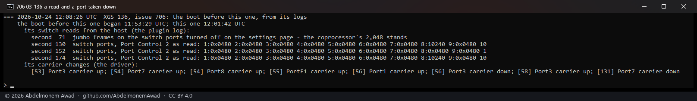
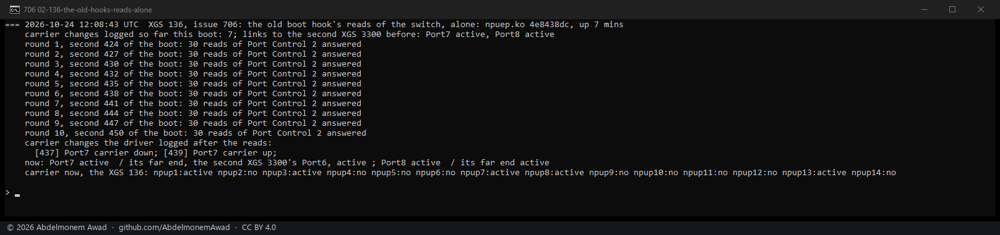
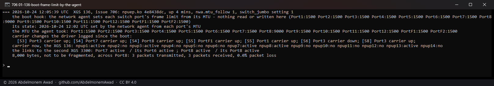

<!-- reviewed: 2026-10-24 -->
# The switch's frame limit set by the network agent on the XGS 136, measured, 2026-10-24

Issue [706](https://github.com/AbdelmonemAwad/os-xgs-npu/issues/706): after a reboot of the XGS 136
the network agent reported Port3 and F1 down while frames still came in through Port3, and no
connection through Port3 went into hardware that boot. The boot hook `switch-jumbo.sh` had just
read and written Port Control 2 of the ten switch ports over the MDIO bus - the bus the coprocessor's
network agent follows the links on. The switch is in multi-chip mode, where a read is a command to
one register and its answer in another, and the agent took an answer of ours for a port's status.
On the XGS 136 it follows links by interrupt, so a state it takes wrongly stays until the link
changes.

**The host no longer touches the switch's bus on the XGS 136.** npuep gives each front port's MTU to
the network agent, as the vendor's host does (`nwa_port_mtu_set`: op SET, attribute 0x02, the port's
tag and the MTU), and the agent sets the switch port's frame limit itself, on the bus it already
drives. The boot hook reads and writes nothing there. The XGS 3300 is unchanged and was not measured
for this.

## The cause, shown

Two photographs with npuep.ko `4e8438dc`, the switch's frame limit already set by the agent, and only
reads made from the host - the way `switch-jumbo.sh` read before it wrote.

The boot before the clean one, from its own logs: three times the plugin read Port Control 2 of every
switch port (`switch-jumbo.sh --check`, which writes nothing), at seconds 130, 152 and 174 of the boot.
The driver logged Port7 down at second 131, a second after the first. Nothing said it came up again in
the six minutes that boot had left.

The old hook's reads alone, on the clean boot: Port Control 2 of the ten ports three times each, as
the hook read it, by the switch tool on the coprocessor (`mvsw`), ten rounds in 26 seconds. The driver
logged Port7 down at second 437 and up at 439, while the second XGS 3300's Port6 at its far end stayed
up. Two runs before it, of three and ten rounds, changed nothing: like
[#639](https://github.com/AbdelmonemAwad/os-xgs-npu/issues/639)'s counter reads, it is rare, and it
does not need writes.

## The agent's own way

npuep (`contrib/npuep/npunwa.c`) reads each front port's MTU at the link sweep and tells the agent
when it differs from what the agent last accepted, once per change:
`nwa: Port8 frame size given to the agent: MTU 9000`. What the agent made of it, read from the
switch on the boot before (the photograph above, seconds 130, 152 and 174), with Port8's MTU changed
in between and the hook writing nothing:

| Port8's MTU | Port8's Port Control 2 | the other ports, MTU 1,500 |
|---|---|---|
| 9,000 | 10,240 bytes (`0x2480`) | 1,522 bytes (`0x0480`) |
| 1,500 | 1,522 bytes (`0x0480`) | 1,522 bytes |
| 9,000 again | 10,240 bytes | 1,522 bytes |

The coprocessor leaves 2,048 bytes (`0x1480`) on every port at boot. The agent sets what the MTU
needs: 1,522 bytes for 1,500 - a full frame with one VLAN tag - and 10,240 for 9,000; MTUs between
were not tried. Before, the hook wrote 10,240 on all ten ports. A port that is to carry larger frames now gets them
by its MTU in OPNsense, which is where an operator sets them anyway. Not measured here: a full-size
frame with two VLAN tags on a port at MTU 1,500, which 1,522 bytes does not hold.

## A clean boot

A reboot with the agent setting the limit and nothing of the host's on the bus: the hook's line says
so, the agent took fourteen MTUs (Port8 at 9,000, the link to the second XGS 3300), and the driver
logged its carrier changes only in the first minute - the links coming up, and Port3 down and up
again at seconds 56 to 58 as the LAN bridge came up, as at every boot. None after. Every port with a
cable had carrier, both links to the second XGS 3300 were up at both ends, and 8,000 bytes that may
not be fragmented crossed Port8 three times out of three.

## What changed

- **npuep:** each front port's MTU to the agent, as above. `dev.npuep.0.nwa.mtu_follow` - 1, the
  default; 0 gives the agent nothing, as before. `nwa.mtu` shows what the agent last accepted for each
  port (0 before the first), `nwa.mtu_sets` how many it accepted. A port whose MTU the agent refuses
  three times is not asked again, and the driver says so once.
- **`switch-jumbo.sh`:** on an XGS 136 whose driver gives the agent the MTU, it reads and writes
  nothing, and its state says the agent sets the limit. XGS: Ports and XGS: Status show
  "Follows the MTU". The setting "Jumbo frames on the switch ports" has no effect there now, and its
  help says so.
- **The XGS 3300:** its hook still writes the switch's ports at boot. Its driver refuses an MTU
  request to its agent by name (`contrib/octep/octep_nwa.c`); giving it the same route is not built.

## The instruments

- `images/deploy/lab-706.sh` - a boot read: the hook's line and state, the MTUs the agent took, the
  carrier changes since the boot, each port against the far end, the 8,000-byte ping.
- `images/deploy/lab-706-reads.sh` - the old hook's reads alone (`ROUNDS`, 3 by default), and the
  carrier changes after them. A port it takes down stays down until the link changes: reboot after.
- `images/deploy/lab-706-evidence.py` - the boot before, from its logs: its switch reads with their
  second and its carrier changes.
