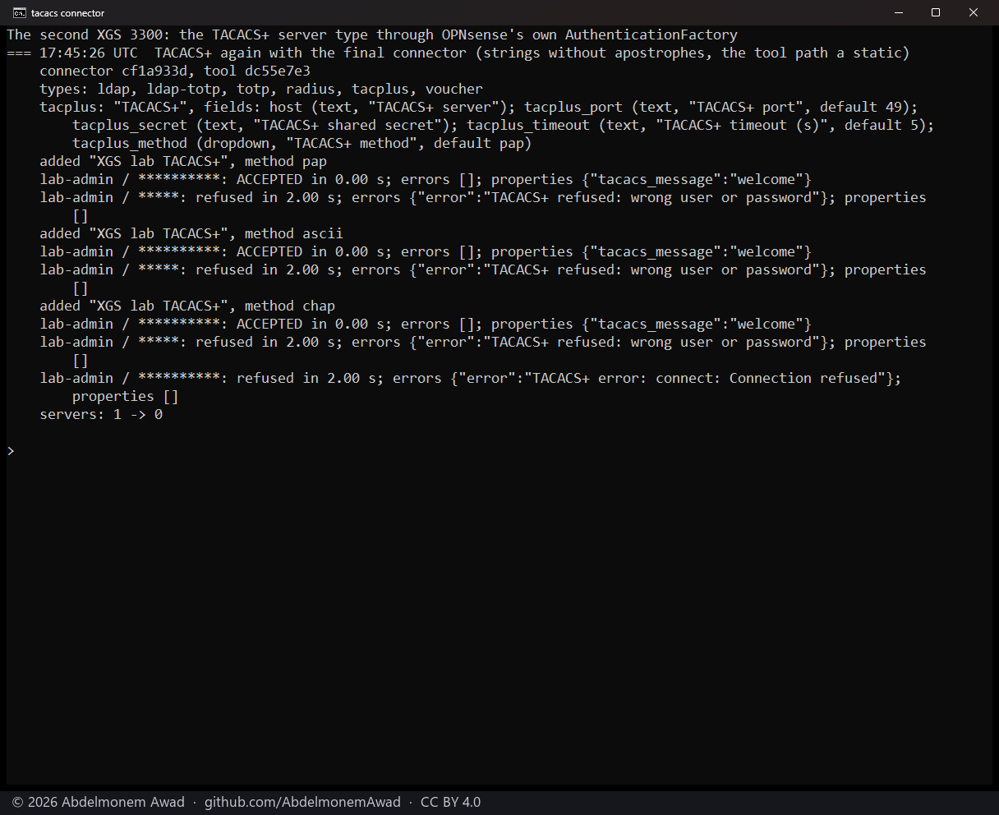

<!-- reviewed: 2026-11-15 -->
# TACACS+ as a server type of System: Access: Servers, through FreeBSD's own libtacplus: PAP, ASCII and CHAP answered, 2026-11-15

OPNsense's authentication servers are LDAP and RADIUS; a network run with TACACS+ had no way to log in to the
firewall with it. os-xgs-npu now adds **TACACS+** to the types of System: Access: Servers (plan 01, package
3.10): a connector in OPNsense's own authentication library, which every service that asks OPNsense - the web
GUI's login among them - can then use like a RADIUS server.

## How it asks

FreeBSD has a TACACS+ client library in its base system, libtacplus (taclib(3)), and OPNsense 26.7's image
carries it with its header (read on the second XGS 3300). OPNsense's PHP has no binding to it and no FFI, so a
small C tool asks the server - `tools/tacacs/xgs-tacauth.c`, built at install with the appliance's own `cc`, as
the sensor tool is - and the connector (`library/OPNsense/Auth/TacacsPlus.php`) runs it. The server, the shared
secret, the user and the password go to the tool on its standard input, never on a command line.

**A fault of the library**: `tac_add_server()` of OPNsense 26.7's FreeBSD 15.1 dereferences a null pointer inside
libtacplus and stops the program before a byte is sent (`SIGSEGV`, fault address 0, in the library's own
code, on the second XGS 3300). `tac_config()`, which reads the servers from a `tacplus.conf(5)` file - the way
pam_tacplus(8) gives them - does not. So the tool writes the one server as a one-line `tacplus.conf` in a folder
of its own that only root can read, and removes it as soon as the library has read it.

## How it was tested

2026-11-15, 17:40 to 17:47 UTC, on the second XGS 3300 (vendor version 22): the tool built as the installer
builds it, the connector in place, and a TACACS+ server written for the lab - Python's standard library only,
authentication by PAP, ASCII and CHAP as RFC 8907 has it, the body obfuscated by the shared secret - running on
the firewall itself, on 127.0.0.1. One user, with one password; anything else refused.

- **The tool by itself**: each method with the right password, a wrong one, a user the server does not know, a
  wrong shared secret, an IPv6 server and the server stopped.
- **The connector through OPNsense**: a server of the new type written into the configuration, as the servers
  page writes it, and `AuthenticationFactory`'s `authenticate()` - what the login asks - with each method; the
  lab server taken out of the configuration after.

## Results

| Asked | The tool | Through OPNsense |
|---|---|---|
| PAP, ASCII or CHAP, the right password | PASS, exit 0 | accepted |
| the same, a wrong password | FAIL, exit 1 | refused after 2 s, "TACACS+ refused: wrong user or password" |
| a user the server does not know | FAIL, exit 1 | refused after 2 s |
| a wrong shared secret | ERROR, exit 2 - the reply does not decrypt | - |
| the server stopped | ERROR, exit 2, "connect: Connection refused" | refused after 2 s, the error in the system log |
| an IPv6 server | ERROR, exit 2, refused before any connection | refused by the field when the page is saved |

- **ASCII** went as a terminal login goes: the server asked for the password and the tool answered it; **CHAP**
  sent a response computed from the password and a random challenge of 16 bytes, which the server checked.
- **Two seconds** is OPNsense's own: every failed login is held to two seconds, whichever server refused it.
- **The fields** as the servers page draws them, read from OPNsense's own list of server types: TACACS+ beside
  LDAP, RADIUS and the vouchers, with **TACACS+ server**, **port** (49), **shared secret**, **timeout** (5 s)
  and **method** (PAP, ASCII or CHAP). An IPv6 address, port 70000, a timeout of 0 and a method of MSCHAP were
  refused, each with its message.
- **Nothing left behind**: no temporary folder of the tool after any run.

The pictures show the runs as the log has them (`tacacs-3300.log`), not runs done again for the camera; the
IPv6 line of the first run read the exit status of a pipe, so its own was read again in the run after it.

### What these figures do not mean

- **A login to the web GUI** with a TACACS+ user was not made: OPNsense lets in only a user that exists on the
  firewall, and no lab user was made for it. The connector answered as the login asks it.
- **A TACACS+ server of a vendor** - tac_plus, ISE, ClearPass - was not tried; the lab server follows RFC 8907.
- **Groups and privileges** come from the firewall's own user, not from the server: the connector takes only its
  answer, as a RADIUS server whose groups are not synchronised.
- **The page itself** was not opened: its fields were read from the list OPNsense draws it from.
