<!-- reviewed: 2026-11-18 -->
# A connection taken out of hardware gives pf its last counts, measured, 2026-11-18

Once a connection runs in the coprocessor, pf's state of it grows only by what the driver gives it: the
coprocessor's counts, read from its statistics messages about once a second, handed to the state by the
keep-alive at its visits (`dev.octep.0.dp.hw_to_pf`; on the XGS 136 `dev.npuep.0.flow.hw_to_pf`). What a
connection counted after the last visit and before it was taken out of hardware - handed back to the host,
reclaimed at its end, released from the **Offloaded Flows** page - went with it. os-quota counts a host's
bytes from pf's states, and its phase 0 measured how much went (#1189). This change gives it to pf at the
take-out, on both drivers, with what the fast path counted after its last statistics message.

The bench: the second XGS 3300 (vendor version 22) and the XGS 136 (vendor version 21), both on OPNsense
26.7.9_1. On the XGS 3300 the PC sends from F1 to a virtual machine behind F2; on the XGS 136 from its F1,
out of Port8, to a receiver on the XGS 3300's Port8. Each module was built on its box against the running
kernel's own sources; the one there was kept, and put back after, each box restarted onto the new one and
back (the photographs `3300-build`, `3300-up`, `3300-down`, `136-build`, `136-up`, `136-down`).

## What was lost

The same runs, before the change, with the modules the boxes came with:

- **A stream handed back by hand at its third second** (`configctl xgs flowrelease`), 4,000,000,000 bytes,
  five runs; pf's final count against the IP bytes the far end received.
  - The XGS 3300, at 3.4 to 3.5 Gbit/s: pf was 1,611,639,653 to 1,667,933,663 bytes short in the three runs
    that went to their end - the first 3.8 seconds of each stream. The other two were reset by the far end
    after the hand-back (the sender's `ConnectionResetError`), at 1.54 and 1.66 GB, of which pf held 8.7
    and 10.9 MB; the runs with the change saw no reset, and five runs do not say whether the change has to
    do with it.
  - The XGS 136, at 0.79 to 0.82 Gbit/s: pf was 32 to 99 MB short, 0.31 to 1.00 s of each stream. npuep has
    given pf the counts before a take-out from its let-go pass since 2026-10-19, but `flow.release` took
    the connection out without that give.
- **20 short connections** (iperf3 `-n 20M` each) on the XGS 3300, pf's count of each against its payload:
  0.21 % with the flow maker on, 103.05 % with it off - the payload with its TCP/IP headers, every packet
  through the host.

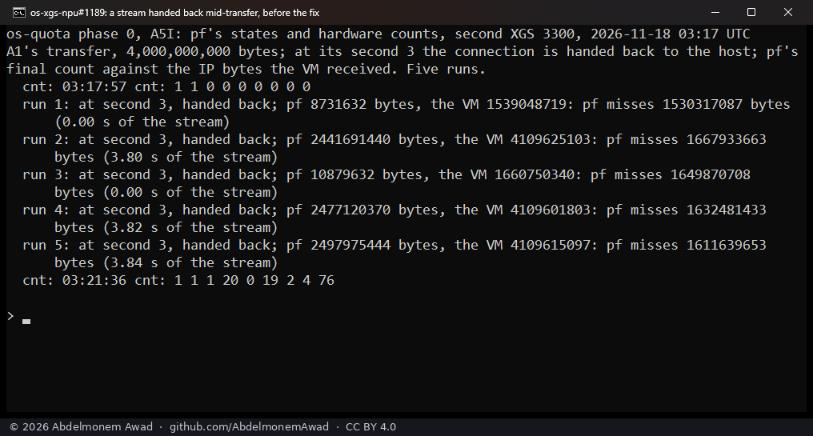
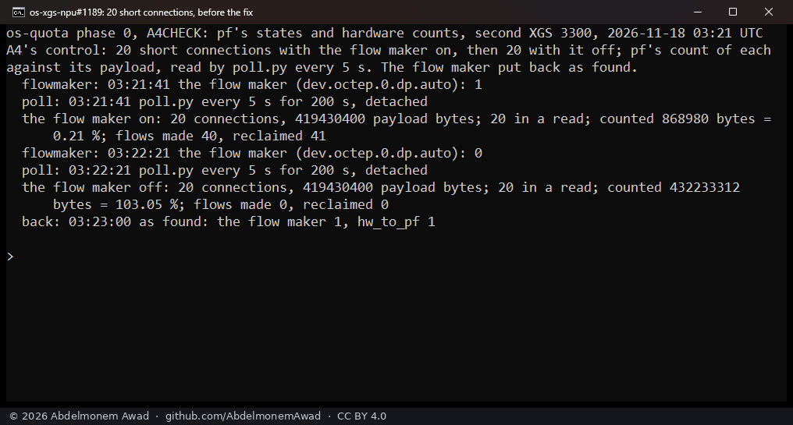
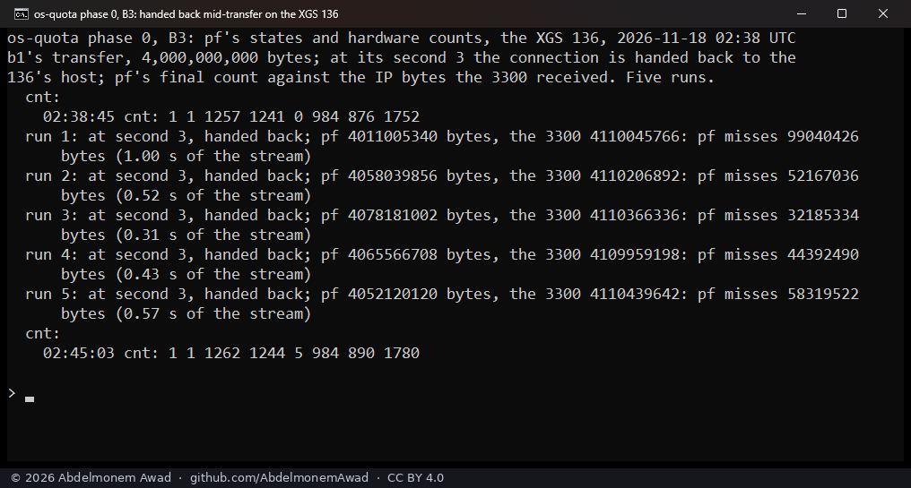

## The change

- **octep** (the XGS 3300): `octep_conn_takeout` queues what the coprocessor counted for the connection that
  pf has not been given - each direction - in the hand-back entry beside the window, or alone for a
  connection with no window to give, and `octep_dp_handback_run` gives it to pf's states once the softc lock
  is dropped (`octep_pf_count`, as the keep-alive does). Not for a connection whose pf states have gone.
  The queue grows from 32 to 256 entries; a full one still loses them, counted in `dp.hw_pf_lost`. Those
  given are `dp.hw_pf_final`.
- **npuep** (the XGS 136): `npuflow_takeout_how` now gives pf the counts first for every ordinary take-out -
  `flow.release`, a cut, a policy that no longer covers the connection - as the let-go pass does. The give
  is a difference against what pf was given, so a second call gives nothing twice.
- **The tail, both drivers.** The statistics messages carry running totals for the table slot, which the
  coprocessor does not start again for a new connection; the driver gives a connection the difference from
  the slot's last message. What moved after that message was in no message before the take-out, and the
  next message for the slot gave it to the next connection to hold it: in this change's first round, with
  the counts given at the take-out, one of 20 short connections on the XGS 3300 was counted 121 % of its
  payload. The reclaim's answer ends with the slot's totals at the moment the fast path let the connection
  go - 64 bytes, the window's 48, then the two directions in the messages' form. Read on the XGS 3300: 1,500
  bytes a packet one way and 41 the other, a stream and its acknowledgements, and the second of two
  reclaims of one slot answered with the first one's totals and the second connection's bytes on top. The
  take-out now gives the connection the difference to them and moves the slot's totals there
  (`octep_conn_tail`, `npuflow_tail`); a message sent before the reclaim and read after it is behind them,
  and passed over. Counted in `hw_tail`, `hw_tail_odd` (an answer behind the slot's last message, not
  taken) and `hw_behind` (a message passed over).
- **From the review of the change**, on the XGS 3300: the keep-alive marks its share given before it drops
  the lock, so a take-out in between cannot give the same share again; a revision bump - a reload of the
  rules, a new WAN lease - gives pf what each connection it forgets had not given, from an array made for
  it; the probe's callers give the queue after a take-out, and `dp.flow_exclude` and `dp.live_users` make
  room in it when it is full. On the XGS 136, a revision bump gives each connection's counts before it
  forgets them.

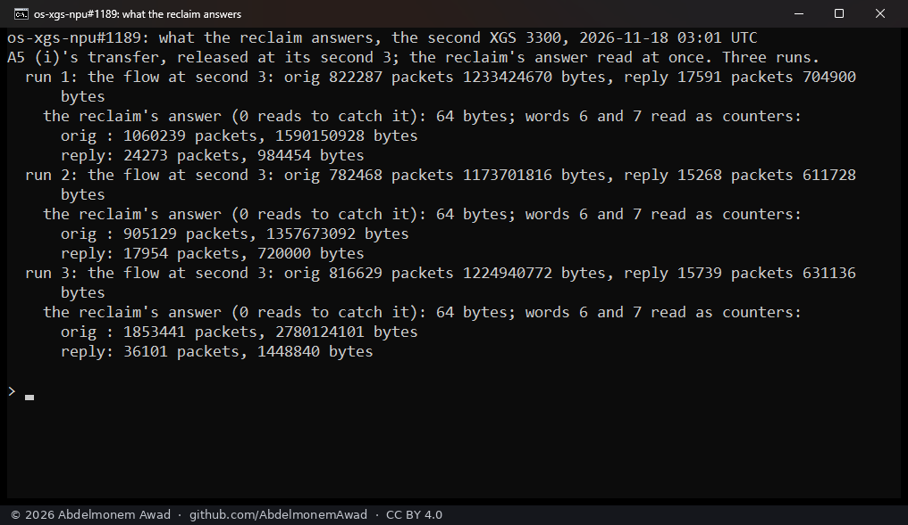

## Measured

- **The stream handed back at its third second, the XGS 3300**, at 3.04 to 3.39 Gbit/s: pf counted 139,214
  to 1,433,714 bytes **more** than the virtual machine received (up to 0.035 %), short by nothing.
  - The control: the same stream never handed back, three runs at 3.59 to 3.82 Gbit/s, counted 214,166 to
    251,668 bytes more than the virtual machine received (0.005 to 0.006 %), where on 2026-11-17, at 0.4
    to 0.7 Gbit/s, it was within 595 bytes. A segment the stream lost after the firewall crossed it twice
    and reached the machine once; the machine's own receive counter does not count what it dropped.
  - What the hand-back adds beyond the control, up to about 1.2 MB, was not taken apart here: segments lost
    around the hand-back, when the stream moves to the host and back, or frames counted twice between the
    fast path letting the connection go and the reclaim's answer.
- **The stream handed back at its third second, the XGS 136**, five runs: pf was 3,790 to 3,974 bytes short
  of what the receiver's IP counted - as for a stream never handed back (3,744 bytes, a run of the first
  round whose connection was not in the flow table at its third second).
- **20 short connections, the XGS 3300**: 104.17 % of their payload with the flow maker on, 103.17 % with
  it off. Each connection 102.74 to 109.08 % with it on, 102.74 to 108.50 % with it off: the payload with
  its headers is 102.74 %, and the rest is segments sent again, which the host path has too.
- **The counters after the runs**: the XGS 3300 `dp.hw_pf_final` 54, `dp.hw_pf_lost` 0, `dp.hw_tail` 58,
  `dp.hw_tail_odd` 0, `dp.hw_behind` 0; the XGS 136 `flow.hw_tail` 5, `hw_tail_odd` 0, `hw_behind` 0.

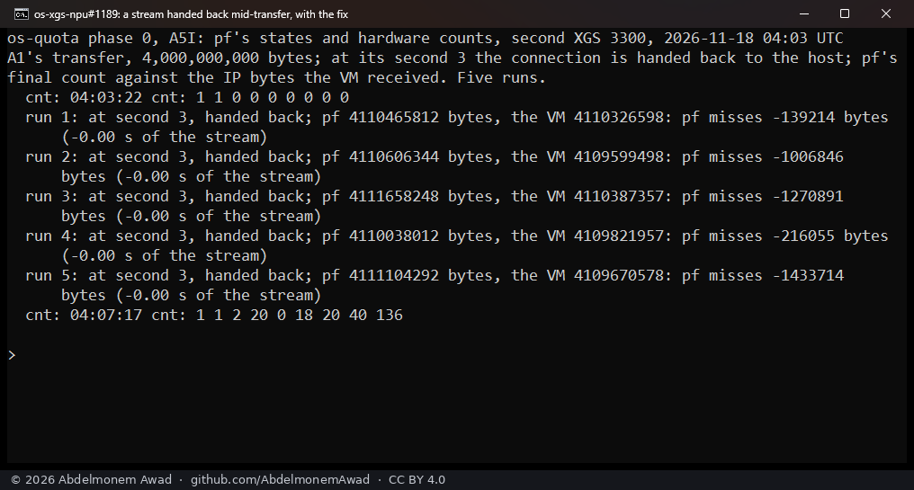
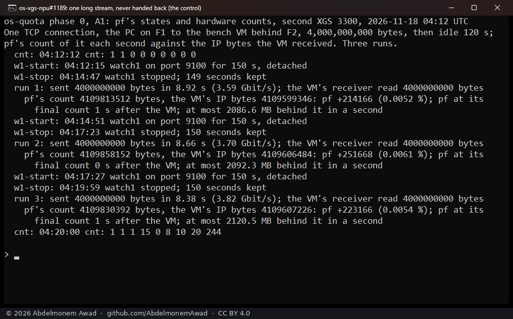
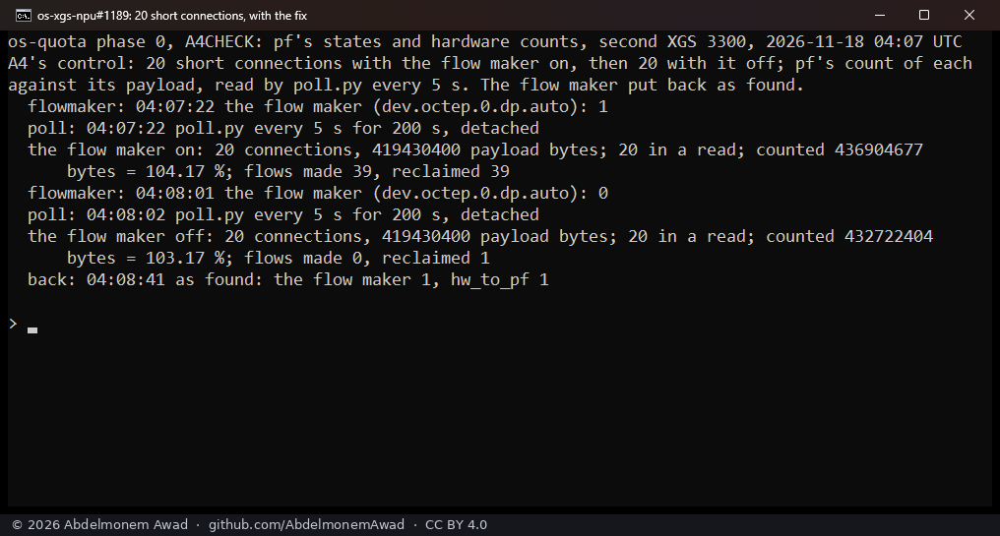
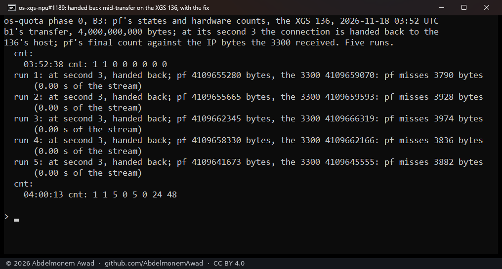
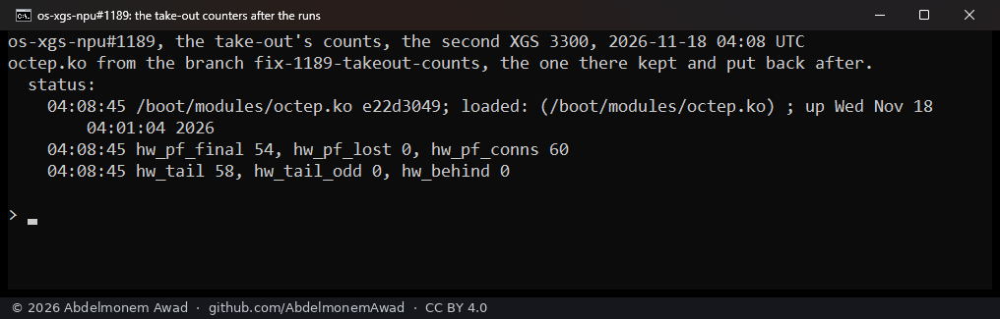

## Not in this change

- A connection taken out with no reclaim answered leaves its tail in the slot, for the next connection to
  hold it: on the XGS 3300 one the fast path had reclaimed itself, or a reclaim refused; on the XGS 136 a
  reclaim only posted - a connection whose window is not checked - and the let-go pass, which takes out a
  connection the fast path gave back without a reclaim; and on both, a revision bump.
- The answer's totals are taken on vendor version 22 only, the second XGS 3300's: on version 23 they wait
  until its answer has been read. The XGS 136's (version 21) were read in these runs.
- A full hand-back queue on the XGS 3300 still loses a take-out's counts, counted in `dp.hw_pf_lost`.

The photographs of the builds, the restarts and the modules put back:

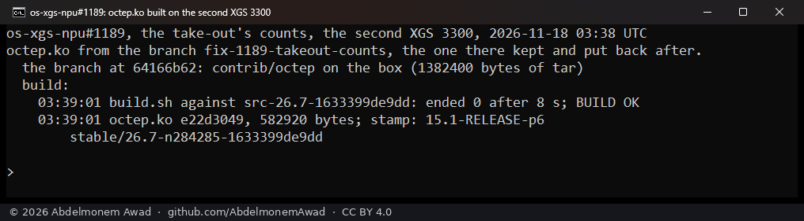
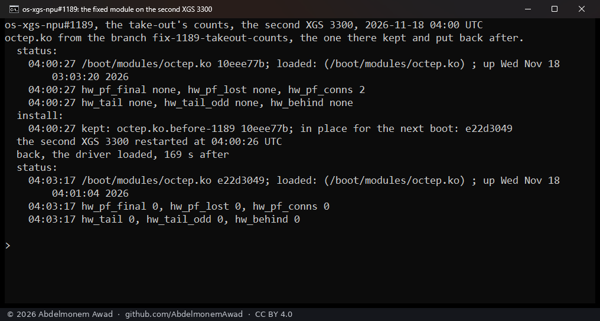
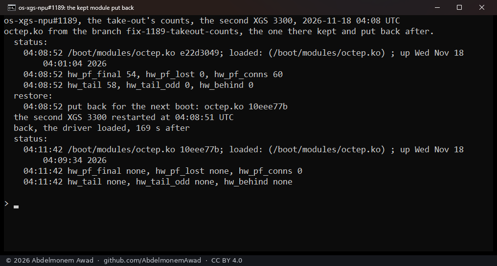
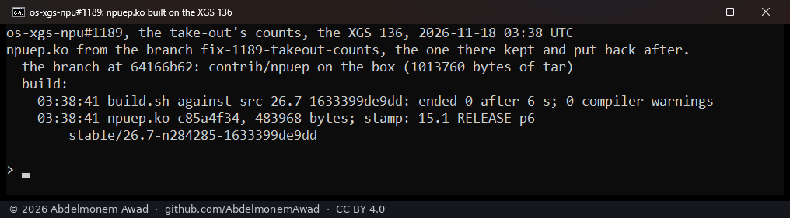
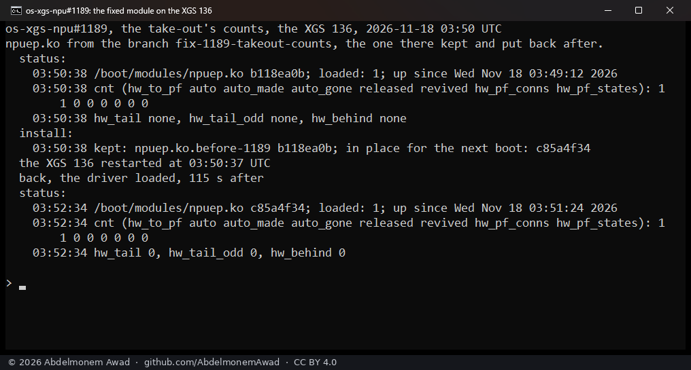
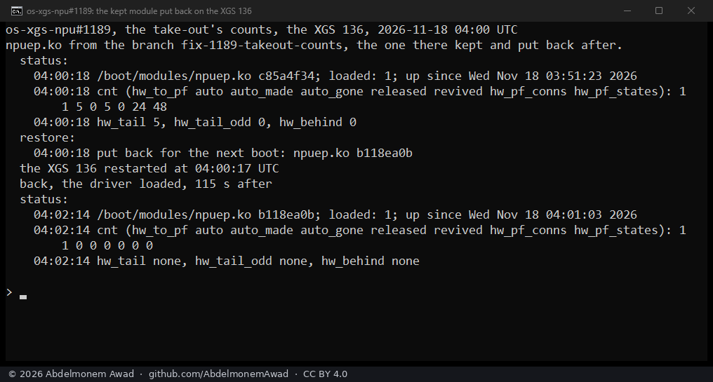
