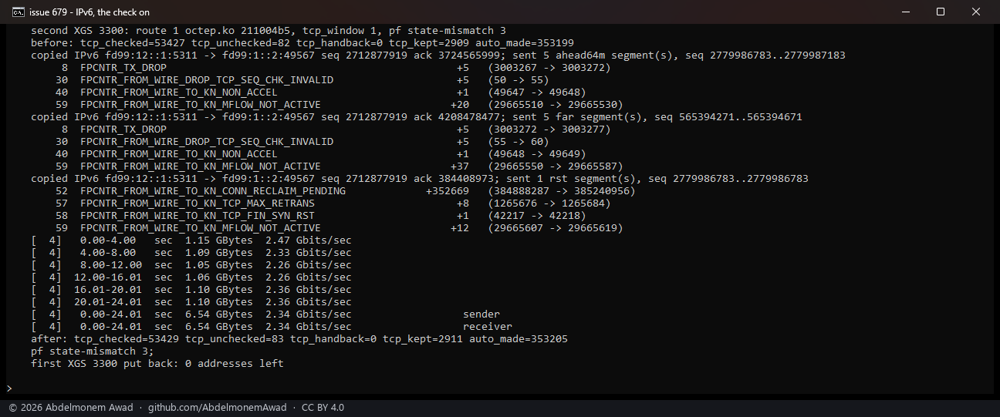
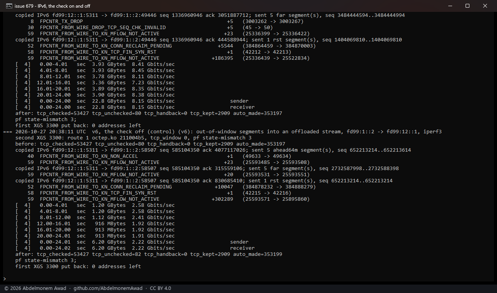
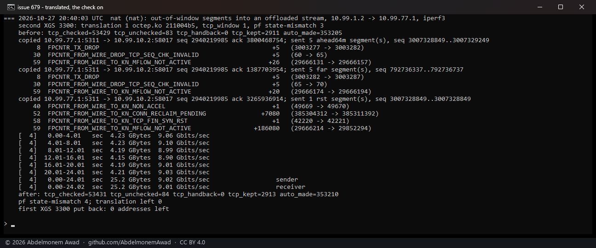
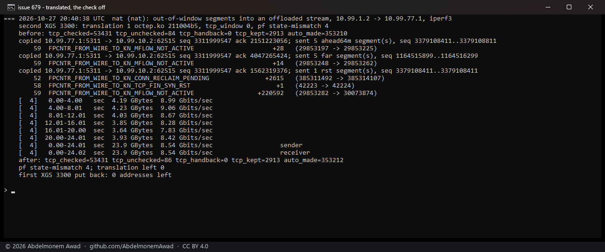

<!-- reviewed: 2026-10-27 -->
# The TCP window checked in hardware on IPv6 and on a translated connection, XGS 3300, 2026-10-27

[679](https://github.com/AbdelmonemAwad/os-xgs-npu/issues/679): the check of a connection's TCP window in
the fast path was measured on 2026-10-22 on plain IPv4 connections
([tcp-window-2026-10-22.md](tcp-window-2026-10-22.md)), and that page left two kinds out: IPv6, and a
connection pf translates. Both are measured here on the XGS 3300, with the same segments. The check holds
on both: every segment outside the window was dropped in hardware with the check on, and none with it off.

## How it was measured

As on 2026-10-22 (`images/deploy/lab-679-v6nat.sh`, made from `lab-tcp-inject.sh`):

- **The stream:** iperf3 from the PC, through the second XGS 3300 (vendor version 22, the box under
  test), to the first XGS 3300 (vendor version 23), which runs the server. Both run `octep.ko 211004b5`
  (main as of #842).
- **The segments:** at second 8 of the stream, the server's end puts on the wire, by BPF and past its own
  pf, copies of the stream's own segment with the sequence moved (`tcp-inject.py`, which handles IPv6
  since this measurement): five data segments 64 MiB ahead, five 2 GiB ahead, and one RST 64 MiB ahead.
  The second XGS 3300's fast-path counters are read around each.
- **IPv6:** the PC's IPv6 address to one put on the first XGS 3300's F1 for the run, routed by the second
  XGS 3300 - no translation.
- **Translated:** the PC's IPv4 address to one put on the first XGS 3300's F1 for the run, with the
  second XGS 3300 translating the PC to its own A4 address, as the soak of
  [361](https://github.com/AbdelmonemAwad/os-xgs-npu/issues/361) does.
- **Each run:** with `dev.octep.0.dp.tcp_window` 1 (the check on, the default), then 0 as the control.
  Every address, route and rule was added at runtime and removed after, and each report says so.

## IPv6

## Translated

| | 64 MiB ahead (5) | 2 GiB ahead (5) | RST 64 MiB ahead (1) |
|---|---|---|---|
| IPv6, check on | **5 dropped** | **5 dropped** | to the host, the connection given back |
| IPv6, check off | none dropped | none dropped | to the host, the connection given back |
| translated, check on | **5 dropped** | **5 dropped** | to the host, the connection given back, refused by pf |
| translated, check off | none dropped | none dropped | to the host, the connection given back |

The IPv6 run with the check on was taken twice, the second time for the photograph, and dropped 5 and 5
both times. The first time ran at 8.15 Gbit/s, the second at 2.34.

## What it does not mean

- **The RST still goes to the host** and takes the connection out of the fast path with it, as on
  2026-10-22. In these runs, about 190,000 to 350,000 of the stream's frames went through the host
  after it - given back, then not yet active - before the connection was made again.
- **pf's state-mismatch count did not move the same way each time.** It went up by one for the blind
  RST in the translated run and in the first IPv6 run, as the closing check of 2026-10-24 has it
  ([closing-check-2026-10-24.md](closing-check-2026-10-24.md)). In the second IPv6 run it did not. That
  run also counted 8 retransmissions handed to the host around the RST. Whether that connection had
  been given back first, so that pf saw the RST another way, is not shown by these counters.
- **The XGS 136 was not run.** Its driver checks the window the same way on IPv4
  ([tcp-window-2026-10-22.md](tcp-window-2026-10-22.md)); IPv6 and a translated connection through
  it are still to be measured.
