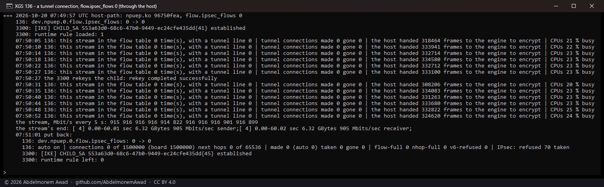
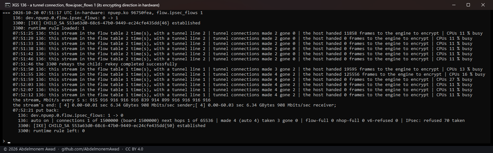
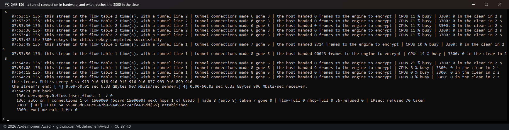
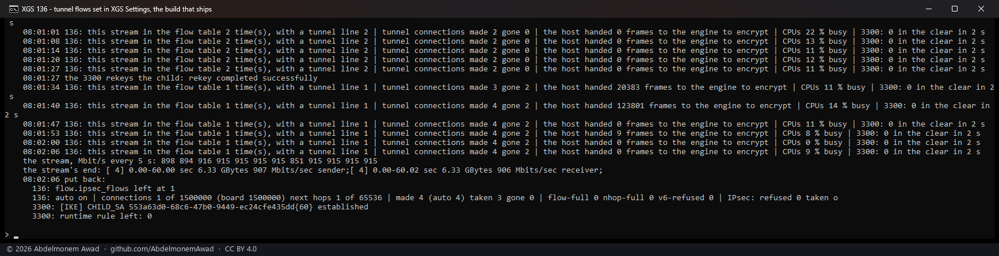

<!-- reviewed: 2026-10-20 -->
# Tunnel connections in the XGS 136's flow table. Measured, 2026-10-20

A connection that runs through an IPsec tunnel now leaves the XGS 136's host for its direction that
leaves encrypted: the fast path forwards it and encrypts it on the engine itself, as it forwards a
plain connection. Through the lab tunnel, one stream held 916 Mbit/s either way; with the setting on,
the host handed the engine **no** frame of it to encrypt where it had handed it some 333,000 every
four seconds, the host's CPUs went from 23 % to 11 % busy, and not one frame of it reached the far
end in the clear. A rekey in the middle took the connection out of the table before its association
went, the host carried it for a few seconds, and the flow maker made it again with the new one.

It is the XGS 3300's tunnel flows ([the flow carries the
association](../findings/the-flow-carries-the-association.md)) at the same setting: the direction that
arrives decrypted stays with the host, where the kernel's inbound policy check sees every packet. The
3300's second mode, both directions, is not built here, for the reason that page measured.

## What the driver does now

- **The setting.** XGS: Settings, *Outbound tunnel flows forwarded by the coprocessor*, now on both
  appliances: it writes the loader tunable `hw.npuep.ipsec_flows`, which the driver reads at attach
  (`dev.npuep.0.flow.ipsec_flows`, 0 by default). XGS: IPsec's data carries it on both; the page itself
  was not looked at here - it asks for the owner's password.
- **Which tunnel.** For a connection a policy covers, the kernel's policy database is asked the way
  `ipsec4_forward` asks, both directions, outbound and inbound - one direction must match an outbound
  policy and no inbound one, the other the reverse, both one ESP tunnel over IPv4, the two the same
  ends turned round - and the association is the kernel's own choice (`key_allocsa_policy`). It must
  be one this driver has on the engine and has taken. NAT-T and CBC associations, IPv6 and translated
  connections stay with the host (not measured in a flow here). [npuipsec.c](../../contrib/npuep/npuipsec.c),
  `npuipsec_flow_tunnel`.
- **The flow.** One FLOW_CREATE_FP with the connection and one microflow - the encrypting direction's,
  from the candidate the plaintext frame made, naming the association by its handle and revision, its
  next hop the tunnel's far end by the association's port - and only when that frame did not arrive on
  the tunnel's own port. [npuflow.c](../../contrib/npuep/npuflow.c), `npuflow_make_tunnel`.
- **Kept true.** An association's removal - a rekey, the tunnel going - takes out the connections that
  name it before its SA_DEL (`npuflow_ipsec_sa_gone`, counted in `flow.ipsec_gone`), and starts the
  kernel's sequence counter past the frames the engine numbered for them. A change of policy has the
  sweep ask again about every connection in hardware (`npuflow_policy_sweep`). `flow.flows` prints a
  `tunnel` line under each such connection.

## How it was measured

The lab tunnel between the XGS 136 (its Port8) and the second XGS 3300, AES-GCM-16-256, widened at
both ends to carry the bench PC's F1 network to the 3300's Port8 address, the 3300 given a runtime rule
passing it on enc0. One stream of 60 s from the PC by its USB adapter into F1, through the 136 into
the tunnel; thirty seconds in, the 3300 rekeyed the child. Every few seconds: the 136's flow table,
how many frames the 136's host handed the engine to encrypt since the last look (the association's
output step), its CPUs busy, and how many of the stream's frames reached the 3300's Port8 in the clear
in two seconds (tcpdump). `images/deploy/lab-136-tunflows.sh`, not in this repository; each run
photographed. At the end both ends' tunnel was put back and the 3300's rules reloaded.

The first three runs were on `npuep.ko` md5 `96750fea`, the setting written by hand; the fourth on
`85064db2` (266,416 bytes, compiled on the appliance with no warning, every symbol in the kernel), the
build that ships - the same code and the tunable read at attach - with the setting made the way an
owner makes it: the model's field set and `configctl xgs apply` run, which wrote
`hw.npuep.ipsec_flows="1"` to the loader and said a reboot was due; after the reboot the driver read
1 and XGS: IPsec's data said so. Afterwards the setting was put back to 0 the same way.

## Results

| | `flow.ipsec_flows` 0 | 1, by hand | 1, from XGS: Settings |
|---|---|---|---|
| the stream, Mbit/s every 5 s | 822 to 916, 905 on average | 839 to 916, 908 | 851 to 916, 907 |
| the connection in the flow table | never | both of iperf3's, each with its `tunnel` line | the same |
| frames the 136's host handed the engine to encrypt, each look | about 333,000 | **0**, but for the seconds after the rekey | **0**, the same |
| the 136's CPUs busy | 20 to 25 % | 11 %; 13 to 27 % around the rekey | mostly 11 %; 8 to 22 % |
| frames of it reaching the 3300 in the clear | - | **0** in every two seconds counted (the third run) | **0** |
| the rekey | - | both connections out before the old association went (`gone` 2), the host carrying it for about ten seconds, made again on the new one | the same |

## What it does not mean

- **Not the link's limit.** 916 Mbit/s is this lab's one stream over the tunnel either way; what the
  setting changes is who does the work, not the rate - the host's share, here, from 23 % of its CPUs to 11 %.
- **The lifetime the kernel counts.** Frames the fast path encrypts do not reach the kernel's own
  count for the association, so a tunnel whose child ends on a byte count, not on time, would run past
  it while a connection is in hardware. OPNsense's tunnels rekey on time (the lab's every hour), and
  the rekey here was handled. The XGS 3300 feeds the engine's own counts back to the kernel; this does not yet.
- **One stream, one tunnel.** Many tunnels and many connections through them were not run; nor NAT-T,
  CBC, IPv6 or a translated connection, which stay with the host.
- **The last two readings of the fourth run** (08:02:00, 08:02:06) fall after the stream ended; the
  zeros there are of an idle box.

All the numbers are in the run's log, `measurements/tunflows-136-2026-10-20.log` (kept with the bench,
not in this repository).
