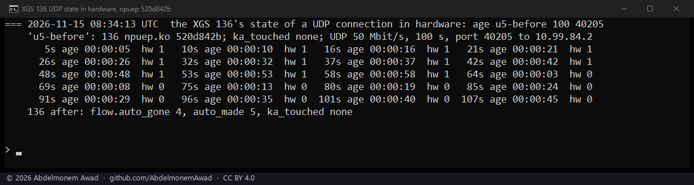
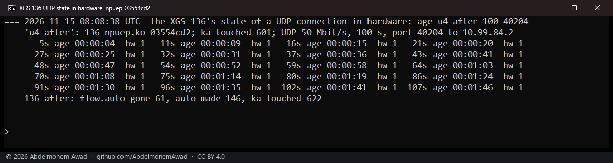

<!-- reviewed: 2026-11-15 -->
# The XGS 136 keeps the state of a UDP connection in hardware now, 2026-11-15

The XGS 136's keepalive asked whether a connection's state still existed and gave pf the coprocessor's counts, and
refreshed nothing: `npuep_pf_touch`, which restamps a state as a packet would, had no caller since the driver's
flow table began. So the state of a UDP connection in hardware lapsed at its own timeout - `udp.multiple`, 60
seconds - and the connection left hardware with it. Since the change the keepalive restamps a connection's states
when the coprocessor has counted traffic for it since the last restamp, at most every five seconds a connection
(counted in `flow.ka_touched`), and each restamp is told to pfsync (`npuep_pf_sync`), as the XGS 3300's driver does
([pfsync to a peer](pfsync-2026-11-15.md)).

## How it was measured

2026-11-15 from 06:32 to 08:36 UTC: the XGS 136 (vendor version 21) on the path of
[the lagg measurement](lag-3300-2026-11-15.md) - a jail on the FreeBSD test machine behind the second XGS 3300 (vendor
version 22), through it to the XGS 136's Port7, and out of its Port11 to a second jail.

- **The connection**: UDP at 50 Mbit/s for 100 seconds from a fixed client port, routed by both appliances and in
  hardware on both.
- **Read every 5 seconds**: the XGS 136's state for it (`pfctl -ss -vv`, its age) and whether it is in hardware
  there. A state replaced shows as its age falling back.
- **The builds**: npuep.ko `520d842b` (the module of phase 2's first part) before, `03554cd2` after, each loaded with
  reload.sh.

## Results

| npuep.ko | the state's age, read every 5 s | in hardware on the XGS 136 |
|---|---|---|
| `520d842b`, before | 0:58 at second 58, then 0:03 at second 64 - replaced | until second 58, then not again |
| `03554cd2`, after | 0:04 to 1:46, rising at every read | the whole run |

- **Before**: in both runs the state was replaced 60 to 65 seconds in, and the stream went on through the XGS 136's
  host to its end.
- **After**: in three runs - one with `9a7510df`, this change's first build, whose keepalive is the same - the state
  was never replaced, its age 1:44 to 1:47 at the last read, and the stream stayed in hardware throughout.

### What is not measured

- **pfsync with the XGS 136 carrying the connection**: on this path the XGS 3300 carries it in hardware too, so two
  appliances would each hold a state for it and tell the other.
- **TCP**: a state's own timeout is a day, so it would lapse only after a day in hardware.
