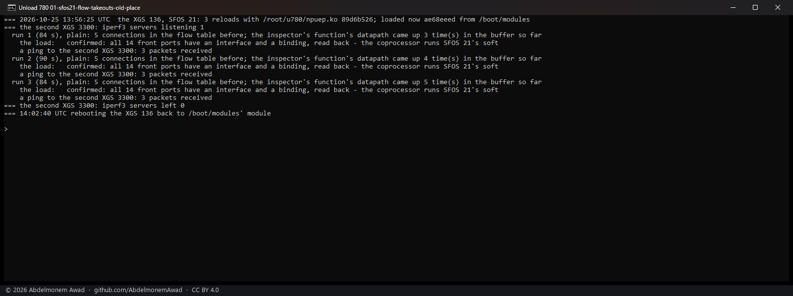
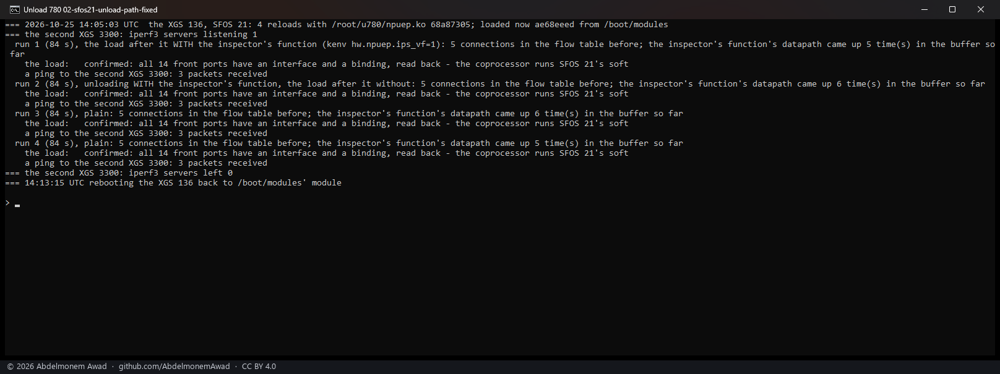

<!-- reviewed: 2026-10-25 -->
# The ARMADA driver's unload: connections taken back while the channel is up, 2026-10-25

[780](https://github.com/AbdelmonemAwad/os-xgs-npu/issues/780): three things in npuep.ko's unload path,
read in the code. An appliance in use never unloads the module - `contrib/npuep/reload.sh` does, in the
lab, with the coprocessor's reset right after, which hid all three.

1. **The flow table's connections were taken out after the control-message channel had gone.**
   `npuep_detach` withdrew the channel (`npurpc_detach`) before `npugiu_detach`, which takes the flow side
   down, so no reclaim was sent and every connection in hardware stayed in the coprocessor's table until
   the reset. `npuep_detach` now takes them out right after its goodbye, while the channel is up, and the
   unload says how many it took back and how many reclaims did not go through.
2. **The inspector's function was freed with nothing said to the device.** It now goes as the physical
   function does: its datapath stopped and its `CC_DISABLE` said first - the same command its management
   code answers (MUSDK `vf.c`) - then its handshake withdrawn and its command rings' addresses zeroed before
   the memory is freed, and kept if its window no longer decodes.
3. **reload.sh's header said it resets before unloading**, while its code unloads and then resets. The code
   is right: a loaded driver reads the BARs of an endpoint in reset, and that read never completes. The
   header and `npuep_detach`'s note are corrected; the code is not changed.

Measured on the XGS 136 on vendor version 21, the only board of the family on the bench, by
`images/deploy/lab-unload-780.sh` (photographed by `lab-unload-780-series.ps1`): each run a reload by
reload.sh from `/root/u780`, made while four iperf3 streams from the PC through the board to the second XGS
3300 held five connections in its flow table. The board's own settings keep the inspector's function on
(its early hook sets `hw.npuep.ips_vf`), so most loads had it. What each unload said was read afterwards
from the board's system log (`lab-unload-780-lines.sh`): the series' own reads looked for a mark the log's
RFC 5424 lines do not carry. The text is in `measurements/unload-780-2026-10-25.log`.

## A comparison build: the flow side in its old place

`89d6b526` is the change with one line taken out - `npuflow_detach` left to `npugiu_detach`, after the
channel's withdrawal, as before - so that the new count shows what the old order did.

## What each unload said

| unloaded | runs | connections taken back | reclaims that did not go through | the inspector's function |
|---|---|---|---|---|
| `68a87305`, the change | 6 (two series) | 5 each | **0** | its `CC_DISABLE` answered when it was there |
| `89d6b526`, the flow side in its old place | 2 | 5 each | **5 of 5** | its `CC_DISABLE` answered |
| `ae68eeed`, main before the change | 3 (the first unload of each series) | not said - it has no count | - | not told |

Every unload's own goodbye was answered (`giu: datapath disabled`), no function's window was found gone
before its withdrawal, and every load after came back with all fourteen front ports confirmed and the
link to the second XGS 3300 answering.

## What this does not settle

- **That the coprocessor dropped the connections** is read from its answers to the reclaims, not from its
  table: once the module is gone, nothing on the host can read it, and the reset that follows clears it.
- **The inspector's function's memory after its withdrawal** was not watched for a late write; the
  withdrawal is what the physical function's has done since it was written, now made for both.
