<!-- reviewed: 2026-11-06 -->
# The userland review's fixes, run on the lab appliances, 2026-11-06

On 2026-11-06 everything this project runs on an appliance outside its two drivers - the boot and
stop hooks, the scripts, the pages and their API, the installer and the updater, the problem reporter,
the workflows and two plugins of the family - was read through for faults:
[1072](https://github.com/AbdelmonemAwad/os-xgs-npu/issues/1072) holds the register, 138 findings - one of them found and fixed that evening -
with their severity, evidence and state. **132 of them were fixed by the end of that day, in 50 pull
requests, each run before it was merged - on the lab appliances, as an owner meets it, wherever an
appliance can show it - and every one of them with its tests.** The rest are open or confirmed there.
This page was first published that evening with 121 in 45; those merged after it are added below.

The appliances: the first XGS 3300 (vendor version 23), the second XGS 3300 (vendor version 22) and
the XGS 136 (vendor version 21), on OPNsense 26.7 with this project's `main`. A change was put on an
appliance over the installed files and the installed ones put back after, or installed by its own
`install/install.sh`; a page was opened in a browser signed in as the user the change is for. Some of
the day's runs follow, then every pull request with what it was run on.

## A recovery in place that reads OPNsense's reload

[1100](https://github.com/AbdelmonemAwad/os-xgs-npu/pull/1100), O8: `recover.sh` counted a recovery
done on the coprocessor's heartbeat alone, whatever OPNsense's reload of its interfaces answered. On
the first XGS 3300, the fast path stopped on purpose on the coprocessor and the branch's `recover.sh`
in place: its console asked once (no answer within 5 s), the coprocessor booted again by 177 s, the
driver up at 245 s, the reload run to its end - and the fast path answered at 279 s, 12 front-port
interfaces, the heartbeat alive.

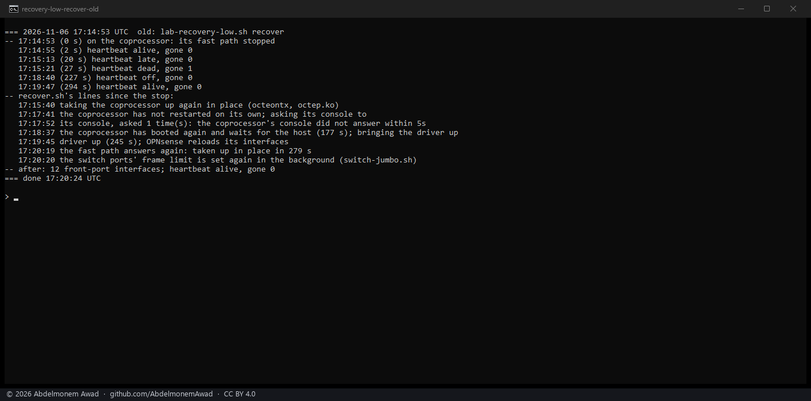

## The flow maker's own tunable, against the page

[1099](https://github.com/AbdelmonemAwad/os-xgs-npu/pull/1099), G5: a row of System: Settings:
Tunables for the flow maker, set by hand before version 1.1.0 put it on XGS: Settings, stayed after
the migration, and OPNsense set it at every boot after the page's setting. On the first XGS 3300 with
the page at on and a row `dev.octep.0.dp.auto = 0` added: with `main`, Apply left the row, and after
OPNsense's own restart the driver ran the flow maker off while the page said on; with the change,
Apply removed the row and said so, and after a restart it ran on, as the page says.

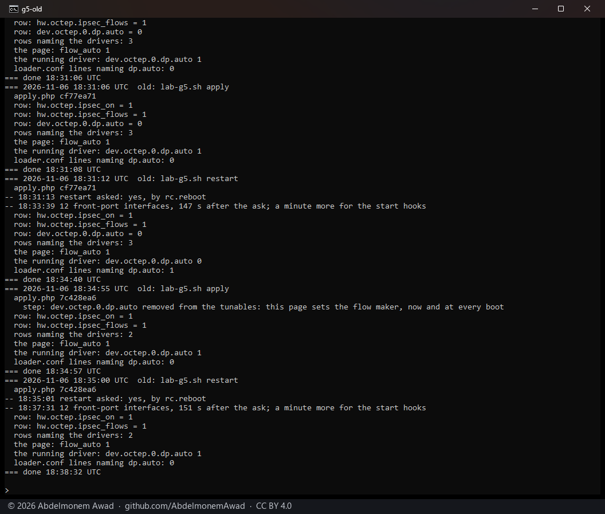

## A refused action said, not drawn as done

[1099](https://github.com/AbdelmonemAwad/os-xgs-npu/pull/1099), G8: OPNsense answers a request a
privilege does not reach with its own page, as HTML with status 200. Signed in on the first XGS 3300
as a user holding XGS: Overview and not XGS: Settings, the fast-path counters' Clear drew "All zero"
read at an Invalid Date with `main`; with the change, a warning that the account may lack XGS:
Settings, and the counters read again as they are.

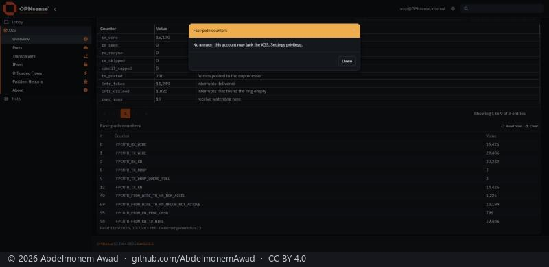

## An update's lock that daemons kept

[1102](https://github.com/AbdelmonemAwad/os-xgs-npu/pull/1102), U17: `update.py` handed its update lock
to `install.sh` under whatever descriptor it had, and every daemon `install.sh` started or restarted
inherited it. On the first XGS 3300, an update to `main` started as XGS: Updates' Update starts it: when
it was done, devd, three cron processes and two of the plugin's Python daemons held the lock, and
`lockf` could not take it - the next update would have been refused as already running. With the change,
after a restart to free it, the same kind of update: nobody held it, and a second update asked straight
after answered that nothing was newer.

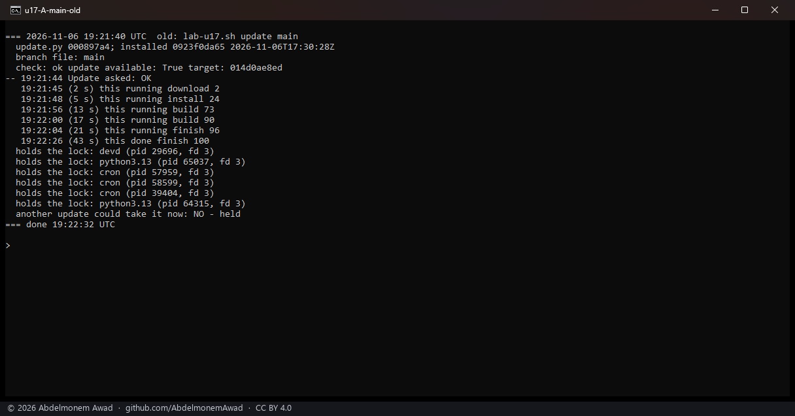

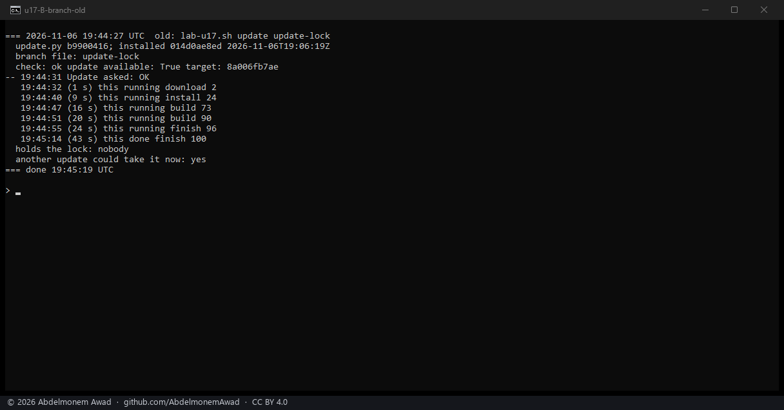

## No fall-back to a kernel of another major release

[1103](https://github.com/AbdelmonemAwad/os-xgs-npu/pull/1103), P19: the kernel follower sent the next
boot to kernel.old wherever the module was built for it, whichever FreeBSD release kernel.old is. On the
first XGS 3300's own sh, strings, grep and sed, with stand-ins in `/tmp` only - a kernel.old of FreeBSD
14.3, a module stamped for it, a `nextboot` that only records what it is asked - against its real
`/boot/kernel` of 15.1: `main`'s follower asked for kernel.old, the change's did not, and said why.

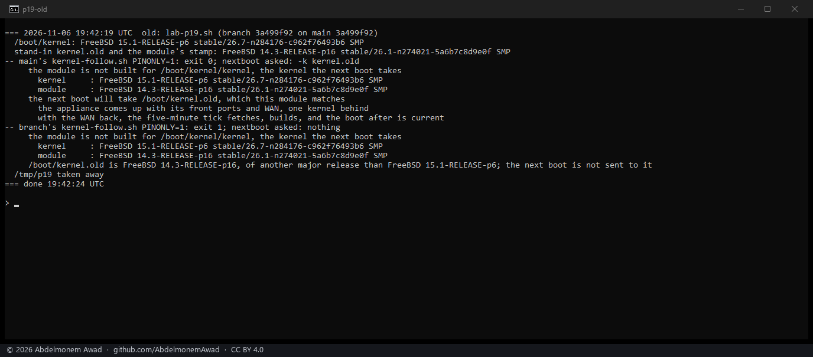

## A download tried again, and a stray module taken off

[1104](https://github.com/AbdelmonemAwad/os-xgs-npu/pull/1104), U14: an update's download was tried once.
On the first XGS 3300, with `codeload.github.com` sent to 127.0.0.1 for the update's first 12 s, the
first try failed, the update said it would try again in 30 s, and the second took it - done in 68 s,
nothing of the download left behind. U11: an `octep.ko` left on an ARMADA appliance by an install of
early October was followed instead of `npuep.ko`. On the XGS 136, four small stand-ins of it put in
`/boot/modules`, then the same update: the change's `install.sh` took all four off. The `npuep.ko.undone`
pair beside them was a lab script's own leftover of two days before, taken away after.

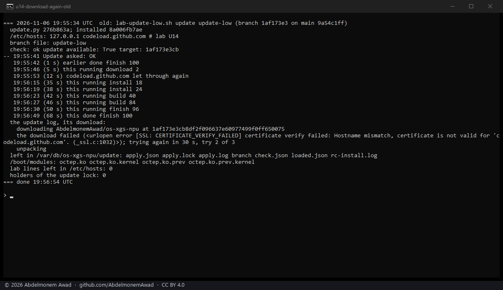

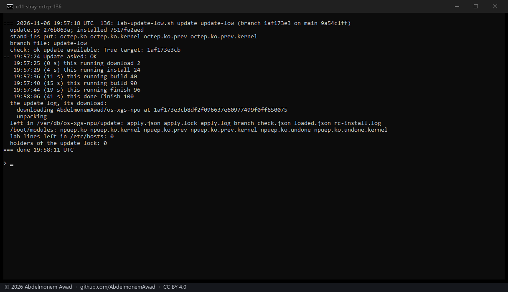

## A connection named by its index and its revision

[1090](https://github.com/AbdelmonemAwad/os-xgs-npu/pull/1090), D1: a verdict or a hand-back named its
connection by the table's index alone, and a connection that closed between the reading and the write
left its index to the next one made - which was then dropped or handed back instead. Both drivers take
the revision the table prints beside the index now, and refuse a write whose revision is not the
slot's. Built from the change and loaded on the first XGS 3300 and the XGS 136, a connection made to
cross each from a lab link to its WAN: with the revision + 1 the verdict and the hand-back were refused,
nothing changed; with the right one both were taken, and the connection went on. On the first XGS 3300
the case came by itself: the next connection took index 2 again with revision 2, and a hand-back with
the revision read before was refused.

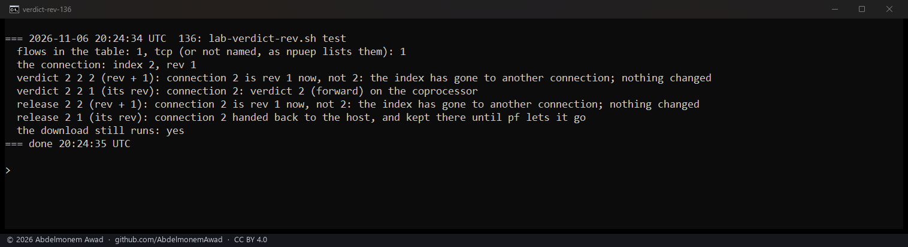

G12, found trying it: XGS: Offloaded Flows never drew its Return to host button on OPNsense 26.7 - the
grid draws the column named `commands` with the formatter of that name alone, and the page's was named
otherwise. With a connection in hardware on the first XGS 3300: before, an empty Commands cell; with the
change, the button, and pressed, the connection handed back with its revision.

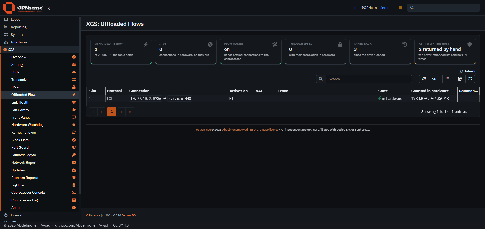

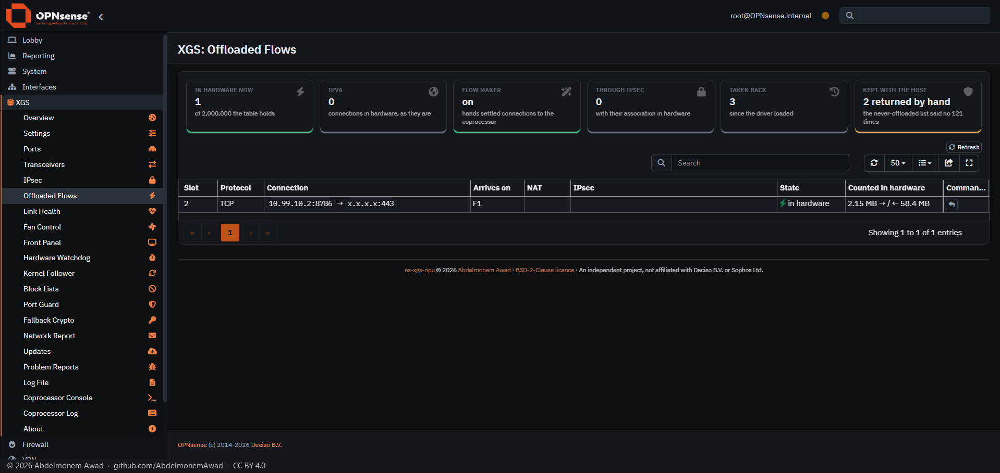

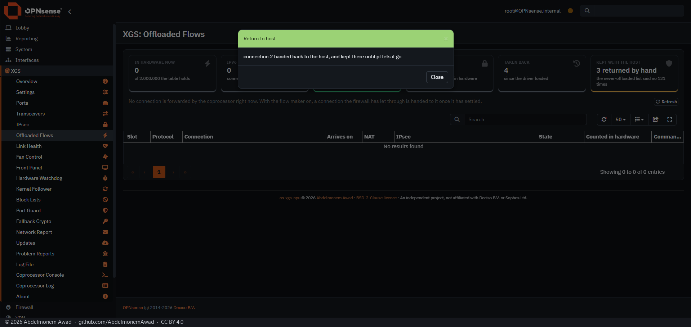

## The ARMADA's management link at the first boot that has it

[1106](https://github.com/AbdelmonemAwad/os-xgs-npu/pull/1106), A4: an XGS 136 installed from a
ready-made image - or reset - had no assignment for its management link, so the coprocessor was reached
over its console only and its clock and log were never handled over the link. On the XGS 136, the
assignment taken out of its configuration and the appliance restarted: with `main`, no address on the
link, nothing of the clock or the log, and the link refused; with the change's early hook, the link
assigned in that same boot before the interfaces came up, the coprocessor answering over it, its log
sent and its clock set. The configuration of before was put back after.

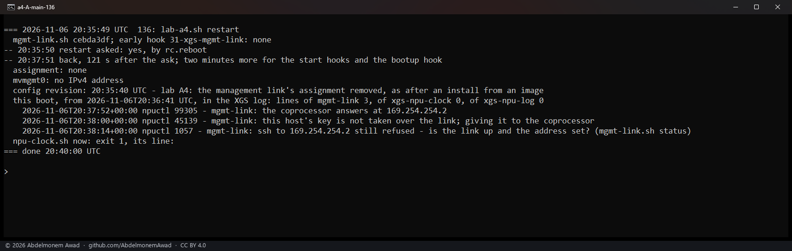

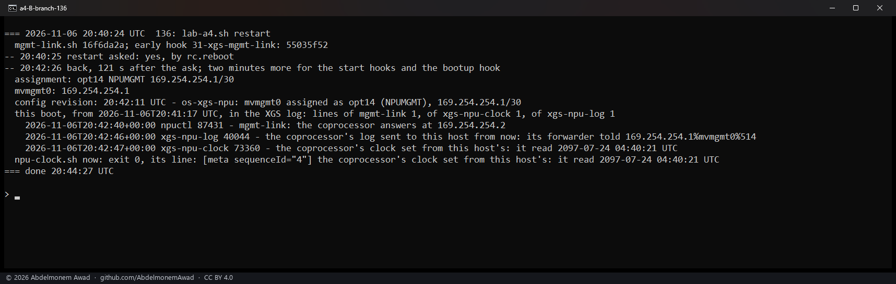

## Every pull request, and what it was run on

| pull request | findings | what changed | what it was run on |
|---|---|---|---|
| [1055](https://github.com/AbdelmonemAwad/os-xgs-npu/pull/1055) | P1, P3, P9 | reporter.py: an address that ends a sentence, a disk's serial and other programs' names kept out of reports | First XGS 3300 (vendor version 23): the installed cleaner on six samples - three addresses and the disk serial withheld, build numbers kept; a support bundle's dmesg.txt with its three serial lines withheld. test-reporter.py: 39 OK. |
| [1056](https://github.com/AbdelmonemAwad/os-xgs-npu/pull/1056) | U1, U2, U3, U4, U7, U10 | update.py, install.sh: an update that stopped is said to have stopped, and a driver that did not build fails the update | First XGS 3300: a 'running' record like #661's answers 'failed - the update stopped'; a held lock refuses a second apply; a tree whose driver cannot build ends with status 3, installed.json and octep.ko unchanged; the real tree then installs with status 0. test-update.py: all passed. |
| [1057](https://github.com/AbdelmonemAwad/os-xgs-npu/pull/1057) | R1, R6 | checks: every shell script parsed, each failure counted; the C step that parsed nothing removed | The new step run as CI runs it: 55 shell files parse, status 0; with one broken file added, status 1 and the file named. No appliance. |
| [1058](https://github.com/AbdelmonemAwad/os-xgs-npu/pull/1058) | A1, A2, A3, A10 | mcp2210.py, 06-npuctl, recover.sh: the release written on every way out of a pulse, the bridge found by its USB ids, boards 200 and 224 refused for every caller | XGS 136 (vendor version 21) restarted on the branch: the pulse at the first try, on the node found by its USB ids, released and settled; 14 front ports, verify.sh 13 passed; board 200 refused before the bridge opens (exit 2), and the recovery's reset lines say 'not reset'. test-mcp2210-commands.py 11 OK, test-npuctl-guard.py 7 OK. |
| [1059](https://github.com/AbdelmonemAwad/os-xgs-npu/pull/1059) | B1, B2 | assign.php, xgs.inc: a front port in service through a VLAN, a LAGG or a PPP link counts as set up; every driver device volatile, so a boot without the coprocessor rewrites no assignment | test-assign-mgmt.py with PHP 8.5.12: 19 OK. OPNsense's is_interface_mismatch() on the XGS 136 and both XGS 3300s with a missing device held in memory. A real boot of the second XGS 3300 without its driver: no assignment asked, config.xml unchanged, every assignment in place; then a normal boot, 16 front ports, verify.sh 8 passed. |
| [1060](https://github.com/AbdelmonemAwad/os-xgs-npu/pull/1060) | R2, R3, R4, R7, R9, R11 | workflows: each finds only its own issue; upstream reads opnsense/core's tags; docs labelled; a release closes "A release is due"; every issue told | test-release-notice.py: all OK, the three new cases fail on main. The issue lookup, the upstream tag comparison and the changelog headings run as written against the live repositories. The workflows themselves run on their schedules. |
| [1061](https://github.com/AbdelmonemAwad/os-xgs-npu/pull/1061) | A5, O2 | the drivers found by their module's name, unloaded by the file they came from: a driver running from its .prev file is seen | Boots from the .prev file on the XGS 136 and the first XGS 3300: kldstat -m finds the driver where -n did not, the recovery chooses the .prev file, verify.sh says loaded (main's: not loaded); then normal boots, 14 and 12 front ports. test-reporter, test-verify, test-fastpath, test-kernel-follow, test-npuctl-guard: OK. |
| [1062](https://github.com/AbdelmonemAwad/os-xgs-npu/pull/1062) | D6 | scripts: command output decoded with errors='replace' everywhere, so one byte that is not UTF-8 stops no script | Second XGS 3300 (vendor version 22): seven installed run helpers given the byte 0xff - main raised UnicodeDecodeError in every one, the branch answered with a replacement character. test-decodes.py: 32 scripts, no strict decode (48 on main). |
| [1063](https://github.com/AbdelmonemAwad/os-xgs-npu/pull/1063) | P11, P12 | reporter.py: the machine's names withheld whole, not inside other words; a missing driver's evidence from this boot alone | test-reporter.py: 41 OK, the two new tests fail on main. First XGS 3300: report collect and list ran without a traceback. |
| [1064](https://github.com/AbdelmonemAwad/os-xgs-npu/pull/1064) | U9 | verify.sh: octep.ko built for the kernel the next boot will use is said to be, not a failure of the chain | test-verify.py: all OK, main fails the three next-kernel cases. First XGS 3300: the kernel's version line read with strings matches uname -v and the stamp; verify.sh 8 passed. |
| [1065](https://github.com/AbdelmonemAwad/os-xgs-npu/pull/1065) | G1 | flow_exclude.php: a Never offloaded list longer than the driver's 64 keeps everything with the host, where it was refused and nothing was kept | First XGS 3300 given 65 documentation addresses: main applied nothing, the branch kept everything with the host (2 entries); the configured list then written back. test-flow-exclude.py with PHP 8.5.12: all OK; it refuses to run where a driver is attached. |
| [1066](https://github.com/AbdelmonemAwad/os-xgs-npu/pull/1066) | O5 | bringup.sh: the RPC write gate shut on every way out, a failure or a stop part-way included | The trap's lines under dash: a failure, a TERM part-way and a full run each open and shut the gate. First XGS 3300 restarted on the branch: 12 front ports, rpc.allow_write 0 afterwards, verify.sh 8 passed. |
| [1067](https://github.com/AbdelmonemAwad/os-xgs-npu/pull/1067) | B5, B8 | 30-xgs-assign, countdown.py, assign.php: a countdown that failed is asked again, a failed assignment is marked, a configured bridge0 is seen, nothing written unbacked | test-countdown.py: 8 OK, main fails three. First XGS 3300: php -l clean, assign.php --check exit 2 ('set up already'), countdown.py on /dev/null exit 0. |
| [1068](https://github.com/AbdelmonemAwad/os-xgs-npu/pull/1068) | D7 | coprocessor.py: a look that cannot read the coprocessor keeps the reading before it, for the next look and a report's vendor build | test-coprocessor-state.py 4 OK and test-reporter.py OK, the new tests fail on main. First XGS 3300: coprocessor.py collect read vendor build 23.0.0.329 into both files. |
| [1069](https://github.com/AbdelmonemAwad/os-xgs-npu/pull/1069) | D4 | lists_cut.py, ja4_cut.py: a run whose pf states could not be read keeps its new entries and its place for the next run | test-lists-cut.py 20 OK, test-ja4-cut.py 38 OK, the new cases fail on main. First XGS 3300: both scripts ran. |
| [1070](https://github.com/AbdelmonemAwad/os-xgs-npu/pull/1070) | F5 | fastpath.py: a restart asked for in this boot is not asked for again by the next minute's check | test-fastpath.py: 23 OK, the first new test fails on main. Second XGS 3300: fastpath.py check on its live fast path, exit 0, its state as before. |
| [1071](https://github.com/AbdelmonemAwad/os-xgs-npu/pull/1071) | F1, F2, F3 | feeder.py: no SysRq keys into a reset under way; only no prompt is a silent console; a silence weighed again when a look finds no prompt | test-feeder.py: 104 OK, 9 of them fail on main. First XGS 3300: feeder.py restarted on the new file and quiet for seven minutes - driver gone 0, heartbeat alive, deaths 0, the link answering every echo. |
| [1073](https://github.com/AbdelmonemAwad/os-xgs-npu/pull/1073) | B3, O1 | recover.sh, switch-jumbo.sh: the switch ports set to 10,240 again after a recovery in place; the console's lock not held through a second link wait, nor taken against the watch | First XGS 3300 (vendor version 23): its fast path stopped on purpose twice and taken up in place in 279 s, the host not restarted - with main's scripts the ten switch ports stayed at 2,048 bytes (0x1480) and the state still said confirmed; with the branch they were set to 10,240 and confirmed 10 s after the link answered. A copy of switch-jumbo.sh whose link never answers: main's waited for the link again under the console's lock (21 to 41 s), the branch's went straight to the console; with a fresh URGENT mark it waited until the mark was a minute old (62 s); the run under the lock gave the console up at once (76). |
| [1074](https://github.com/AbdelmonemAwad/os-xgs-npu/pull/1074) | R5 | plugin-release-pr.py: an open release pull request whose branch carries a person's commits is left to that person; the branch replaced only where it was read | test-plugin-release-pr.py: 28 checks, 0 failures - 14 new: no PR open; only its own commit; a person's commit (no push, nothing written over); its commit amended by a person; a branch left by a merged release; a person's push between the look and the push (refused, kept); the concurrency group. 9 of them fail on main. No appliance. |
| [1075](https://github.com/AbdelmonemAwad/os-xgs-npu/pull/1075) | P5, P7, P8 | reporter.py: a module waiting for its reboot is no module-mismatch; failing configd actions told apart by their program; the shutdown before a boot not taken for its end | test-reporter.py under Linux: 46 OK, the three defect tests fail on main. First XGS 3300 (reporting manual): collect without a traceback; the module's stamp and /boot/kernel's version line, read the follower's way, the same; no module-mismatch; normalise tells portstats.py's and ipsec.py's failing configd actions apart. Filed fingerprints: only configd lines from reporter versions before 2026-10-20 normalise differently. |
| [1076](https://github.com/AbdelmonemAwad/os-xgs-npu/pull/1076) | D3, D5 | transceivers.py: a cage the reply did not reach keeps its last read and the driver its medium; portstats.py, coprocessor.py, temperatures.sh: the ports named by models.py, so an XGS 2100 or 2300 is not shown as a 3300 | test-transceivers.py all passed (15 of 28 checks fail on main); test-models.py 16 OK (4 fail on main). First XGS 3300: a normal read clean, the driver's media unchanged; a reply cut on purpose (3 s on the console, 3 s before each cage): F1 read, F2-F4 kept from the read before with read_at, the driver unchanged, the error naming them; main's copy cut the same way showed F2 (a 10GBASE-SR module) empty and told the driver 0 0 for oxp1. The panel: this 3300 as before; by a 2100's board serial alone, switch ports 9 and 10 F1 and F2 and none on its own MACs. |
| [1077](https://github.com/AbdelmonemAwad/os-xgs-npu/pull/1077) | P2 | kernel-follow.sh, stop/20-octep: the kernel.old fall-back armed at the reboot while another run holds the follower's lock, and said only when it was | test-kernel-follow.py under Linux: 6 OK, the four new cases fail on main. First XGS 3300 (kernel p6, kernel.old p4), the follower's lock held and the module's stamp made kernel.old's for seconds: main's stop hook said the next boot takes kernel.old with nextboot.conf empty; the branch's wrote kernel="kernel.old" and said what it armed; disarmed, stamp and lock put back. On the box as it is: nothing to arm, under a second. |
| [1078](https://github.com/AbdelmonemAwad/os-xgs-npu/pull/1078) | O6 | npu-platform.sh: the platform database read through npu-run.sh, under the console's lock and with its logger standing aside | Second XGS 3300 (vendor version 22, the lab's one with an expansion module): a hand run over the link read 421 keys in 1 s, the same as its boot's; restarted on the branch: the boot's first try found no Linux prompt and sent nothing, the next read the database at 08:25:26 (421 keys), the module's ports bound A4 to A1, 16 front ports ready after 92 s. Its log had 'a reader already holds /dev/cuau2' twice (11-03, 11-04). |
| [1079](https://github.com/AbdelmonemAwad/os-xgs-npu/pull/1079) | G2, G4 | SettingsController.php, status.volt: the settings API holds to xgs.general, and the Overview draws its cards when the settings cannot be read | First XGS 3300, a read-only user (user-config-readonly with Overview and Problem Reports, not Settings): main's Overview drew 0 / 0 with no panel and IPsec Off, the branch's the panel, the ports and the IPsec card as they are. As administrator: settings/get answers xgs.general alone; Apply saved and applied (14 steps), xgs.reporting unchanged; Problem Reports loads; the Overview 4 / 12 with link, twelve ports. |
| [1080](https://github.com/AbdelmonemAwad/os-xgs-npu/pull/1080) | B4 | bringup.sh, 07-npuep: the inspector's marker made to agree with the configuration at boot, so a factory reset or a restore does not leave the inspector's function and ring 0 taken | First XGS 3300 and the XGS 136, the setting saved with no Apply as a restore leaves it: off and restarted - the marker left behind removed, oxips0 gone (pkind 40, first ring 0 on the 3300; hw.npuep.ips_vf unset on the 136); on and restarted - the marker made at boot, oxips0 back (pkind 41, first ring 1; ips_vf 1, 14 front ports) - both boxes as they were. |
| [1081](https://github.com/AbdelmonemAwad/os-xgs-npu/pull/1081) | U6 | update.py, install.sh, kernel-follow.sh, updates.volt: the update's progress read from its own run only, and no number where it cannot be told | Under Linux: test-update.py (59) OK; 13 fail on main's files (an older run's account read as 95%, another run's build as 90%). First XGS 3300: a whole update to the branch's head by update.py apply, as the Update button starts it - 12, 18, 24, 35, 40, 73, 90, 95, 96, 100% in 38 s, each step from this update's own traces; the page during it: Running, 96%. |
| [1082](https://github.com/AbdelmonemAwad/os-xgs-npu/pull/1082) | P4, P6 | reporter.py, relay: a report the relay refuses spends nothing and waits for the owner's Send; a condition that holds is one occurrence until it clears; the relay files for all ten parts | test-reporter.py under Linux: 55 OK, the 9 new fail on main; relay/test.mjs: 17 passed. First XGS 3300 (reporting manual): two collects clean, counts unchanged; a condition held for a minute (stamp made kernel.old's, the follower's lock held): main's module-mismatch count 2, 3, 4; the branch's 5, 5, 5. The relay is not deployed: that waits for the App's installation to take in the five repositories. |
| [1083](https://github.com/AbdelmonemAwad/os-xgs-npu/pull/1083) | F4, F6, F7 | feeder.py, fastpath.py: a passing reading no longer settles a silence, the stop's report is sent behind the recovery, and a recovery past its cap is ended whole | test-feeder.py (110) and test-fastpath.py (26) OK under Linux, the new tests fail on main. First XGS 3300: F7 - a 20 s cap on a healthy box left recover.sh running with its lock free on main; with the branch every process ended, its lock last. F6 - two recoveries in place, reporting automatic, the relay a dead address: 280 s each and no gap between the decision and recover.sh on main or the branch - the delay described did not show here (sends failed at once, 'Network is down'); what showed is those sends using up the day's allowance of reports. F4 not provoked on the appliance. |
| [1084](https://github.com/AbdelmonemAwad/os-xgs-npu/pull/1084) | R8, R10, R12, R13, R14, R15 | release.yml, changelog.py, thanks, answered: the tag on the release's own commit and the site built after it; corrected lines listed; thanks per person; no runner held by a wait in a crowd | test-changelog.py 11 checks (10 fail on main), test-thanks.py 24 (3 fail on main), test-answered.py 48 (3 fail on main), test-plugin-release-pr.py 29 (1 fails on main), test-release-notice.py, test-reminder.py, test-labels.py: 0 failures; every gh call stood in for, nothing on the network. changelog.py --release on alpha.14's pull requests lists #1048 (the line put right by hand), #1040 and #1030, and not #1031, whose correction came from later measurements. Every workflow file parses; every docs and text check of checks.yml clean. To watch on the next real runs: the release's line 'published vX at <sha>' naming the release pull request's merge commit, and a website.yml run behind it. |
| [1085](https://github.com/AbdelmonemAwad/os-xgs-npu/pull/1085) | O7, O10, O11, P17 | upgrade/20-octep, kernel-follow.sh, bringup.sh, npu-run.sh: the upgrade's rebuild bounded and its warning true, an earlier load's handshake said at once, and the console's logger never left paused | Under Linux: test-kernel-follow.py (10), test-bringup.py (2), test-feeder.py (113) OK, the new cases fail on main (2, 1, 3). First XGS 3300: O7 - the follower's lock held, main's hook still waiting when an outside limit cut it at 20 s, the branch's with LIMIT=5 ended after 5 s and logged its four lines. O10 - octep0 detached and attached with the coprocessor running: main's bringup.sh exited after 61 s saying the coprocessor was not answering, the branch's after 0 s with the true reason, no HOST_LOADED written; after the host restart the 12 front ports came back. O11 - the lock held: main's npu-run.sh left the pause file, the branch's took it away, then an ordinary session answered. P17 by the unit tests. Docs: 18 citations of bringup.sh lines put right. |
| [1086](https://github.com/AbdelmonemAwad/os-xgs-npu/pull/1086) | D8, D9, D11, D12, D14 | anomaly.py, ipsec.py, temperatures.sh, ja4_cut.py, offload.sh: one window at a time, the associations in UDP shown, a boot token the clock does not move, each cut state's own ends, and one rpc command at a time | Under Linux the six test files pass; on main the new ones fail (4, 4, 1, 4, 3, 3). First XGS 3300: D14 - the rpc lock held 8 s, main's two ran at once and the branch's waited 7 s; held 40 s, the branch's offload.sh wrote the gate after 30 s and logged why. D8 - a second run 3 s into a 20 s window: main's ran an 8 s window beside the first, the branch's ended at once with the last window's summary. D11 - the clock stepped 2 s ahead: main's asked the coprocessor's memory module again (none 1793958984 -> none 1793958986), the branch's token stayed and it asked nothing. The XGS 136: D9 - a test association in UDP printed by setkey with its ports in brackets: main's kernel_sas() read nothing from it, the branch's mapped it to its ends. D12 by the unit tests. |
| [1087](https://github.com/AbdelmonemAwad/os-xgs-npu/pull/1087) | A8, A9, A11, A12, A13 | bridge-pathcost.sh, mgmt-link.sh, npuhs.py: an owner's path cost kept, 2.5G ports read, old STP's sixteen bits asked for, the console waited for, and the endpoint found by its id | Under Linux: test-bridge-pathcost.py (12), test-npuhs.py (3), test-mgmt-link.py (8) OK; on main 7, 3 and 2 fail. The XGS 136: A13 - on npup3, bridge0's one member with a link (spanning tree off, so a cost carries no traffic): a cost of 12345 set by hand was put back to 20000 by main's next minute run, which logged it; with the branch's copy it stayed 12345 for two runs; the cost was then given back to the kernel and main's copy put back. A12 - npuhs.py probe (read only), both copies: the endpoint found at pci0:1:0:0 and the same BAR2 read. A9, A8, A11 by the unit tests (no link on the 2.5G ports, no member speaking STP). |
| [1088](https://github.com/AbdelmonemAwad/os-xgs-npu/pull/1088) | D2, G10 | coprocessor.py, plugins.py, npu-run.sh: the long reads started in the background and answered at once, the console held in short sessions, and one plugins check at a time | Under Linux: test-feeder.py (116), test-coprocessor-state.py, test-plugins.py, test-mgmt-link.py (6) OK; on main's scripts test-feeder fails. First XGS 3300 with the management link not answering: main's collect one console session of 66 s, slots 162 s, past configd's 120 s; the branch answered in 1 s and read in 40 s over four sessions of 6 to 14 s, slots in 52 s. The plugins check answers at once, a second one joins the check under way. The two pages: each button answered at once, collect read in 19 s, the closed partitions in 22 s. |
| [1089](https://github.com/AbdelmonemAwad/os-xgs-npu/pull/1089) | B6, B7, B9, B10, B11, B12, B13, B14, P14 | stop hooks, switch-jumbo.sh, tunables-kenv.sh, reset_reason.py, npu-clock.sh, apply.php, subnets.py, 74-xgs-defaults: the watches stopped after the rebuild, failures said, and the settings /conf takes with it set again | Under Linux: test-hooks.py (7), test-npu-clock.py (5), test-reset-reason.py (4), test-switch-jumbo.py (5), test-tunables-kenv.py (8), test-subnets.py OK; on main 6, 2, 2, 3, 1 fail and test-subnets.py stops; test-apply.py on the 136 for its PHP: no failures. The XGS 136, the branch's hooks for one restart, the installed ones put back after: B7 - the stop order as the console printed it: with main's xgs-watchdog and xgs-feeder before octep, with the branch's octep, kernelfollow, xgs-feeder, xgs-watchdog. B14 - the record moved aside as a factory reset empties /conf; at the boot 74-xgs-defaults ran defaults.php, which left the owner's amdtemp and wrote the record again. The rest by the unit tests. |
| [1090](https://github.com/AbdelmonemAwad/os-xgs-npu/pull/1090) | D1, D16, G12 | octep, npuep, hwdrop.py, flows.py, flows.volt: a verdict or a hand-back names its connection by index and revision, an index given to another connection since is refused, and Return to host is drawn | Under Linux: test-flows.py, test-hwdrop.py, test-ja4-cut.py OK. octep.ko and npuep.ko built from the branch (-Werror, no warning) and loaded on the first XGS 3300 and the 136. A connection crossing each from a lab link to its WAN: verdict and hand-back with rev + 1 refused, 'nothing changed', taken with the right rev, the download going on. On the first XGS 3300 the case as it came: the next connection took index 2 with rev 2, and the page's action with the old rev 1 was refused. G12: Return to host not drawn by main on 26.7; with the fix drawn, and pressed it sent {"rev":"4"} and handed the connection back (photos 85-88, at the page's size 1918 x 883). |
| [1091](https://github.com/AbdelmonemAwad/os-xgs-npu/pull/1091) | A14, F16, O13, U16 | feeder.py, npu-sysrq.sh, reload.sh, recover.sh, install.sh: a declined SysRq said with its reason, the console's logger let back in after one, and the endpoint taken by its id | Under Linux: test-feeder.py (115) and test-endpoint-select.py (3, new) OK; on main the new cases fail (2 and 2). First XGS 3300: O13 - npu-sysrq.sh with the console's lock held 30 s by a stand-in (no lock had, no key sent): main's exited 75 after 10 s and left the logger's pause file, the branch's exited 75 after 10 s and took it away, and the logger read again; the stderr line both wrote is what feeder.py now says as the reason. F16 and A14 by the unit tests; U16 a comment. |
| [1092](https://github.com/AbdelmonemAwad/os-xgs-npu/pull/1092) | G11 | ReportsController, PoeController: a user with user-config-readonly refused before config.xml is saved | test-readonly-saves.py finds the two actions, both checking first; it fails on main on both. First XGS 3300, a read-only user: Apply on Problem Reports saved config.xml with main (a revision by that user through reports/set), refused with the branch, the revision kept. As administrator: saved as before (saved, xgs.reporting unchanged), poe/set past the check to poe.py. Not tried: PoE refused to a read-only user - no XGS 3300 has PoE. |
| [1093](https://github.com/AbdelmonemAwad/os-xgs-npu/pull/1093) | O4 | bringup.sh: a port left without its address named, with the reason, and an answer of zeros not taken for one | Under Linux: test-bringup.py (10) OK; on main 6 fail (a cage that never answers, a switch port refused, an answer of zeros, a word that is not a number, a cage the model lacks, names without the models table). First XGS 3300: the branch's bringup.sh in place for one restart, the installed one put back after: 'bound 10 of the ten' and 'up: 12 front-port interfaces' with no port named as not bound; 12 front ports, handshake completed, heartbeat alive. A port without an address not provoked on an appliance (NetAgent answered for every port). Nine bringup.sh citations moved in three pages. |
| [1094](https://github.com/AbdelmonemAwad/os-xgs-npu/pull/1094) | A6, A15 | 07-npuep, recover.sh, reload.sh: the ARMADA's offload gate after a reset of its coprocessor - waited for as long as the driver waits, its old word not shown as this one's - and reload.sh loading a module that is there | Under Linux: test-offload-gate.py (11, new) OK; on main 9 fail. The XGS 136, each run detached since a reload takes F1 down: main's reload.sh beside the module - exit 0 after 104 s, the page's word 7 throughout with the token unchanged though the coprocessor was reset; the branch's run from the source tree with no module beside it - it took the installed module, exit 0 after 110 s, the token made again at 8 s so the page showed nothing, the gate written at 50 s and the word 7 again. main's from the source tree that morning: it unloaded the driver, reset the coprocessor and failed to load, leaving no front ports until a restart. Three status.py citations put right. |
| [1095](https://github.com/AbdelmonemAwad/os-xgs-npu/pull/1095) | F8, F9, F10, F11, F12, F13, F14, F15 | feeder.py, fastpath.py, console_log.py, recover.sh: crash records marked only once kept, an error in a handler not the end, the ARMADA's stop seen at once, a boot told by a token, and a lock probe no failed recovery | Under Linux: test-feeder.py (127) and test-fastpath.py (31) OK; on main the new cases fail (12 and 3). First XGS 3300: the branch's feeder.py, fastpath.py, console_log.py and recover.sh in place for five minutes, put back after: both running, no Traceback, Error or 'stopped:' in the log, both boot tokens made, the heartbeat alive. F11 not tried on an appliance (it needs the 136's fast path stopped and a recovery), nor the faults of F8, F9, F12, F13, F15 but by the unit tests. Left on purpose, with reasons in the pull request: daemon -r (F9), the earlier reading (F10), the day windows (F14). |
| [1096](https://github.com/AbdelmonemAwad/os-xgs-npu/pull/1096) | D10, O12, P10 | reporter.py, portcheck.py, octep.c: the Kernel row the running kernel's, a short line of the coprocessor's ports said, and the temperature sensors described for every model | Under Linux: test-reporter.py (56) and test-portcheck.py (2) OK; on main the new reporter case fails and the short line raises IndexError. XGS 136: the branch's portcheck.py beside the installed one on the coprocessor's real ports: rc 0 and the same lines, four of four as the board says. First XGS 3300: reporter.py system with the branch's file: the Kernel row 15.1-RELEASE-p6 c962f76493b6, as the installed one prints it. octep.ko built from the branch in place of the installed one, the host restarted: sysctl -d gives the two new descriptions and the four others unchanged, the values as before once temperatures.sh has run, 12 front-port interfaces, the heartbeat alive; the installed module put back and the host restarted again. Not tried on an appliance: a kernel on disk other than the running one (P10) and a short line from the coprocessor (D10), but by the unit tests. |
| [1097](https://github.com/AbdelmonemAwad/os-xgs-npu/pull/1097) | D15 | device_facts.py, devices-table.py: the XGS 2100's and 2300's F1 and F2 on the switch on the site's pages, and the table stopped where the facts and models.py disagree | Under Linux: test-models.py (22) OK; on main's files 3 fail, each naming the XGS 2100's F1 as a switch port given a coprocessor MAC and PHY, and the branch's generator on main's facts stops with exit 1. Every site page that reads devices.json rendered offline from main and from the branch in eight languages (227 files each): the one difference is the wrong 88X5113 row gone from the 2100's and 2300's pages. No appliance: the change is the site's alone; the published pages are looked at after the site's build. |
| [1099](https://github.com/AbdelmonemAwad/os-xgs-npu/pull/1099) | G5, G6, G7, G8, G9 | apply.php, status.volt, ports.volt, reports.volt, updates.volt, reporter.py: the flow maker's hand-set tunables removed, a refused action said, only an https issue address a link, the panel's tooltips named, and the API's text escaped once | test-apply under the first XGS 3300's PHP 13 of 13, test-reporter 57. G5: a row dev.octep.0.dp.auto = 0 with the page at 1 - main's Apply kept it and after a restart the flow maker ran 0; the branch's removed it and after a restart it stayed 1. G8 as a read-only user: main drew All zero at an Invalid Date, the branch a warning and the counters read again. G6: main a javascript: link and a title cut at its quote, the branch #958 as text and the whole reason. G7: main's twelve tooltips [object Object], the branch's none. G9: no text to compare on the box; the escaping read from Response.php. |
| [1100](https://github.com/AbdelmonemAwad/os-xgs-npu/pull/1100) | O8, O9, P13, P15, P18 | recover.sh, kernel-follow.sh, reporter.py, early/05-xgs-report: reload's answer read, a refused detach asked again, a stamp never naming the wrong module, and a boot that crashed early reported | Under Linux: test-recover.py, test-kernel-follow.py, test-hooks.py, test-reporter.py OK. P18 on the first XGS 3300 and the XGS 136 through OPNsense's restart: the early hook ran, boots.json named the new boot, no unexpected-reset report. O8 on the first XGS 3300: the fast path stopped on purpose and taken up again in place in 279 s, OPNsense's reload run to its end. P15: kernel-follow.sh FORCE=1 built octep.ko in 9 s, its stamp right before and after, nothing VOID. Not on an appliance: a reload that stops, a refused detach (O9), a panic after the stop hook's line (P13). |
| [1102](https://github.com/AbdelmonemAwad/os-xgs-npu/pull/1102) | U17 | update.py, install.sh: the update's lock on descriptor 9, closed for every daemon the installer starts | Under Linux: test-update.py (64) OK; it stops on main's update.py. FreeBSD's sh on the first XGS 3300: a child inherits descriptor 9, and sh sets no close-on-exec on a descriptor exec moves, so each daemon start closes 9 itself. First XGS 3300, A: an update to main 014d0ae8 as the Update button starts it - after it devd, three cron processes and two python3.13 held the lock, lockf could not take it. B after a restart: the branch's update.py and an update to its head 8a006fb7 in 43 s - nobody held the lock, lockf took it at once, and a second update asked straight after answered 'nothing to update to', not 'already running'. |
| [1103](https://github.com/AbdelmonemAwad/os-xgs-npu/pull/1103) | P19 | kernel-follow.sh: the fall-back to kernel.old never across a FreeBSD major release | Under Linux: test-kernel-follow.py (18) OK; the two new major-release tests fail on main's script. First XGS 3300 on its own sh, strings, grep and sed: the stop hook's PINONLY=1 run with stand-ins in /tmp only - a kernel.old of FreeBSD 14.3-RELEASE-p16, a module stamped for it, a nextboot that only records - against the real /boot/kernel 15.1: main's exit 0 and -k kernel.old asked; the branch's exit 1, nothing asked, the reason said. Nothing in /boot touched, nothing to syslog. Not tested: a real major upgrade. |
| [1104](https://github.com/AbdelmonemAwad/os-xgs-npu/pull/1104) | U11, U12, U13, U14, U15 | update.py, install.sh, uninstall.sh, verify.sh, kernel-follow.sh: an ARMADA appliance's stray octep.ko taken off, an uninstall that leaves nothing armed, verify.sh naming what is installed, a download tried again, and the releases read past the twenty newest | Under Linux: test-update.py (99), test-verify.py, test-kernel-follow.py, test-uninstall.py OK. U13: the branch's verify.sh on the first XGS 3300 and the 136 says the release installed, the last update and the installer's files - on the 136 one of 135 not as written. U15: as if alpha.2 were installed, main's check offered 1 release since it, the branch's 40. U14: on the first XGS 3300 codeload blocked for the first 12 s - the first download failed and the log said 'trying again in 30 s, try 2 of 3', the second took it, the update done in 68 s, no archive or tree left. U11: on the 136 four stand-in octep.ko files taken off by the branch's install.sh in the update. U12 not on an appliance: an uninstall takes the plugin off whole; by test-uninstall.py only. |
| [1106](https://github.com/AbdelmonemAwad/os-xgs-npu/pull/1106) | A4 | 31-xgs-mgmt-link, mgmt-link.sh, install.sh: the ARMADA's management link assigned at the first boot that has it, before OPNsense configures its interfaces | Under Linux: test-hooks.py, test-mgmt-link.py OK. The 136 with mvmgmt0's assignment taken out of its configuration, as after an install from an image: with main's files it stayed unassigned, no address, no npu-clock or npu-log, npu-clock.sh exit 1. With the branch's early hook the link was assigned in that same boot before the interfaces came up, took its address, the coprocessor answered, its log was sent and its clock set. The kept configuration and main's files put back after. |
| [os-kernelfollow 10](https://github.com/AbdelmonemAwad/os-kernelfollow/pull/10) | P16 | stop/21-kernelfollow, follow.sh: the fall-back armed first, on its own, and the cut-off said as it is - released in 1.0.3 | Under Linux: test-follow.py (17, new) OK; on main 16 fail. First XGS 3300, follow.sh's lock held 40 s by a stand-in, nothing registered: the installed follow.sh with PINONLY=1 waited for the lock until an outside limit cut it at 15 s, the branch's ended at once (2); the installed stop hook with LIMIT=5 said the next boot takes kernel.old with nothing armed (no nextboot.conf), the branch's said what it found. No fall-back actually armed on an appliance (nothing registered needs one). |
| [os-watchdog 10](https://github.com/AbdelmonemAwad/os-watchdog/pull/10) | B15 | stop/24-watchdog: the host's watchdog disarmed after the slow stop hooks, not first - released in 1.0.2 | The XGS 136: the branch's 24-watchdog in place of 04-watchdog for one restart, the installed one put back after. The stop order as the console printed it: before, watchdog first of all; with it, after octep and kernelfollow. install.sh and uninstall.sh as they now are not run on an appliance (sh -n passes). |

The two plugins' releases were checked as a release of this project is: [Hardware Watchdog 1.0.2 and Kernel Follower 1.0.3, checked before their release](plugin-releases-2026-11-06.md).
