<!-- reviewed: 2026-10-23 -->
<!-- board: Cut in hardware | XGS 3300 | cut flood: 10 to host vs 610,533 -->
<!-- board: Cut in hardware | XGS 136 | cut flood: 36 to host vs 280,202 -->
# A connection cut on the coprocessor itself, by its verdict. Measured, 2026-10-23

Until this, a connection that a watched block list or a listed TLS fingerprint cut had its pf state
killed, and the driver then took it out of hardware - within a second or two - after which every
frame its sender went on sending crossed to the host for pf to drop. Each connection on the
coprocessor carries a **verdict** that its fast path can be asked about for every frame, and the
driver only ever wrote "forward"
([the discovery](../findings/discoveries-2026-10-22.md#a-connection-dropped-by-its-verdict),
[680](https://github.com/AbdelmonemAwad/os-xgs-npu/issues/680)).

Now, with **XGS: Settings - Cut in hardware**, on by default:

- **A cut drops the connection on the coprocessor at once, both ways, before its pf state is
  killed as always** - one command, `CONN_MODIFY_FP_VERDICT` with DROP.
- **It is kept there while its sender goes on sending**, so those frames never reach the host: a
  UDP flood at 400 Mbit/s through the XGS 3300, cut, sent the host **10 frames** in ten seconds
  against **610,533** without the setting; through the XGS 136 at 300 Mbit/s, **36** against
  **280,202**, its CPUs 0.4 % busy against 7.0 %. Once the frames stop, the connection is taken out
  like any other.
- **It costs nothing measured**: a thousand connections at once ran the same with it as without.
- Off, connections are made as before and a cut works as before.

The modules measured: **octep.ko a3472a42** on the second XGS 3300 and **npuep.ko 6e231f79** on the
XGS 136.

## What makes it work

The verdict's numbers and the microflow's actions are not in the source this project holds - its
debugging code names them without numbers. They were read from the vendor's host module: its
printer of a connection chooses "SEND TO IPS" for 0, "DROP" for 1 and "CUT THRU" for 2, and its
printer of a microflow "DROP" for 0, "FWD" for 1, "IPS" for 2 and "AUX" for 3. Then measured:

| the connection's microflows | the fast path's IPS switch (bit 0x004 of the configuration word) | the verdict set to DROP |
|---|---|---|
| FWD, as this driver made them | either | **asked nothing**: the stream went on at 5.2 Gbit/s |
| IPS | off | asked nothing either: sent on to the wire, counted as `FROM_WIRE_TO_WIRE_IPS_DISABLED` |
| IPS | **on** | **dropped**, counted as `FROM_WIRE_DROP_IPS_VERDICT`; set back to CUT_THRU, forwarded again |

So "Cut in hardware" makes every plain connection with the action IPS and keeps the IPS switch on
- `dp.mflow_action` / `flow.mflow_action` 2, written at a save and at every boot, and the switch
written by `offload.sh` with the gate. With CUT_THRU, the verdict every connection is made with,
the fast path sends the frame on, counted as `FROM_WIRE_TO_WIRE_VERDICT_CUT_THRU`. A tunnel's
connection stays FWD: its encryption under IPS is untried. If the coprocessor restarts and forgets
the switch, an IPS frame is sent on to the wire as before - nothing is cut that should not be.

## How it was measured

Each run in a window of its own, photographed (`images/deploy/lab-verdict-series.ps1`); the text of
every run, the ones before the photographs among them, is in the run log.

- **The cut** (`lab-cut-hw.sh`): one stream in hardware - TCP, or UDP at a fixed rate, the flood a
  listed sender would keep up - from the PC through the appliance. At second 10 its far end is added
  to a watched block list that has a block rule, as a real list has, and the cut is run as saving
  the settings page runs it. From second 12 to 22: what still arrives where the traffic ends, the
  frames the host takes in on the interface the stream enters by, and the host's CPUs. The setting
  is set on or off for the run the way the page sets it, and put back.
- **The verdict alone** (`lab-verdict.sh`): a stream in hardware, its verdict set to DROP at second
  10 and back to CUT_THRU at second 16 with the driver's own sysctl, pf's state left alone.
- **The cost** (`lab-verdict-many.sh`): the thousand-connection run of 2026-10-19, eight clients of 128
  streams each, with FWD and the switch off, then with IPS and the switch on.

On the XGS 3300 the far end of the stream is the bench VM, which is the listed address itself: once
it is listed, the reading of what reaches it is cut too, and the page says so rather than a figure.
What the stream did there is in the PC's own iperf3 lines beside it.

## The cut

| | stream | Cut in hardware | the cut | dropped on the coprocessor, seconds 8 to 22 | frames to the host, seconds 12 to 22 | its CPUs | still in hardware at 22 |
|---|---|---|---|---|---|---|---|
| XGS 3300 | TCP | on | 4 states cut, 2 connections dropped first | 32 | 10 | 2.3 % | no - the sender stopped, and the fast path handed it back |
| XGS 3300 | UDP, 400 Mbit/s | on | 6 cut, 2 dropped first | **690,389** | **10** | 0.3 % | **yes** |
| XGS 3300 | UDP, 400 Mbit/s | off | 4 cut | 0 | **610,533** | 2.4 % | no |
| XGS 136 | TCP | on | 4 cut, 2 dropped first | 49 | 40 | 0.5 % | yes, until 20 s after |
| XGS 136 | UDP, 300 Mbit/s | on | 4 cut, 2 dropped first | **355,968** | **36** | 0.4 % | **yes** |
| XGS 136 | UDP, 300 Mbit/s | off | 4 cut | 0 | **280,202** | 7.0 % | no |

Twenty seconds after each stream ended its connection had left hardware.

A TCP sender stops by itself once nothing is acknowledged, so a cut TCP connection costs the host
little either way; and the fast path hands back a connection that keeps retransmitting the same
segment, which is how the XGS 3300's left hardware before second 22. A sender that does not stop - a
UDP flood, or a program that ignores the network - is what the setting is for.

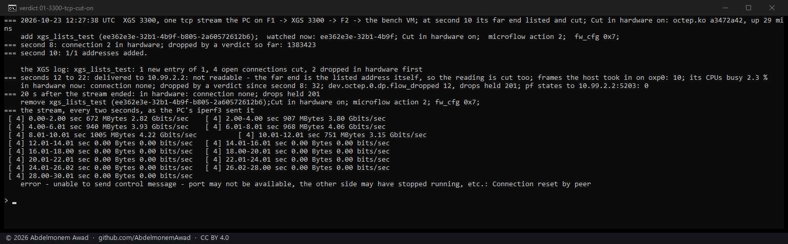

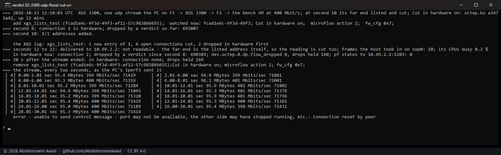

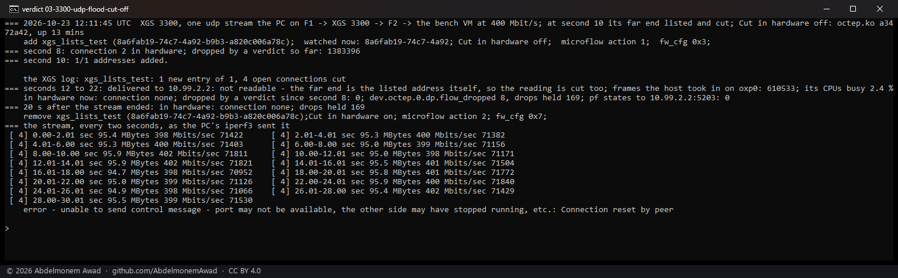

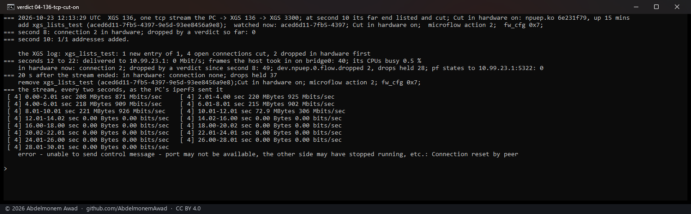

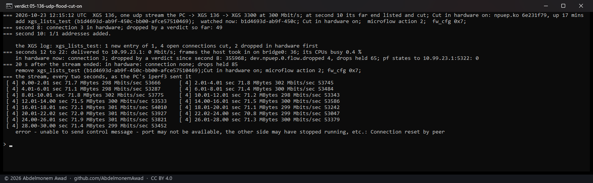

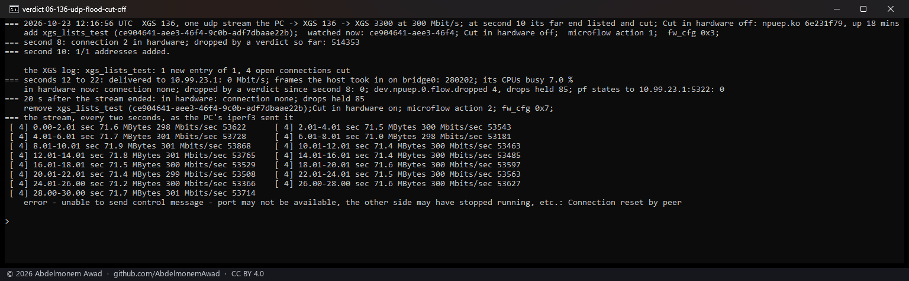

## The verdict alone

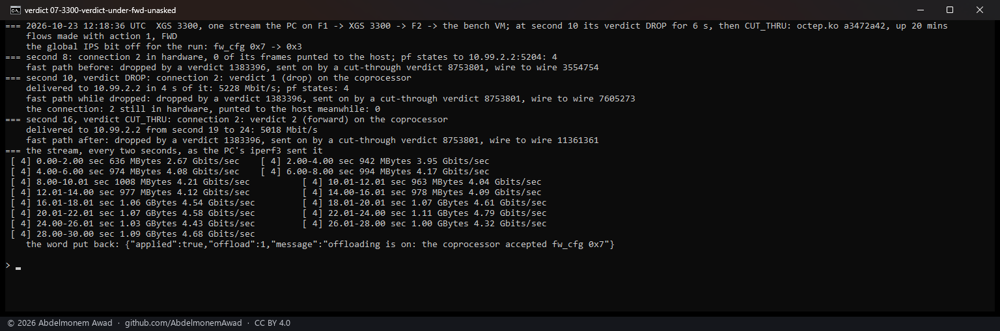

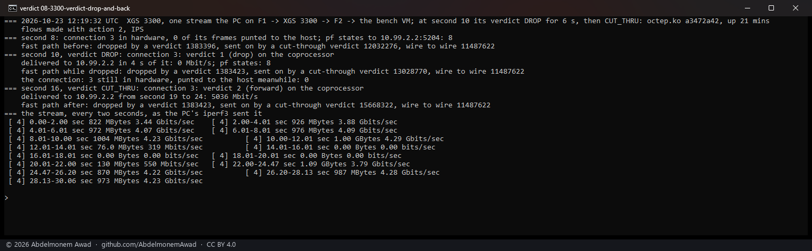

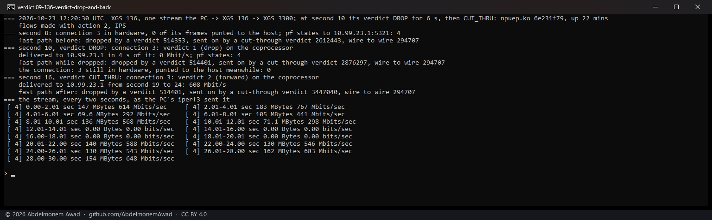

## The cost

| | flows | delivered | the host's CPUs | streams that finished |
|---|---|---|---|---|
| XGS 3300 | FWD, the switch off | 8,011 Mbit/s | 14.4 % | 640 of 1,024 |
| XGS 3300 | IPS, the switch on | 7,371 Mbit/s | 14.9 % | 1,024 of 1,024 |
| XGS 136 | FWD, the switch off | 1,000 Mbit/s | 0.3 % | 1,024 of 1,024 |
| XGS 136 | IPS, the switch on | 1,000 Mbit/s | 7.6 % | 1,024 of 1,024 |

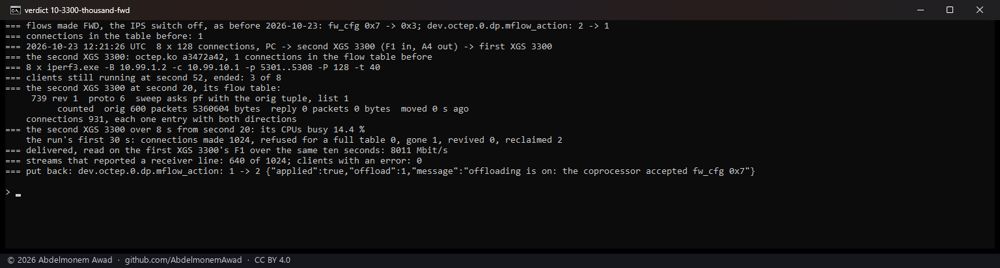

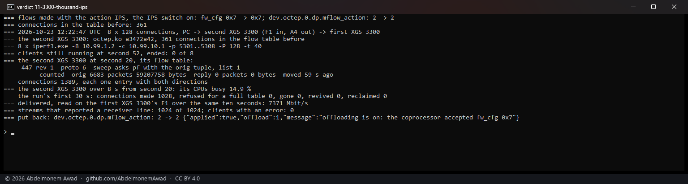

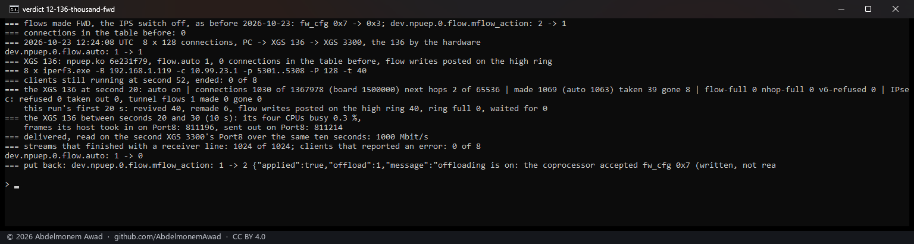

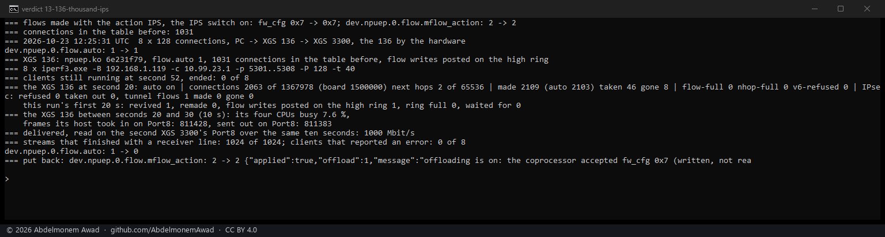

One run each is not a difference, and these are not the only runs: over the day the XGS 3300 ran
7,692 to 8,012 Mbit/s with FWD (six runs) and 7,371 to 8,086 with IPS (eight), its CPUs 13.8 to
17.0 % either way but for the first FWD run's 21.6; the XGS 136 ran 995 to 1,000 Mbit/s with both,
its CPUs 0.3 to 7.3 % with FWD and 0.7 and 7.6 % with IPS. Its 7.6 % began with the last run's
1,031 connections still in its table to be taken out, and its 0.3 % with none. What the runs show is
that a thousand connections fill the link the same either way.

## What it found on the way

**The thousand-connection run itself fails often, whichever the flows are made.** Some clients
could not open a stream - "unable to connect stream: Connection timed out" - or did not finish, on
both families and with FWD as often as with IPS: on the XGS 3300 four of six FWD runs and three of
eight IPS runs lost clients, on the XGS 136 two of four FWD runs and one of two IPS runs. Tracked in
[695](https://github.com/AbdelmonemAwad/os-xgs-npu/issues/695); it is not this change. **2026-10-27:** it is the bench, not the appliance - the
servers' host kept a lost connection's four-tuple in TIME_WAIT from the run before, and dropped its
SYN unanswered; runs started after that drained lost nothing
([many-connections-time-wait-2026-10-27.md](many-connections-time-wait-2026-10-27.md)).

**`lab-136-many.sh` leaves the XGS 136's flow maker off at its end** - it was written for a run that
needed it off. The runs here put it back as they found it.

## What it does not do yet

- A tunnel's connections are made FWD, so a cut takes them out as before.
- A connection made before the setting was turned on keeps the action it was made with: DROP changes
  nothing for it, and the pf kill cuts it.
- "Send to IPS", the third verdict, hands a connection's frames to an inspector on a virtual
  function. Nothing here uses it; it is where Suricata and the offload would meet
  ([the discovery](../findings/discoveries-2026-10-22.md#inspection-then-hardware)).
