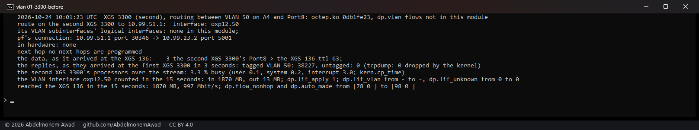
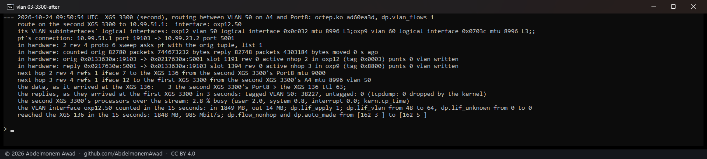
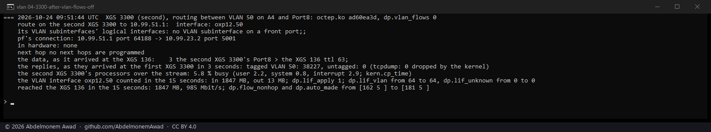
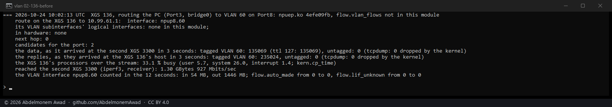
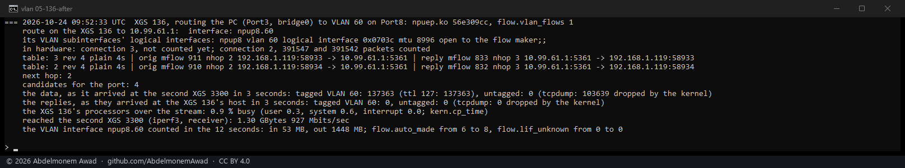
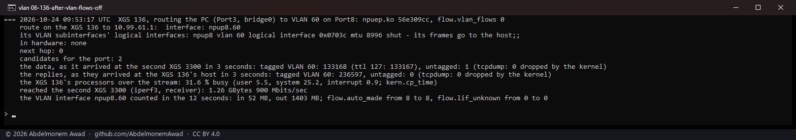

<!-- reviewed: 2026-10-24 -->
# VLAN connections in hardware, measured on the XGS 3300 and the XGS 136, 2026-10-24

Discovery 10 of [the discoveries](../findings/discoveries-2026-10-22.md#vlan-interfaces), taken from
the source to a product. The coprocessor's logical interface is a port and a VLAN together -
`(iface_id << 12) | vlan` - and each driver made only each port's VLAN 0. A tagged frame found no
entry, and the fast path handed it to the host without a lookup
(`FROM_WIRE_TO_KN_LIF_UNKNOWN_VLAN_L3_MODE`): **every connection by a VLAN subinterface crossed the
host, on both appliances**. Both drivers now give each VLAN subinterface of a front port its own
logical interface, name the VLAN in a next hop, and have the microflow write the tag
(`OCTEP_BRCTL_ROUTED_VLAN`, `NPURPC_BRCTL_ROUTED_VLAN`: the routed bridge control with its VLAN bit) -
added where a direction leaves by a VLAN, taken off where it arrives by one and leaves by a plain
port. A connection routed by a VLAN is now made in hardware like any other.

The MACs in the photographs are named, not printed: a MAC identifies one unit, so the lab's tools
print whose it is (`the second XGS 3300's Port8`, `the XGS 136`, ...).

## On the XGS 3300

VLAN 50 made at run time on the 10G link at both ends - the first XGS 3300's `oxp0.50` and the
second's A4, `oxp12.50`, one subnet between them - and the XGS 136 reached through the second XGS 3300's
Port8, untagged. A 15-second TCP stream from the first XGS 3300 to the XGS 136, which the second XGS
3300 routes from its VLAN to its plain port, at 9,000-byte frames. Read on the second XGS 3300 - pf's
connection, the driver's entry for it and the next hops it names, its VLAN interface's counters and
its processors (`kern.cp_time` across the stream) - and at both ends with tcpdump: the data as it
arrives at the XGS 136, the replies as they arrive back at the first XGS 3300, counted tagged and
untagged. Before the change with octep.ko `0db1fe23`; after it with `ad60ea3d`
(`images/deploy/lab-vlan.sh`).

| | in hardware | the replies at the first XGS 3300, 3 seconds | the second XGS 3300's processors | reached the XGS 136 |
|---|---|---|---|---|
| before | **none**: the host routed every frame, `dp.flow_nonhop` up 20 | 38,227 tagged, 0 untagged | 3.3 % busy, interrupts 3.0 | 997 Mbit/s |
| after | **both directions**, each marked `vlan written`; the reply's next hop leaves by VLAN 50; 0 punts | 38,227 tagged, 0 untagged | 2.8 % busy, interrupts 0.0 | 985 Mbit/s |
| after, `dp.vlan_flows 0` | none: the VLAN's entry switched off, the host routes it | 38,227 tagged, 0 untagged | 5.8 % busy, interrupts 2.9 | 985 Mbit/s |

The data arrived at the XGS 136 untagged, from the second XGS 3300's Port8 with its TTL at 63 - the
tag taken off, the MACs rewritten and the TTL lowered by the coprocessor, as the host had done before.
The same counts every run, because the 1G link to the XGS 136 is full: 38,227 acknowledgements in
three seconds is the rate at which the stream sends them. Two runs before the photographs, in the log
(`measurements/vlan-2026-10-24.log`), put the second XGS 3300 at 0.4 and 0.5 % busy with the
connection in hardware and at 3.4 and 5.6 % with it in the host; in each, the interrupts were all of
the difference - 0.0 against 2.9.

## On the XGS 136

VLAN 60 made at run time on the 1G link at both ends - the XGS 136's Port8, `npup8.60`, and the
second XGS 3300's Port8, `oxp9.60`, one subnet between them, the second XGS 3300 running the iperf3
server. The bench PC,
on the XGS 136's Port3 in its LAN bridge, sends a 12-second iperf3 stream to the second XGS 3300,
which the XGS 136 routes from its LAN into the VLAN, at 1,500-byte frames. Read on the XGS 136 - the
driver's table, its candidates, its VLAN interface's counters, its processors, and with tcpdump how
many of the replies reached its host - and at the second XGS 3300 the data as it arrives, tagged and
untagged, with its TTL. Before the change with npuep.ko `4efe09fb`; after it with `56e309cc`
(`images/deploy/lab-vlan-136.sh`).

| | in hardware | the data at the second XGS 3300, 3 seconds | the replies at the XGS 136's host, 3 seconds | the XGS 136's processors | iperf3, receiver |
|---|---|---|---|---|---|
| before | **none** | 135,069 tagged, TTL 127; 0 untagged | **235,024** | **33.1 % busy**, system 26.0 | 927 Mbit/s |
| after | **both of iperf3's connections**, each marked `vlan written` - 391,547 and 391,542 packets counted in the first five seconds | 137,363 tagged, TTL 127; 0 untagged | **0** | **0.9 % busy** | 927 Mbit/s |
| after, `flow.vlan_flows 0` | none: the VLAN's entry shut | 133,168 tagged, TTL 127; 1 counted untagged | 236,597 | 31.6 % busy | 900 Mbit/s |

Three runs of each in the log put the XGS 136 at 0.9 to 1.7 % busy with the connection in hardware
and at 31.6 to 39.2 % with it in the host; the stream filled the link either way, so its speed is not
where the difference is. In the run after the change, the second XGS 3300's tcpdump dropped 103,639
frames, so its 137,363 is what it counted, not every frame; the one frame counted untagged with the
switch at 0 came by the host's path, not the coprocessor's, and the three other runs with the switch
at 0 counted none.

## How it is made

- **The VLAN's logical interface.** Each driver collects every vlan(4) interface whose parent is a
  front port and makes its entry, `(iface_id << 12) | vlan`, with the VLAN interface's MAC and MTU -
  L3 on the XGS 3300, L2 on the XGS 136 as its ports' own entries are - with the full mask; a full
  add of an entry that is still there is refused with rc 1, so it is repeated every 30 seconds as the
  check (`dp.vlan_lif_table`, `flow.vlan_lif_table`; [lif-provisioning.md](../octep/lif-provisioning.md#f-a-vlan-subinterfaces-own-entry-discovery-10-2026-10-24)).
- **The candidate keeps its tag.** A punted frame's VLAN is read with its tuple - the XGS 136's
  receive path now parses a tagged frame at all - so a tagged connection is seen, and one whose frames
  are addressed to the host is a VLAN subinterface's, routed.
- **The next hop names the VLAN.** A route out of a VLAN subinterface of a front port resolves to that
  port and that VLAN, with the VLAN interface's MAC and MTU; the next hop carries it, and two next hops
  differing only by VLAN are two entries.
- **The microflow writes it.** A direction that arrives tagged or leaves by a VLAN gets the routed
  bridge control with its VLAN bit: measured, with the next hop's VLAN 50 the coprocessor added the
  tag, and with VLAN 0 it took the arriving tag off.

## Switched off, not cut off

~~An entry is switched off, never removed: there is no command that removes one.~~ An entry is
switched off, not removed. A command does remove one - `LIF_DELETE` (4), measured on the XGS 136 on
2026-10-24 ([an interface entry removed](lif-delete-2026-10-24.md)) - but what a removed entry does
with its frames is not measured, and the off switch below is. It is switched off
with `offload_disabled`, which hands its frames to the host. **The first build switched it off with
`admin_disabled`, and that cut the VLAN dead**: with `dp.vlan_flows 0`, a TCP connection across VLAN
50 moved 0 bytes, where the same connection with `offload_disabled` went on through the host at 997
Mbit/s - the drop the XGS 136's notes record for `admin_disabled`, seen on this family. Found before
the change was published, and the reason the off switch is measured above.

## The VLAN's counters

The coprocessor sends the counts of what it forwarded for each logical interface, a VLAN's among
them. Until the change it had no VLAN's to send; with the first build it did, and the driver dropped
them (`dp.lif_unknown` 16 in a run). Each driver now gives a VLAN's counts to its port, which carried
the frames, and to the VLAN interface, as the host counts a tagged frame it forwards on both - with
`dp.lif_apply` or `flow.lif_apply` 1, the default (`dp.lif_vlan`, `flow.lif_vlan`). Measured on the
XGS 3300: `oxp12.50` counted 1,849 MB in for the 1,848 MB that reached the XGS 136, with the
connection in hardware.

## What stays with the host

These are the driver's rules, not measured here:

- a bridge over a VLAN subinterface - a VLAN interface that is a bridge member gets no entry, and its
  frames reach the host's bridge as before;
- a tunnel whose far end is reached by a VLAN, and a tunnelled connection that arrives or leaves by
  one: the engine builds the ESP frame for the port itself, and a tag on it is untried;
- every VLAN's connection while `dp.vlan_flows` or `flow.vlan_flows` is 0.

## On the page

XGS: Flows marks such a connection **VLAN** in its Connection column, its tooltip saying the
coprocessor writes its tag. `flows.py` reads the mark from both drivers' tables: the XGS 3300's ends a
microflow's line with `vlan written`, the XGS 136's prints a line of its own under the connection's.
Read on both appliances through the configd action the page uses, with the connections above in
hardware: each marked `vlan`, the XGS 3300's one and both of the XGS 136's; the page compiled on both.

## The instruments

- `dev.octep.0.dp.vlan_flows` and `dev.npuep.0.flow.vlan_flows`: 1, the default, makes connections
  routed by a VLAN subinterface; 0 switches every VLAN's entry off and leaves them to the host.
- `dp.vlan_lif_table`, `flow.vlan_lif_table`: each VLAN's entry, its index, MTU and mode; and their
  counts - made, made again, changed or switched off, failed.
- `dp.flow_vlan` and `flow.vlan`: connections made with a VLAN on either side; `flow.vlan_kept`:
  attempts left to the host.
- The driver's tables (`dp.flow_table`, `flow.flows`) mark each such connection `vlan written`, and
  the next hops the VLAN they leave by.
