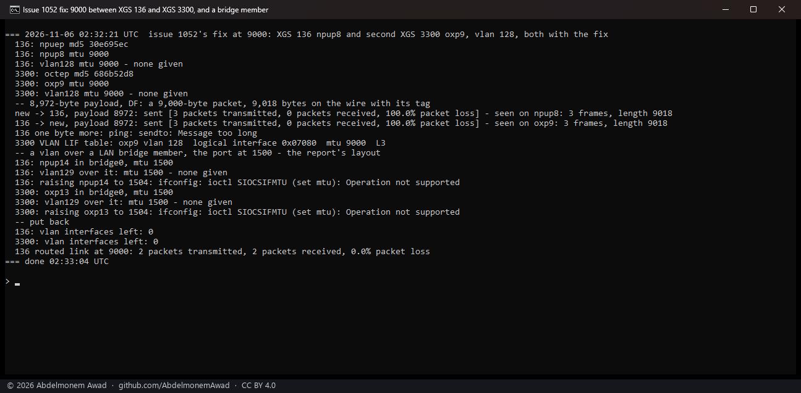
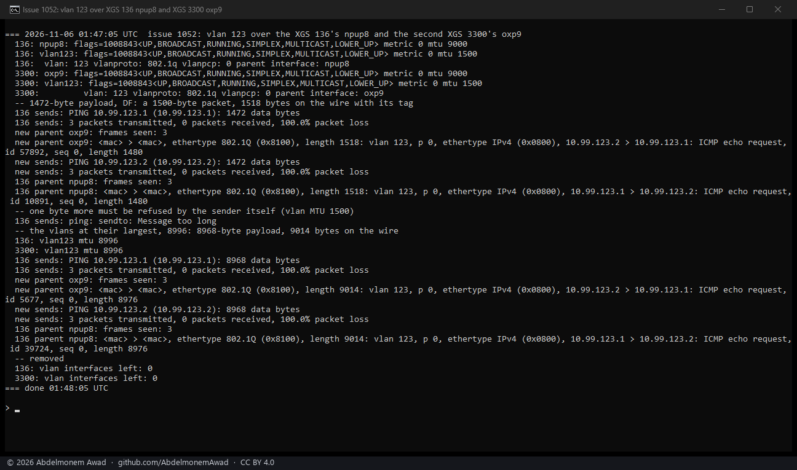
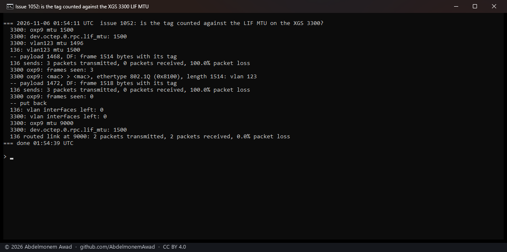
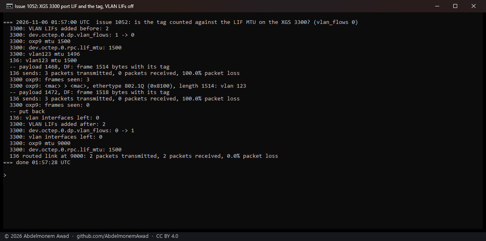
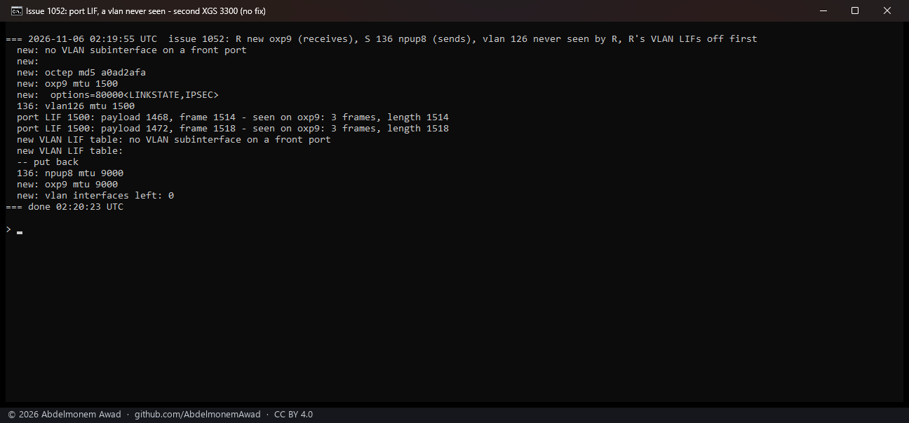
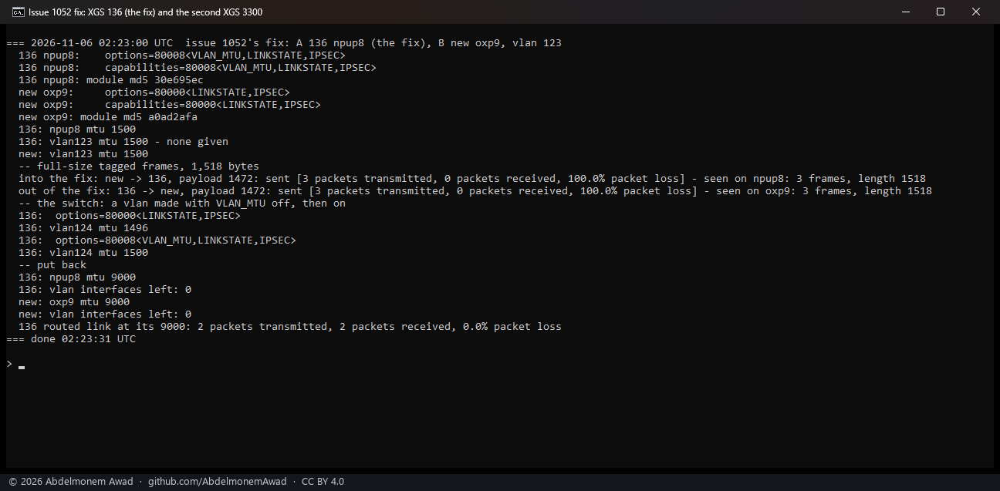
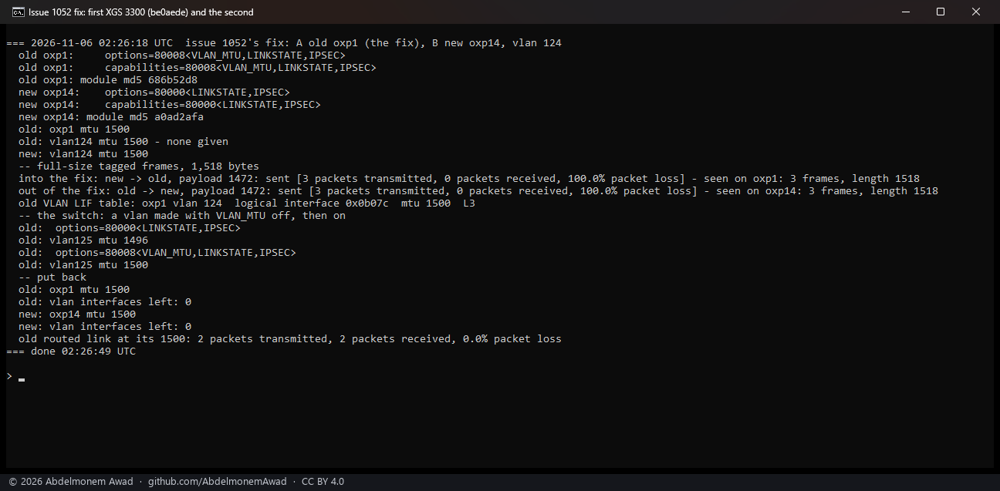
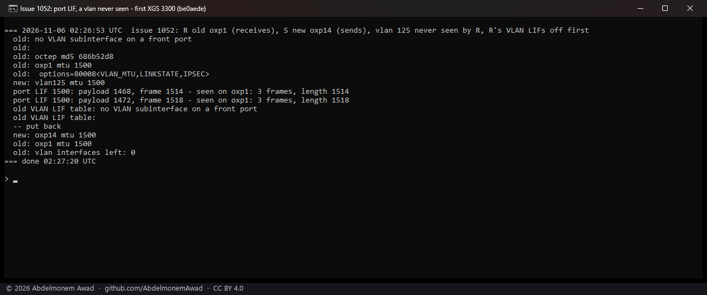
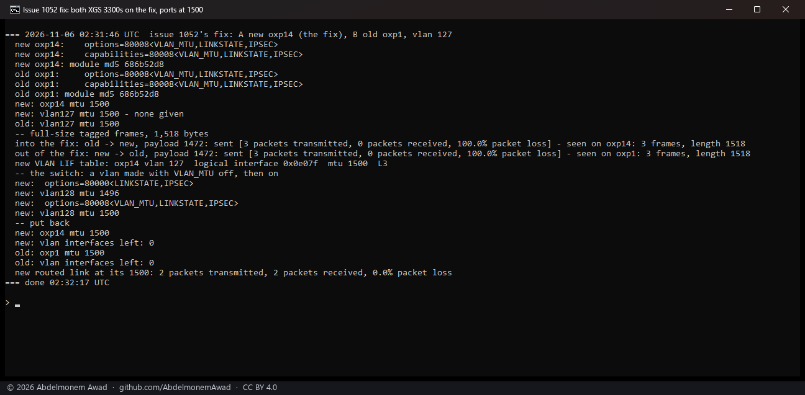

<!-- reviewed: 2026-11-06 -->
# A vlan's whole MTU over a front port, on the XGS 136 and both XGS 3300s, 2026-11-06

[1052](https://github.com/AbdelmonemAwad/os-xgs-npu/issues/1052): on an XGS 136 running
v0.1.0-alpha.12, four vlan(4) interfaces over the front port `npup8` took an MTU of 1,496, not 1,500;
`ifconfig npup8 mtu 1504` was refused with "Operation not supported", `vlanmtu` changed nothing, and a
TLS handshake whose first segment was full-size stalled. Measured on the lab on 2026-11-06 (UTC): the
port's refusal is FreeBSD's for a member of a bridge, not the driver's; the coprocessors of both
families carry a tagged frame of 1,518 bytes, and of 9,018; and the four bytes went because neither
driver offered VLAN_MTU. **With VLAN_MTU on every front port, a vlan over a port of 1,500 takes 1,500,
and its full-size frames cross both ways** - on the XGS 136 and on both XGS 3300s, at 1,500 and at
9,000.

## The bench

- The XGS 136 (vendor version 21), Port8 `npup8`, to the second XGS 3300 (vendor version 22), Port8
  `oxp9`, 1G copper; the first XGS 3300 (vendor version 23), F2 `oxp1`, to the second's A2 `oxp14`,
  10G.
- Modules: before, v0.1.0-alpha.14's (npuep `147248cf`, octep `a0ad2afa`); with the fix, npuep
  `30e695ec` and octep `686b52d8`, each built on its appliance by the fix's own `install/install.sh`
  (the XGS 136's from the fix's first commit; the second touched octep alone).
- Each run made a vlan on both ends of one cable, a /30 on it and static ARP both ways, sent DF pings,
  and counted the frames on the receiving end's port with `tcpdump -e` - before pf, whose default
  block drops the echo on an unassigned vlan, so no reply comes back: the frame is what is measured.
  Everything made was removed after, and nothing was written to `config.xml`.

## Before the fix

### The port's refusal is FreeBSD's, for a bridge member

`ifconfig npup14 mtu 1504` on a member of the XGS 136's LAN bridge, and `ifconfig oxp13 mtu 1504` on
a member of the XGS 3300's, both answer *Operation not supported* - the report's words - while
`npup8` and `oxp9`, outside any bridge, run at 9,000. FreeBSD refuses an MTU change on a bridge member
before a driver is asked; the drivers' own handlers take 46 to 9,220 bytes (npuep, from its buffers)
and 72 to 9,000 (octep). The first boot puts every front port but the WAN in the LAN bridge, so a
trunk port left there keeps 1,500.

### Both coprocessors carry the longer frame

From the XGS 136 to the second XGS 3300 and back, both ports at 9,000, before any change:

| tagged frame | the vlans | 136 to 3300 | 3300 to 136 |
|---|---|---|---|
| 1,518 bytes (an IP packet of 1,500) | 1,500 | 3 of 3 | 3 of 3 |
| 9,014 bytes (8,996) | 8,996, the most a vlan took | 3 of 3 | 3 of 3 |

### Why 1,496

Neither driver offered VLAN_MTU (`capabilities=80000<LINKSTATE,IPSEC>` on both families), and vlan(4)
gives a vlan over a port without it the port's MTU less its tag.

### On the XGS 3300, a VLAN's own LIF holds the vlan's MTU

octep gives a vlan over a front port a logical interface of its own in the coprocessor
(`octep_dp_vlan_lifs`; section F of [the LIF page](../octep/lif-provisioning.md)),
made with the vlan's MTU. The second XGS 3300's `oxp9` at 1,500, tagged frames sent to it:

| the VLAN's LIF in the coprocessor's table | tagged 1,514 | tagged 1,518 | photo |
|---|---|---|---|
| switched on, MTU 1,496 - the vlan's | 3 of 3 | 0 of 3 | 02 |
| switched off with `dp.vlan_flows=0`, still holding 1,496 | 3 of 3 | 0 of 3 | 03 |
| none: a VLAN id the box had never seen, VLAN LIFs off before it was made | 3 of 3 | 3 of 3 | 06 |

A tagged frame is held to its VLAN's LIF, the tag left out; with no VLAN LIF, the port's LIF of 1,500
let the tagged 1,518 through. So on this family the vlan's four missing bytes reached the coprocessor
as well. A first reading of 02 and 03 blamed the port's LIF; 06 told the two apart, and a first build
that gave the port's LIF four bytes more was withdrawn before any of the runs below.

## The fix

Both drivers offer and enable `IFCAP_VLAN_MTU` on every front port, and `ifconfig npupN -vlanmtu` or
`oxpN -vlanmtu` turns it off: a vlan configured over the port takes the port's whole MTU, its tag on
top, and the tag stays software's (no VLAN_HWTAGGING). npuep's MTU bound now leaves room in a buffer
for the Ethernet header and a tag. Nothing else moves: on the XGS 3300 the VLAN's LIF takes the vlan's
MTU, which is now the port's.

## With the fix

| ends of the cable | ports | a vlan, no MTU given | tagged frames, each way | the switch | photo |
|---|---|---|---|---|---|
| XGS 136 (fix) and second XGS 3300 | `npup8` 1,500, `oxp9` 9,000 | 1,500 | 1,518: 3 of 3, 3 of 3 | off: a new vlan 1,496; on: 1,500 | 07 |
| first XGS 3300 (fix) and second | `oxp1` 1,500, `oxp14` 9,000 | 1,500, its VLAN LIF 1,500 | 1,518: 3 of 3, 3 of 3 | 1,496, 1,500 | 08 |
| first XGS 3300 (fix): a VLAN id never seen, VLAN LIFs off | `oxp1` 1,500 | - | 1,514 and 1,518 in: 3 of 3 each | - | 09 |
| both XGS 3300s (fix) | `oxp14`, `oxp1` both 1,500 | 1,500, its VLAN LIF 1,500 | 1,518: 3 of 3, 3 of 3 | 1,496, 1,500 | 10 |
| XGS 136 and second XGS 3300 (both fix) | both 9,000 | 9,000, its VLAN LIF 9,000 | 9,018: 3 of 3, 3 of 3; one byte more refused by the sender | - | 11 |
| a LAN bridge member, each family (fix) | 1,500, raising it refused | 1,500 | - | - | 11 |

After each appliance booted with the fix, `install/verify.sh` passed 13 checks on the XGS 136 and 8 on
each XGS 3300, none failed; every routed lab link answered a full-size frame after each run.

## Not measured

- Traffic that answers: a TCP connection or a TLS handshake through such a vlan end to end. The runs
  count frames; pf held the replies on the unassigned vlans.
- The reporter's appliance, and the XGS 116, 126 and 3100 families' own boards - the same two drivers.
- A tagged frame longer than its VLAN's LIF on the XGS 136's coprocessor (the XGS 3300's case above).
