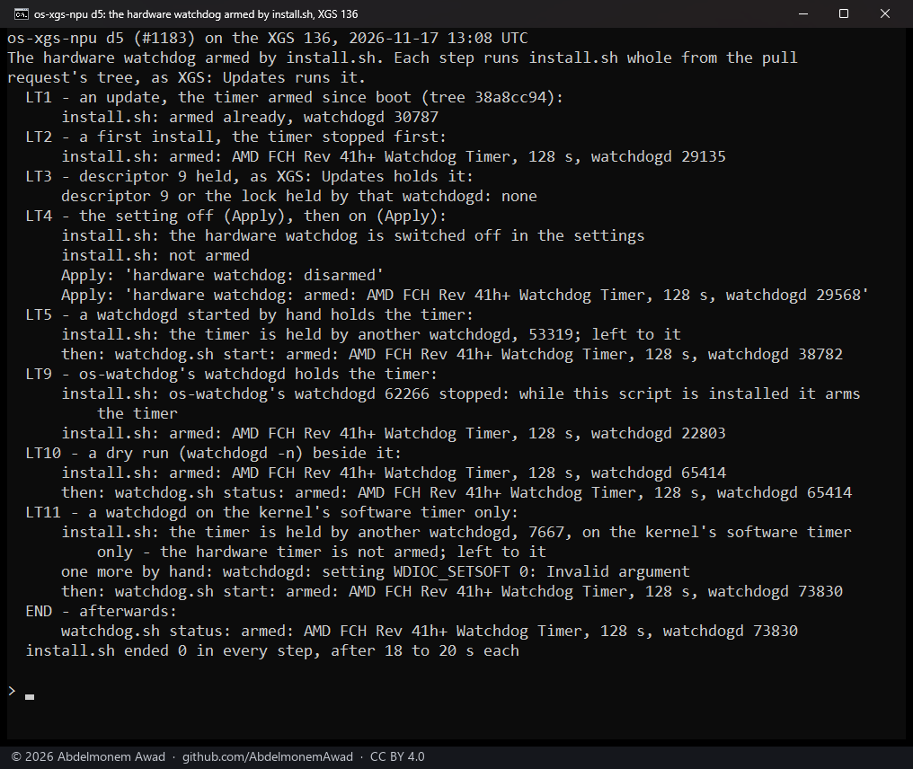

<!-- reviewed: 2026-11-17 -->
<!-- board: watchdog at install | XGS 136 | armed by install.sh -->
# The hardware watchdog armed by install.sh. Tried, 2026-11-17

The appliance's hardware watchdog is on by default (XGS: Settings, Hardware watchdog, since
2026-10-17). Until this, a first install left the timer unarmed until the next boot. Now
`install/install.sh` arms it at once, unless a watchdogd already holds it, and says which of these
happened under "== hardware watchdog ==" ([#1183](https://github.com/AbdelmonemAwad/os-xgs-npu/pull/1183)).

## How it was tried

On the XGS 136 (OPNsense 26.7.9), at 13:08 UTC, from a copy of the pull request's tree - 38a8cc94; its
commits after it change documentation only - `install.sh` was run whole in each step, as XGS: Updates
runs it. Before each step the timer was put in the state the step names:

- **LT1** an update: the timer armed since boot;
- **LT2** a first install: the timer stopped first;
- **LT3** descriptor 9 held, as XGS: Updates holds it while it runs the installer;
- **LT4** the setting off and Applied, then on and Applied;
- **LT5** a watchdogd started by hand holds the timer;
- **LT9** os-watchdog's watchdogd, started as that plugin starts it, holds the timer;
- **LT10** a dry run (`watchdogd -n`) beside it;
- **LT11** a watchdogd on the kernel's software timer only.

## What came of it

- **LT1** "armed already": the watchdogd that held the timer since boot ran on.
- **LT2** "armed: AMD FCH Rev 41h+ Watchdog Timer, 128 s": the timer armed at once, before any reboot.
- **LT3** armed, and the watchdogd `install.sh` started holds neither descriptor 9 nor the lock, so
  XGS: Updates does not wait on it.
- **LT4** with the setting off: "the hardware watchdog is switched off in the settings", "not armed";
  Apply disarmed the timer, and Apply with the setting on armed it again.
- **LT5** "the timer is held by another watchdogd, ...; left to it"; once that one stopped,
  `watchdog.sh start` armed the timer.
- **LT9** os-watchdog's watchdogd was stopped ("while this script is installed it arms the timer"),
  and the timer armed.
- **LT10** armed; the dry run beside it was not counted as holding the timer.
- **LT11** "the timer is held by another watchdogd, ..., on the kernel's software timer only - the
  hardware timer is not armed; left to it". One more watchdogd by hand was refused by the kernel
  (`setting WDIOC_SETSOFT 0: Invalid argument`); once the first stopped, `watchdog.sh start` armed
  the timer.
- Afterwards the timer was armed, 128 s. `install.sh` ended 0 in every step, after 18 to 20 s each.

The same steps ran on the second XGS 3300 that morning, 09:43-09:46 UTC, with the same outcome. After
a reboot of each appliance the stop hook had disarmed the timer and the start hook armed it again.
Those runs are in the pull request's notes, not photographed.
