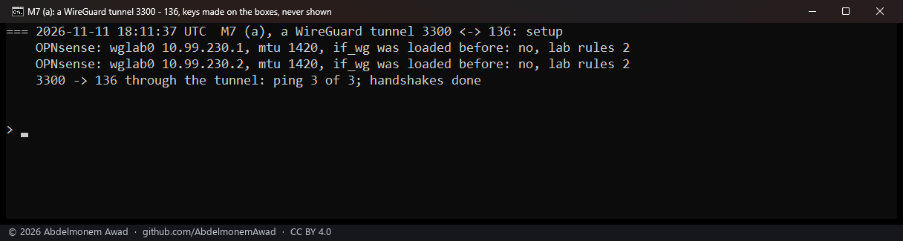
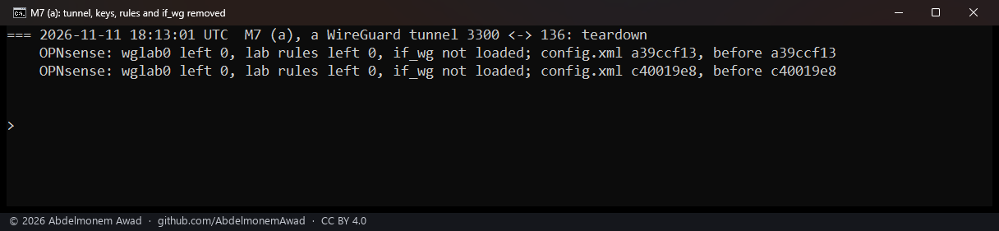
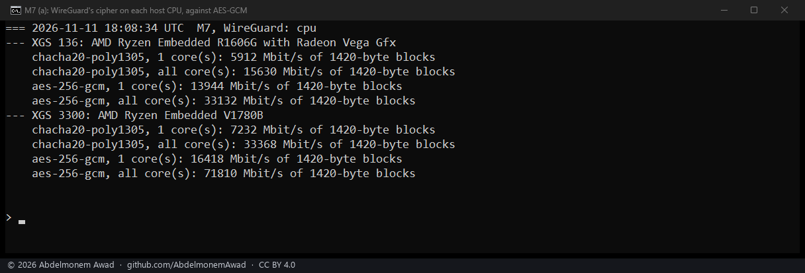
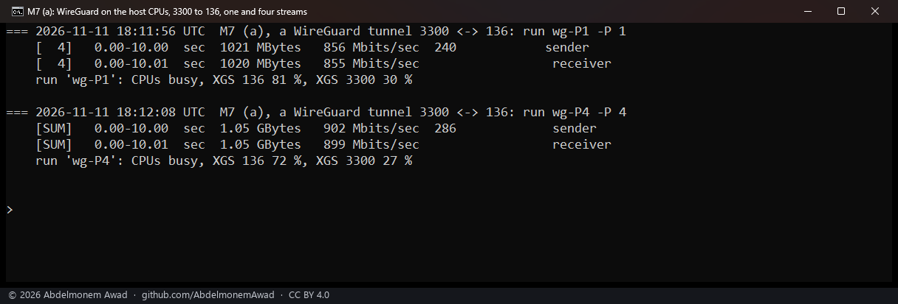
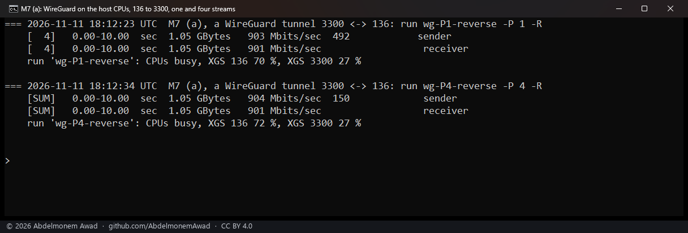
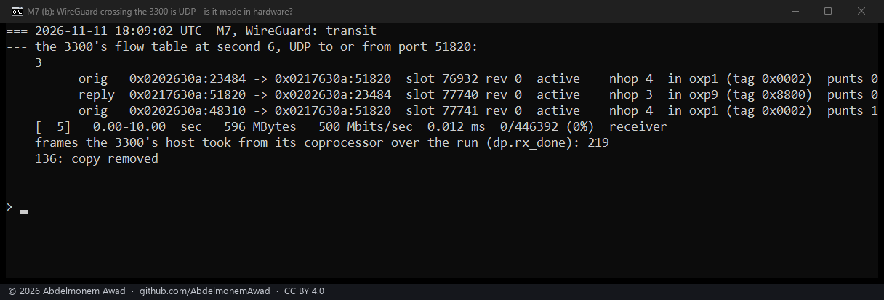

<!-- reviewed: 2026-11-11 -->
# WireGuard on XGS 136 and XGS 3300: 855 to 901 Mbit/s on host CPUs, and UDP to its port carried in hardware across, 2026-11-11

Neither coprocessor can encrypt for WireGuard. Its cipher, ChaCha20-Poly1305, was given to every engine as an
experiment on 2026-10-25, and every engine took the association and then dropped every frame of it
([the measurement](cipher-2026-10-25.md#chacha20-poly1305-refused-by-the-datapath-on-all-three-versions)). On
2026-11-10 both coprocessors' own kernels listed ChaCha20 only in software (its generic and NEON
implementations), Poly1305 not at all, and no engine driver (`/proc/crypto`). So a WireGuard tunnel that ends on
the appliance runs on the host's CPU. How fast, and at what cost? And WireGuard that only crosses the appliance
is UDP to it: is that carried in hardware?

## How it was measured

2026-11-11 from 18:08 to 18:13 UTC: the XGS 136 (vendor version 21, AMD Ryzen Embedded R1606G, npuep.ko
`ad3b1480`) and the second XGS 3300 (vendor version 22, AMD Ryzen Embedded V1780B, octep.ko `861b8b50`).

- **The cipher on each host**: `openssl speed -evp` for ChaCha20-Poly1305 and, beside it, AES-256-GCM, on
  1,420-byte blocks for 3 seconds, on one core and on all of them (`-multi`).
- **A WireGuard tunnel between the two hosts**, over their gigabit Port8 link (10.99.23.x, the two ends, UDP
  port 51821), tunnel addresses 10.99.230.x, the two ends, MTU 1420. Made for the runs from the command line
  with FreeBSD's `if_wg`, which was not loaded before, and two pass rules added to each host's loaded rule set;
  not on OPNsense's WireGuard pages. Taken away after: no tunnel interface or rule left, `if_wg` unloaded,
  `config.xml` unchanged on both.
- **Through it**: iperf3 between the two hosts, 10 seconds a run, one TCP stream and four, each way; both hosts'
  CPUs busy over each run (`kern.cp_time`).
- **WireGuard crossing an appliance**: UDP to port 51820, the port WireGuard is usually given, at 500 Mbit/s in
  1,400-byte datagrams for 10 seconds, from a virtual machine behind the XGS 3300's F2 (10.99.2.x) to the XGS 136
  behind its Port8 (10.99.23.x). Read on the XGS 3300: its flow table at second 6, and the frames its host took
  from the coprocessor over the run (`dev.octep.0.dp.rx_done`).

## Results

| Cipher in user space (openssl) | ChaCha20-Poly1305, one core | all cores | AES-256-GCM, one core | all cores |
|---|---|---|---|---|
| XGS 136 (R1606G) | 5,912 Mbit/s | 15,630 Mbit/s | 13,944 Mbit/s | 33,132 Mbit/s |
| XGS 3300 (V1780B) | 7,232 Mbit/s | 33,368 Mbit/s | 16,418 Mbit/s | 71,810 Mbit/s |

| Through the tunnel | Streams | Received | XGS 136 CPUs busy | XGS 3300 CPUs busy |
|---|---|---|---|---|
| XGS 3300 to XGS 136 | 1 | 855 Mbit/s | 81 % | 30 % |
| XGS 3300 to XGS 136 | 4 | 899 Mbit/s | 72 % | 27 % |
| XGS 136 to XGS 3300 | 1 | 901 Mbit/s | 70 % | 27 % |
| XGS 136 to XGS 3300 | 4 | 901 Mbit/s | 72 % | 27 % |

- **WireGuard runs near the gigabit link's rate, both ways**: 855 to 901 Mbit/s.
- **It takes most of the XGS 136's CPUs**: 70 to 81 % busy, the XGS 3300's 27 to 30 %. Each host was also an
  end of the stream, so the figures include iperf3 and TCP.
- **IPsec in the engines costs the XGS 136 far less on the same link**: the same day, UDP into it through the
  tunnel in 1,400-byte datagrams, packets of about the size of these, arrived at 893 Mbit/s with its CPUs 20 %
  busy ([the IPsec measurement](ipsec-directions-2026-11-11.md)).
- **The cipher alone is fast on both hosts**: in user space ChaCha20-Poly1305 ran at 5,912 Mbit/s on one core
  of the XGS 136 and 7,232 on one of the XGS 3300's, AES-256-GCM at more than twice that.
- **UDP to WireGuard's port, crossing the appliance, is carried in hardware**: 500 Mbit/s, none of 446,392
  datagrams lost. At second 6 the XGS 3300's flow table held entries for port 51820, `active`, the first in both
  directions, and its host took 219 frames from the coprocessor over the whole run.

## What it does not mean

- **WireGuard's own share of the CPU was not separated** from iperf3 and TCP at both ends. openssl measures the
  cipher in user space; the kernel's `if_wg` does its own, which was not measured apart.
- **Not OPNsense's own WireGuard configuration**: the tunnel was made from the command line.
- **No forwarding for machines behind the appliances**: both ends of every stream were the appliances' hosts.
- **The tunnel's MTU was WireGuard's 1420**, over a link at 9000; a larger one was not tried.
- **UDP against TCP**: the comparison with IPsec sets its UDP against WireGuard's TCP, in packets of about the
  same size. The IPsec runs' TCP used packets of about 8,900 bytes and is not comparable
  ([the IPsec measurement](ipsec-directions-2026-11-11.md)).
- **The crossing stream was UDP to port 51820, not WireGuard**, and only the XGS 3300 was crossed.
- **One run of each.**
