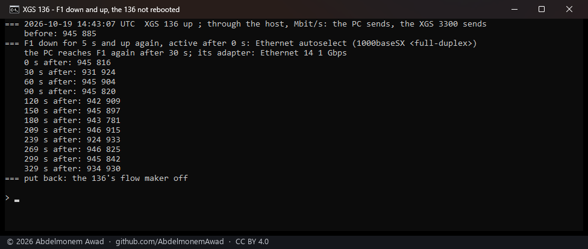
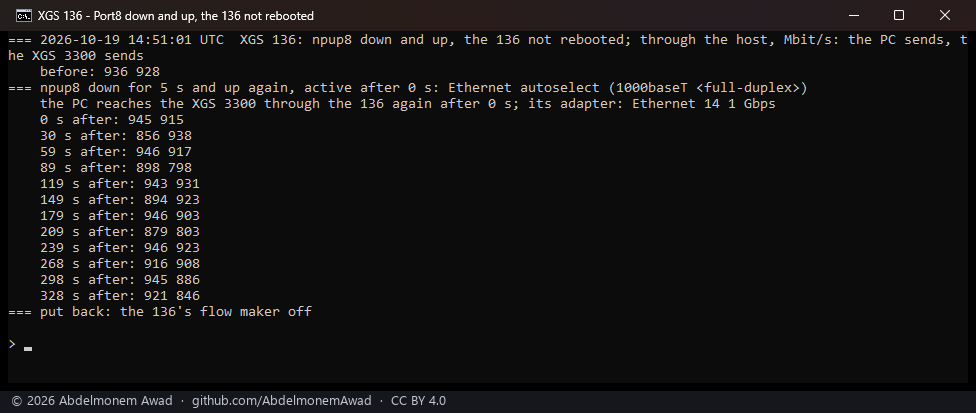
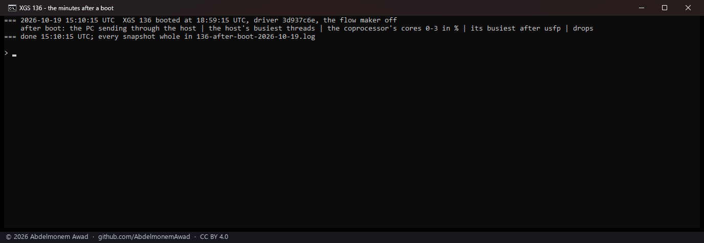
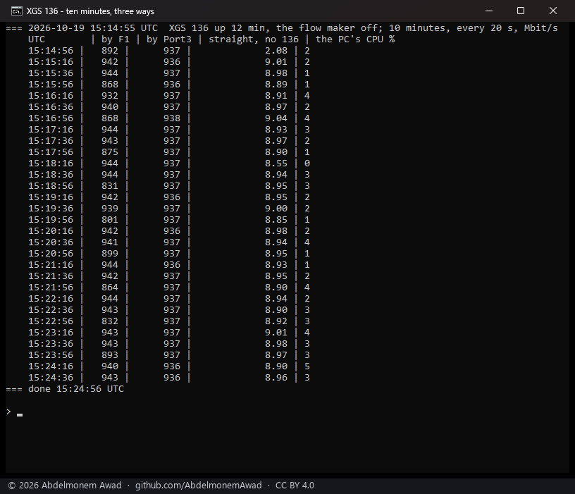
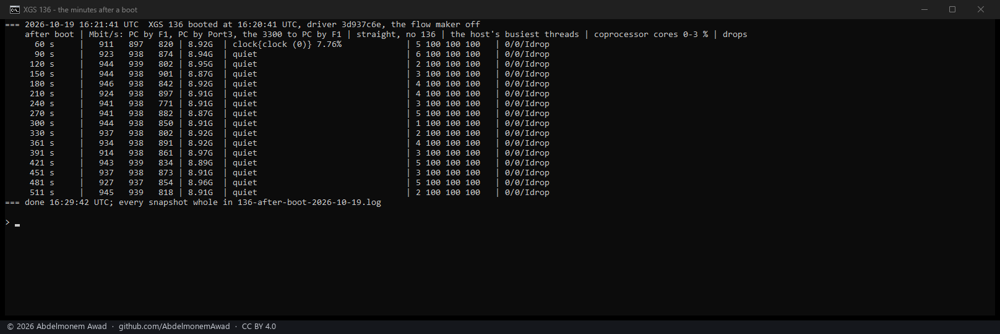

<!-- reviewed: 2026-10-19 -->
# Slow minutes on the XGS 136, looked for, 2026-10-19

Four times on 2026-10-19 a stream from the bench PC through the XGS 136 to the second XGS 3300 ran
at a quarter to a third of its speed for a short while
([#531](https://github.com/AbdelmonemAwad/os-xgs-npu/issues/531), open). This page is what was done
to find the cause, and what was found on the way. The cause has not been found: in 28 minutes of
watching and one boot watched, it did not happen again.

## What was seen

| UTC | after the 136's boot | the PC sending, by | rate | the other way, the same minute |
|---|---|---|---|---|
| 12:30 | about 2 minutes | F1, in hardware and through the host | 323 and 237 Mbit/s | 928 and 855 |
| 14:21 | about 2 minutes | F1, in hardware and through the host | 339 and 236 Mbit/s | 869 and 858 |
| 14:24 | 5 minutes | F1, through the host | 674 Mbit/s | - |
| 15:13 | 11 minutes | Port3, through the host | 235 Mbit/s | - |

- Each time a stream a minute or two later ran at its usual 930 to 945.
- The direction the XGS 3300 sent in was never slow.
- The first two are on [xgs136-giveback-2026-10-19.md](xgs136-giveback-2026-10-19.md), photographs 05
  and 08.

## What it is not

- **A link going down and up.**
  - A boot takes F1's link to the PC and Port8's to the XGS 3300 down and up. Each was taken down
    for 5 seconds and brought back, the 136 not rebooted (`images/deploy/lab-136-f1-bounce.sh`), and
    then streams both ways ran every 30 seconds for six minutes.
  - F1's showed 924 to 946 Mbit/s the PC's way from the first stream, and Port8's 856 to 946.
  - Not settled by this: `ifconfig down` on the host may not take the physical link down, so the
    PC's adapter may never have seen it go.

  

  

- **Anything the boot logs show.**
  - On the host, the start hooks are done within seconds of the boot. The switch's jumbo hook
    writes all ten ports in about 5 seconds.
  - The coprocessor's own log (`/var/log/messages`, read over the management link) ends 48 seconds
    after its start.
  - The console on COM5, listened to with a stamp on every line (`images/deploy/com-listen-stamped.ps1`,
    nothing sent), printed the whole boot and then nothing after the login prompt.

## Watching for it

1. **The first watch of a boot was lost to a fault in the script.** It took the microseconds of
   `kern.boottime` for its seconds, never recognised the boot, and waited out the minutes it was
   there for. The photograph shows a run that did nothing.

   

2. **Ten minutes, three ways, every 20 seconds.** The PC sent through the 136's F1, through its
   Port3, and straight to the XGS 3300 by its 10G port, the 136 not on the way, as a control
   (`lab-136-slow-watch.sh`). Nothing was slow:
   - F1: 801 to 944 Mbit/s;
   - Port3: 936 to 938;
   - the control: 8.55 to 9.04 Gbit/s;
   - the PC's CPU: 0 to 5%.

   

3. **A boot watched, from 60 to 511 seconds after it** (`lab-136-after-boot.sh`). Every 30 seconds:
   the PC sending by F1 and by Port3, the XGS 3300 sending to the PC, and the control. Beside them:
   - the host's busiest threads, the load of each of the coprocessor's four cores, and the driver's
     receive drops. Three of the cores are the fast path's, `usfp`, polling at 100%.

   Nothing was slow:
   - F1: 911 to 946 Mbit/s; Port3: 874 to 939; the other way: 771 to 901; the control: 8.9 Gbit/s;
   - the host: quiet; the coprocessor's free core: 1 to 6%; drops: none.

   

## Found on the way

- **Both of the 136's cages hold modules, and they are copper.** The coprocessor's log reads:
  ```
  xgs-sff-event: SFF insertion to phy8 F2 OEM SFP-GE-T
  xgs-sff-event: SFF insertion to phy9 F1 OEM SFP-GE-T
  ```
  The host reports F1's medium as `1000baseSX` because the driver takes every cage to be fibre. The
  XGS 3300's driver does the same with its cages
  ([#533](https://github.com/AbdelmonemAwad/os-xgs-npu/issues/533); since then each cage reports its
  module's medium - [measured](cage-medium-2026-10-19.md)). The 136's completion table said F1 had
  a 1000BASE-SX module and F2 none; both are corrected there.
- **The XGS 136's F1 and F2 are ports 9 and 10 of its switch**, as Port1 to Port8 are its ports 1 to
  8, not ports of the coprocessor itself; corrected on the counts page.

## Next

The slow minutes have to be caught with everything read around them. That means a long watch:
streams every 30 seconds by F1, by Port3 and by the control. Beside them the 136's host and
coprocessor, the XGS 3300's CPU (it receives every one of those streams) and the PC's. Started when
the bench is free for it.
