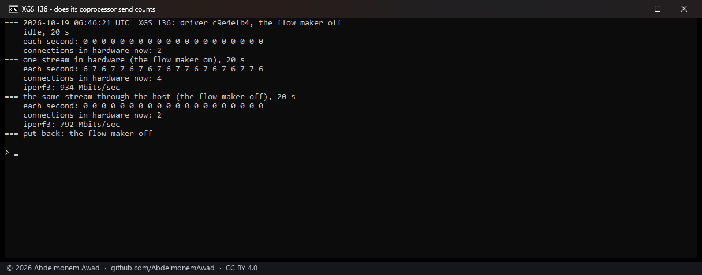
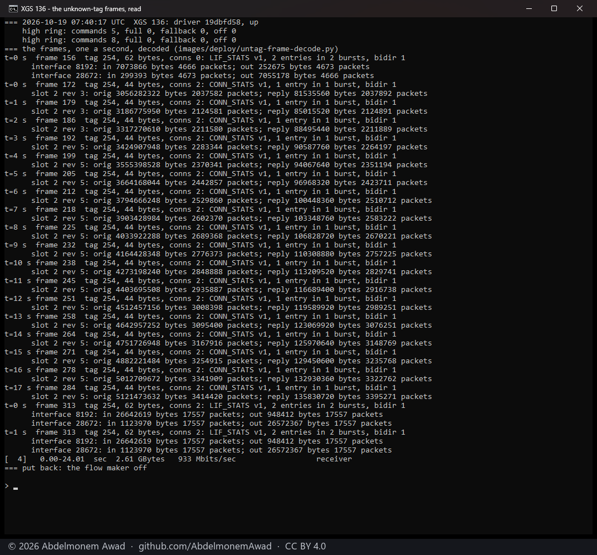

<!-- reviewed: 2026-10-19 -->
# What the XGS 136's coprocessor says about the traffic it forwards, measured, 2026-10-19

The XGS 3300's coprocessor sends the host the counts of every connection it forwards, and of every
port, as control messages on tag 254 - which the driver now reads and gives to pf and the interfaces
([hw-counters-2026-10-19.md](hw-counters-2026-10-19.md)). The XGS 136 is as blind to its own
hardware traffic as the XGS 3300 was: once a connection is in hardware, pf's state and the interface
counters stop growing. This page is the first step of the same work on the XGS 136: does its
coprocessor send such messages at all, and in what form.

**It does, in the same form.** The XGS 136's coprocessor sends `CONN_STATS` and `LIF_STATS`
messages - types 1 and 0 of the vendor's `cmsg_types.h`, version 1, EtherType 0xEFEF, on tag 254 -
laid out as the XGS 3300's, while traffic is in hardware and never otherwise. The driver frees them
unread; reading them is the next step.

## Do they come at all

The XGS 136's driver frees a frame whose tag no port claims and counts it
(`dev.npuep.0.giu.rx_untagged`). The count was read once a second through three windows of twenty
seconds (`images/deploy/lab-136-untagged.sh`, driver `c9e4efb4`):

| window | frames with an unknown tag, each second |
|---|---|
| idle | 0 in every second |
| one stream from the bench PC on Port3, through the appliance and out of Port8, in hardware (934 Mbit/s) | 6 or 7 in every second |
| the same stream through the host (the flow maker off, 792 Mbit/s) | 0 in every second |

## What they are

The driver now keeps the last such frame before freeing it: its tag, its length, the metadata and
its first 256 bytes, printed by `dev.npuep.0.giu.rx_untagged_frame` (`contrib/npuep/npugiu.c`). On
the XGS 136, rebooted onto that driver (`npuep.ko` 238,560 bytes, md5 `19dbfd58`), the frame was read
once a second through the same stream in hardware, 24 seconds of it, twice
(`images/deploy/lab-136-untagged-frame.sh`), and decoded by `images/deploy/untag-frame-decode.py`.
The photograph is the second run:

Every frame had tag 254, both MAC addresses zero, then EtherType 0xEFEF and:

- **During the stream, 44 bytes: `CONN_STATS`.** The control header (padding, type 1, version 1), one
  entry in one burst, both directions. The burst names slot 2, and the entry carries for each
  direction a u32 of bytes and a u32 of the bytes' bits 32 to 34 under the packets shifted left by
  three, then the slot's revision - eighteen bytes, as on the XGS 3300.
- **After the stream, 62 bytes: `LIF_STATS`.** Two entries in two bursts, for interfaces 8192 and
  28672, each a pair of the same counts: what came in on the interface and what went out by it.

### The numbers in them

- **Bytes are IP lengths.** At the last reading of the second run, slot 2 held 5,121,473,632 bytes in
  3,414,420 packets one way - 1,499.96 bytes a packet, the full segments - and 135,830,720 bytes in
  3,395,271 packets the other, 40.006 bytes a packet, the bare acknowledgements.
- **The connection counts are the slot's, not the connection's.** The second run's first reading
  found slot 2 already at 3,056,282,322 bytes: the first run's stream, about 2.8 GB, and three
  seconds of its own. The coprocessor does not start the counts again for a new connection in the
  slot - the same as on the XGS 3300, where taking a new connection's first message as all new was
  the mistake of [#515](https://github.com/AbdelmonemAwad/os-xgs-npu/issues/515).
- **The revision moves.** It went from 1 to 2 about three seconds into the first stream, was 3 at the
  start of the second and 5 three seconds later. What moves it during a connection was not looked
  into; a reader has to take the revision from the message, not assume one per connection.
- **The interface counts are increments.** The last `LIF_STATS` of each run held 4,666 and 17,557
  packets - a fraction of a second of a stream at 934 Mbit/s - so, as on the XGS 3300, each message
  carries what moved since the one before.
- **Which ports 8192 and 28672 are** - 0x2000 and 0x7000 - was not read anywhere. The stream came in
  on Port3 and left by Port8, which would make the number the port's less one, times 4,096; one pair
  of ports is not enough to say so.
- **About seven a second.** Between the first and the last reading of the first run, 112 messages
  arrived in 17 readings, and the slot grew by 2,066,014,116 bytes: 18.4 MB a message.

## The posted commands, with the driver's bound

The same driver bounds the clear of a command posted on the high ring to its slot
([#524](https://github.com/AbdelmonemAwad/os-xgs-npu/issues/524)). Through both streams the high ring
took the flows' commands as before: 3 posted in the first run and 3 in the second, none refused for
a full ring and none sent on the low ring instead (`dev.npuep.0.rpc_channel.hi_commands`, `hi_full`,
`hi_fallback`).

## Next

The driver reads these messages as the XGS 3300's does: each slot's last totals kept across the
connections that use it, each connection given what moved while it held the slot, those counts added
to its pf state, and the interface counts to the interfaces - and then measured against a stream of
known size, as there.
