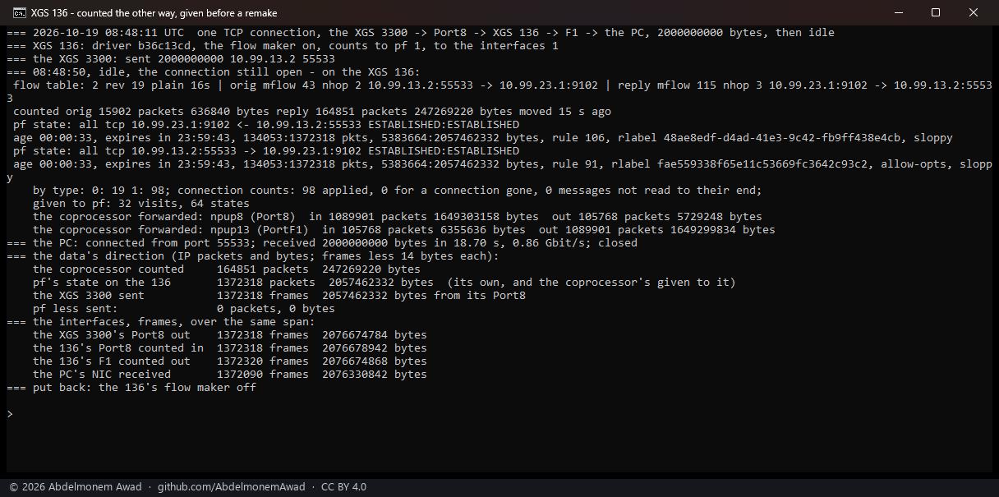
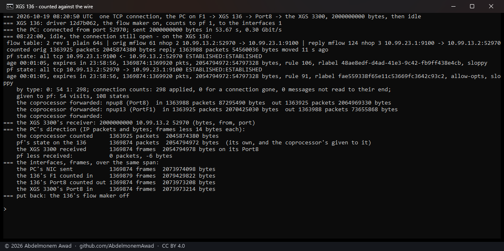
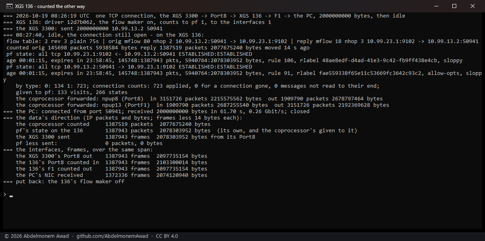
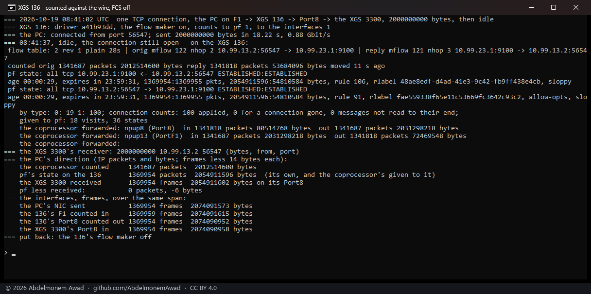
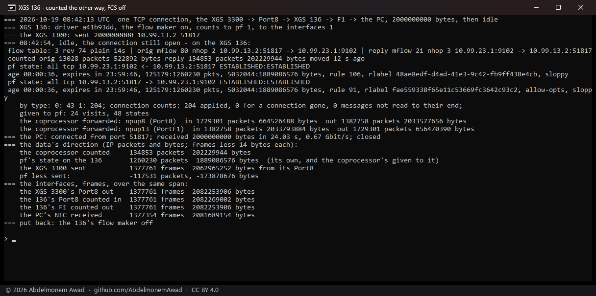

<!-- reviewed: 2026-10-19 -->
# What the XGS 136's coprocessor says about the traffic it forwards, measured, 2026-10-19

The XGS 3300's coprocessor sends the host the counts of every connection it forwards, and of every
port, as control messages on tag 254 - which the driver now reads and gives to pf and the interfaces
([hw-counters-2026-10-19.md](hw-counters-2026-10-19.md)). The XGS 136 is as blind to its own
hardware traffic as the XGS 3300 was: once a connection is in hardware, pf's state and the interface
counters stop growing. This page is the first step of the same work on the XGS 136: does its
coprocessor send such messages at all, and in what form.

**It does, in the same form.** The XGS 136's coprocessor sends `CONN_STATS` and `LIF_STATS`
messages - types 1 and 0 of the vendor's `cmsg_types.h`, version 1, EtherType 0xEFEF, on tag 254 -
laid out as the XGS 3300's, while traffic is in hardware and never otherwise. ~~The driver frees them
unread; reading them is the next step.~~ **Since the same day the driver reads them.** Given to pf,
they put a connection in its state as it crossed the wire: 0 packets apart in 1.37 million, either
way. Added to the interfaces, they bring every frame back into the counters
([The reader, measured](#the-reader-measured)).

## Do they come at all

The XGS 136's driver frees a frame whose tag no port claims and counts it
(`dev.npuep.0.giu.rx_untagged`). The count was read once a second through three windows of twenty
seconds (`images/deploy/lab-136-untagged.sh`, driver `c9e4efb4`):

| window | frames with an unknown tag, each second |
|---|---|
| idle | 0 in every second |
| one stream from the bench PC on Port3, through the appliance and out of Port8, in hardware (934 Mbit/s) | 6 or 7 in every second |
| the same stream through the host (the flow maker off, 792 Mbit/s) | 0 in every second |

## What they are

The driver now keeps the last such frame before freeing it: its tag, its length, the metadata and
its first 256 bytes, printed by `dev.npuep.0.giu.rx_untagged_frame` (`contrib/npuep/npugiu.c`). On
the XGS 136, rebooted onto that driver (`npuep.ko` 238,560 bytes, md5 `19dbfd58`), the frame was read
once a second through the same stream in hardware, 24 seconds of it, twice
(`images/deploy/lab-136-untagged-frame.sh`), and decoded by `images/deploy/untag-frame-decode.py`.
The photograph is the second run:

Every frame had tag 254, both MAC addresses zero, then EtherType 0xEFEF and:

- **During the stream, 44 bytes: `CONN_STATS`.** The control header (padding, type 1, version 1), one
  entry in one burst, both directions. The burst names slot 2, and the entry carries for each
  direction a u32 of bytes and a u32 of the bytes' bits 32 to 34 under the packets shifted left by
  three, then the slot's revision - eighteen bytes, as on the XGS 3300.
- **After the stream, 62 bytes: `LIF_STATS`.** Two entries in two bursts, for interfaces 8192 and
  28672, each a pair of the same counts: what came in on the interface and what went out by it.

### The numbers in them

- **Bytes are IP lengths.** At the last reading of the second run, slot 2 held 5,121,473,632 bytes in
  3,414,420 packets one way - 1,499.96 bytes a packet, the full segments - and 135,830,720 bytes in
  3,395,271 packets the other, 40.006 bytes a packet, the bare acknowledgements.
- **The connection counts are the slot's, not the connection's.** The second run's first reading
  found slot 2 already at 3,056,282,322 bytes: the first run's stream, about 2.8 GB, and three
  seconds of its own. The coprocessor does not start the counts again for a new connection in the
  slot - the same as on the XGS 3300, where taking a new connection's first message as all new was
  the mistake of [#515](https://github.com/AbdelmonemAwad/os-xgs-npu/issues/515).
- **The revision moves.** It went from 1 to 2 about three seconds into the first stream, was 3 at the
  start of the second and 5 three seconds later. ~~What moves it during a connection was not looked
  into;~~ It is the driver's own: when the fast path gives a connection back, the driver makes it
  again in the same slot with the next revision (`flow.remade`, below). A reader has to take the
  revision from the message, not assume one per connection.
- **The interface counts are increments.** The last `LIF_STATS` of each run held 4,666 and 17,557
  packets - a fraction of a second of a stream at 934 Mbit/s - so, as on the XGS 3300, each message
  carries what moved since the one before.
- **Which ports 8192 and 28672 are** - 0x2000 and 0x7000 - ~~was not read anywhere. The stream came in
  on Port3 and left by Port8, which would make the number the port's less one, times 4,096; one pair
  of ports is not enough to say so.~~ is in this driver's own source: a front port's LIF is its
  `iface_id` shifted left by twelve (`RPC_LIF_IFACE_SHIFT` in `contrib/npuep/npuep.h`), and
  `npuep_front_ports` in `contrib/npuep/npuep.c` gives Port3 the `iface_id` 2 and Port8 the 7.
- **About seven a second.** Between the first and the last reading of the first run, 112 messages
  arrived in 17 readings, and the slot grew by 2,066,014,116 bytes: 18.4 MB a message.

## The posted commands, with the driver's bound

The same driver bounds the clear of a command posted on the high ring to its slot
([#524](https://github.com/AbdelmonemAwad/os-xgs-npu/issues/524)). Through both streams the high ring
took the flows' commands as before: 3 posted in the first run and 3 in the second, none refused for
a full ring and none sent on the low ring instead (`dev.npuep.0.rpc_channel.hi_commands`, `hi_full`,
`hi_fallback`).

## Next

~~The driver reads these messages as the XGS 3300's does: each slot's last totals kept across the
connections that use it, each connection given what moved while it held the slot, those counts added
to its pf state, and the interface counts to the interfaces - and then measured against a stream of
known size, as there.~~ Done the same day: below.

## The reader, measured

The driver now reads the messages where they arrive (`npuflow_cmsg_rx` in `contrib/npuep/npuflow.c`,
called by the receive path for a frame on tag 254 before it is freed):

- **Connection counts (type 1).** Each slot keeps the last totals the coprocessor sent for it, across
  the connections that use it. Each connection is given only what moved while it held the slot, and
  only when the message's revision is its own. `flow.flows` prints the result under the connection,
  in the XGS 3300's line (`counted orig ... reply ...`), and the Offloaded Flows page reads it there.
- **Into pf.** The keepalive adds what was counted since its last visit to the connection's pf states
  and to the rule that passed it, as the packets would have (`npuep_pf_count` in
  `contrib/npuep/npupf.c`, the XGS 3300's function). It does so every sweep, and again just before
  the let-go pass takes a connection out to make it again. The setting is `flow.hw_to_pf`.
- **Port counts (type 0).** They are kept by front port (`flow.lif_counted`) and added to the port's
  interface counters (`flow.lif_apply`).
- **Both on by default.** XGS: Settings has the two settings for both appliances now, applied when
  the page is saved and at every boot by `rc.syshook.d/early/07-npuep`.
- **Memory.** Each connection costs 100 bytes more: the table of 1,500,000 connections is
  430,223,616 bytes, where it was 280,223,616.

### How it was measured

The path is the bench PC on the XGS 136's F1, through the 136 and out of its Port8, to the second
XGS 3300 at the far end of that cable.

- **F1 is a measurement link.** It was taken out of the LAN bridge for this, as a link of its own
  (`images/deploy/link-port.php`). On the PC's side is a USB adapter.
- **One way.** The PC sends exactly 2,000,000,000 bytes over one TCP connection to a receiver on the
  XGS 3300, then holds the connection open, idle (`images/deploy/lab-136-counts.sh`).
- **The other way.** The PC opens the connection, and the XGS 3300 sends the 2,000,000,000 bytes
  (`lab-136-counts-back.sh`). This way the data comes in on Port8, a port of the 136's switch,
  where the first way it comes in on F1, one of its own MACs.
- **What is read.** The 136's flow maker is on for each run. While the connection is idle, the
  scripts read the coprocessor's count of it and pf's two states on the 136. Over the whole span they
  read the interface counters of the PC's adapter, the 136's F1 and Port8, and the XGS 3300's Port8.
  All are photographed.

The adapter first carried the stream at 0.30 Gbit/s. After the owner moved it to another of the PC's
USB ports, it carried 943 Mbit/s one way and 802 the other (`lab-136-f1-rate.sh`). The counts below
compare bytes, not speed, and every run was read the same way.

### The driver that is published

`npuep.ko` 246,088 bytes, md5 `b36c13cd`, after a reboot onto it.

| | PC to XGS 3300, 0.90 Gbit/s | XGS 3300 to PC, 0.86 Gbit/s |
|---|---|---|
| the connection's data, as pf's state on the 136 has it | 1,372,215 packets, 2,056,455,455 bytes | 1,372,318 packets, 2,057,462,332 bytes |
| what crossed the wire into or out of the XGS 3300, frames less 14 bytes | 1,372,215 packets, 2,056,455,461 bytes | 1,372,318 packets, 2,057,462,332 bytes |
| **pf's state less the wire** | **0 packets, -6 bytes** | **0 packets, 0 bytes** |
| of which the coprocessor counted, in the connection's last making | 1,369,623 packets | 164,851 packets |
| the 136's interface where the data came in, and the other end's count | F1 in: 1,372,219 frames, 2,075,667,319 bytes; the PC sent 1,372,215 frames, 2,075,667,313 bytes | Port8 in: 1,372,318 frames, 2,076,678,942 bytes; the XGS 3300 sent 1,372,318 frames, 2,076,674,784 bytes |
| the 136's interface where it left, and the other end's count | Port8 out: 1,372,215 frames, 2,075,666,465 bytes; the XGS 3300 received 1,372,215 frames, 2,075,666,471 bytes | F1 out: 1,372,320 frames, 2,076,674,868 bytes |

- **pf** has the whole connection, its own packets from before the flow was made and the
  coprocessor's given to it after. The six bytes one way are most likely one minimum-size frame,
  which the XGS 3300 counts with its padding; that was not checked.
- **The interfaces** have every frame. A few more are counted than the other end sent or received:
  4 on F1 coming in and 2 on F1 going out - most likely the hosts' own, such as ARP; not checked. Bytes agree to
  within those frames, except on Port8 coming in: 4,158 more than the XGS 3300 sent, with the frames
  equal. That is 0.0002%, and not explained.
- **The other way, the fast path gave the connection back** and the driver made it again 18 times
  (revision 19); the coprocessor's count is of the last making only. The PC's own received-frame
  count is not compared: Windows joins received segments before counting them.

### Two faults found on the way, and fixed before publishing

**What comes in was counted with its FCS.** The first reader (`12d7b062`) added the port counts as
the coprocessor sent them.

- On F1 coming in, the interface counted 5,455,724 bytes more than the PC sent. The coprocessor had
  sent 2,070,425,030 bytes for 1,363,925 frames of 1,514 bytes, which is 1,517.97 a frame.
- On Port8 coming in, the other way's data - at 0.26 Gbit/s through the adapter's first USB port -
  came to 5,564,860 bytes more than the XGS 3300 sent.
- In the first run, the acknowledgements coming in on Port8 were counted at 64 bytes each, for
  frames of 60.
- What went out was counted exactly as an interface counts it.

So the coprocessor counts arriving frames with their four bytes of FCS, and the driver now takes four
bytes a frame off what comes in. After that, F1 coming in was 42 bytes from what the PC sent
(`a41b93dd`).

**A connection made again lost its counts.** With the adapter at full speed, the other way, the fast
path gave the connection back 73 times in 25 seconds (`flow.remade` 73, revision 74). Each time, the
driver took the connection out and made it again in the same slot, and its counts since the last
sweep went with it. pf's state was 117,531 packets and 173,878,676 bytes short of what the XGS 3300
sent (`a41b93dd`). The let-go pass now gives pf those counts before it takes the connection out
(`npuflow_give_pf`), and the run above, through 18 remakes, came to 0 packets and 0 bytes.

Why the fast path gives this connection back so often was not looked into: 73 times at 0.67 Gbit/s
and 18 at 0.86, the XGS 3300 sending; the PC sending, the connection kept its first making (revision
1, and 20 in a slot used before).

### Not measured

- **The pages on the XGS 136.** Its plugin is an older install. The new `flows.py` was run there by
  hand during a connection in hardware and gave its bytes and packets, but the Offloaded Flows,
  Sessions and interface pages were not opened.
- **The boot path.** The two settings' lines in `rc.syshook.d/early/07-npuep` were run by hand on the
  136: they set both counts back on from the configuration. A boot with a setting turned off was not
  tried.
- **IPv6, NAT and IPsec connections.** One TCP connection over IPv4, untranslated, each way.
