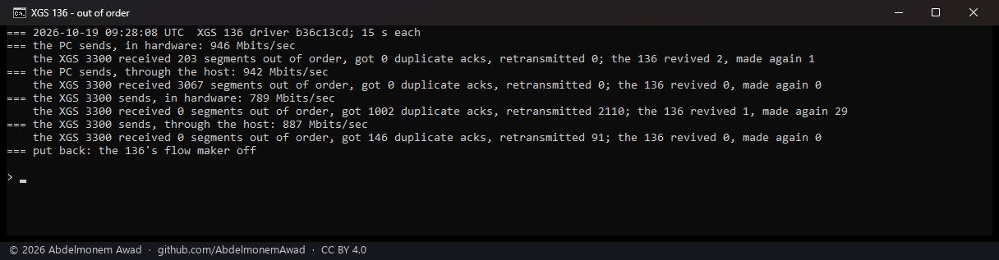
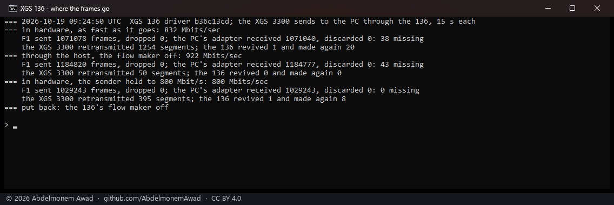
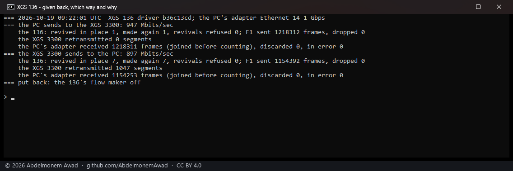
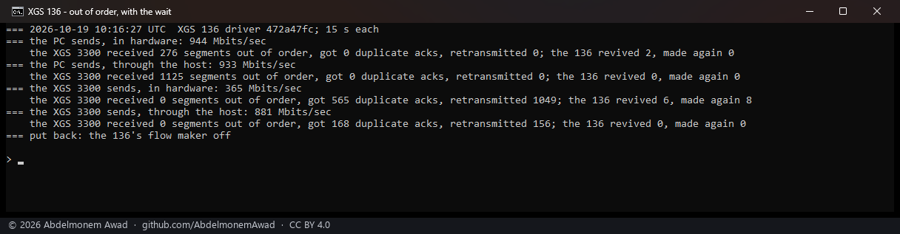
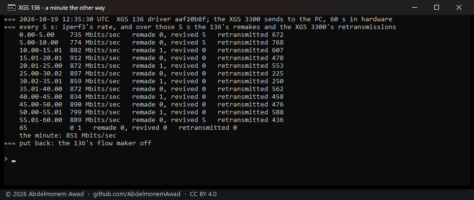
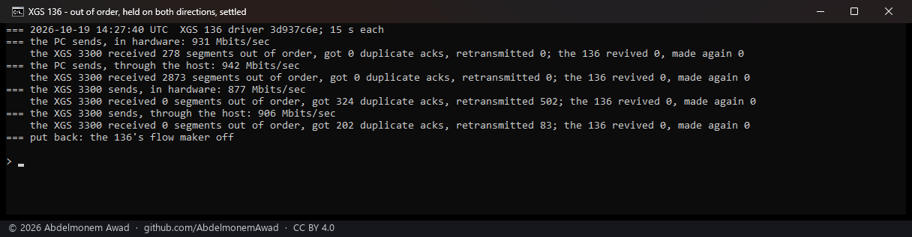
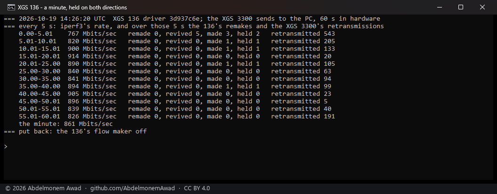
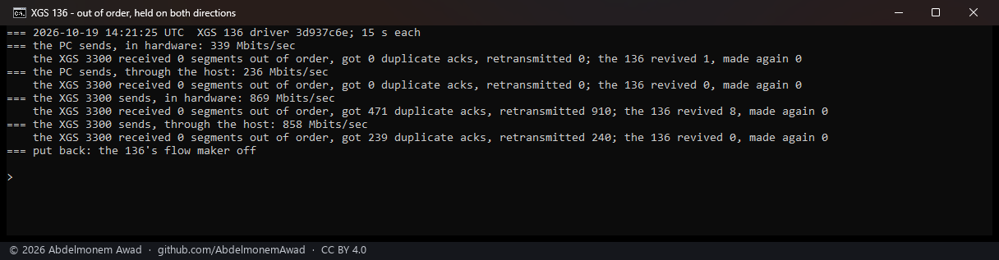
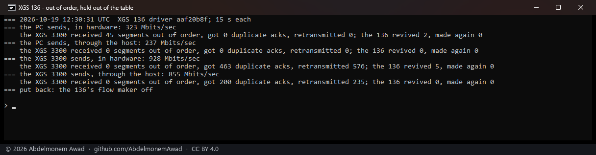

<!-- reviewed: 2026-10-19 -->
# A connection given back by the XGS 136's fast path, and made again at once, measured, 2026-10-19

When the second XGS 3300 sent to the bench PC through the XGS 136, a stream in hardware ran slower
than the same stream through the host, and retransmitted far more. The fast path kept giving the
connection back, and the driver kept making it again at once - and making it again was what gave it
back. The driver now waits, with the connection left with the host, before it makes one the fast
path gave back soon after it was made. In that direction the hardware path now runs level with the
host's, and a minute of it retransmits a quarter of what it did
([#529](https://github.com/AbdelmonemAwad/os-xgs-npu/issues/529)).

The bench is the one of [xgs136-counts-2026-10-19.md](xgs136-counts-2026-10-19.md#how-it-was-measured):

- **The ends.** The PC's USB adapter is on the XGS 136's F1. The second XGS 3300 is behind its Port8.
- **The stream.** One iperf3 stream of 15 seconds each way, with the 136's flow maker on, or off for
  the host's path.
- **What is read.** The XGS 3300's own TCP counters give the segments that reached it out of order,
  the duplicate acknowledgements it got back, and its retransmissions. Beside them, the 136's
  revivals and remakes. All are photographed.

## What was seen

Driver `b36c13cd`, before the fix:

| | rate | the XGS 3300 retransmitted | the 136 made the connection again |
|---|---|---|---|
| the PC sends, in hardware | 946 Mbit/s | 0 | 1 |
| the PC sends, through the host | 942 Mbit/s | 0 | - |
| the XGS 3300 sends, in hardware | **789 Mbit/s** | **2,110** | **29** |
| the XGS 3300 sends, through the host | **887 Mbit/s** | 91 | - |

Was anything lost? An earlier run compared what F1 sent with what the PC's adapter received, and read
the XGS 3300's retransmissions over the same span (`images/deploy/lab-136-loss.sh`):

| the XGS 3300 sends | frames F1 sent that the PC never counted | the XGS 3300 retransmitted | remakes |
|---|---|---|---|
| in hardware | 38 | 1,254 | 20 |
| through the host | 43 | 50 | - |
| in hardware, the sender held to 800 Mbit/s | **0** | **395** | 8 |

- **Some frames are lost after F1, through the host as much as in hardware.** That is the cable, the
  converter or the PC's adapter, not the 136: F1 dropped none.
- **In hardware, with nothing lost at all, there were 395 retransmissions.** Only reordering explains
  that.
- **The fast path does not reorder a stream it is forwarding.** With the PC sending, 203 segments
  reached the XGS 3300 out of order in hardware, against 3,067 through the host.

## The cause

The fast path gives a TCP connection back when it sees ten packets in a row, in one direction, with
the same acknowledgement, end and window:

- It is `conn_tcp_max_retrans` with `USFP_MAX_RETRANS 10` in the vendor's source (`conn_table.h`,
  `conn_common.c`).
- The count starts over at any packet that differs, from either direction.
- It is a constant compiled into the fast path, not a setting.

The driver then made the connection again at once, every time, and that is what closed the loop:

1. The frames of the connection still in the host's path are overtaken by the first ones the fast
   path forwards.
2. The PC answers the reordering with a run of duplicate acknowledgements, the XGS 3300 holds back,
   and the run reaches ten.
3. The fast path gives the connection back, and the driver makes it again.

Only reviving in place had a wait that grew while give-backs kept coming; the remake had none.

## The fix, in three builds

**1. Wait with the connection still in the table** (`472a47fc`) - worse: 365 Mbit/s the XGS 3300's
way.

- A connection given back and kept in the table punts every frame. Each frame woke the let-go pass,
  which walks the whole candidate table under the lock the receive path takes for every frame.
- Read on the 136 during a 12-second stream: 131,974 passes, and the table held for up to 201
  milliseconds at a time. These were read from the sysctls; the run was not photographed.

**2. Wait with the connection out of the table, and wake the pass at most once every hundredth of a
second** (`aaf20b8f`).

- The connection is taken out at once, as before. If it was given back within ten seconds of being
  made, it is not made again until a wait is over: a second, doubling each time, to a minute. The flow
  maker skips it until then, and its frames are the host's like any other's.
- The passes fell to 25 in 15 seconds, and the rate came back: 928 and 812 Mbit/s.
- But a minute still retransmitted 6,073 segments, and in 15 seconds the connection was held 14
  times and made 15 times: the wait never doubled. The wait was kept on the candidate of the
  direction whose frame was punted, and the make came from the other direction's.

**3. The wait and the time of a make on both directions' candidates** (`3d937c6e`, 247,096 bytes) -
the build published.

| the XGS 3300 sends, 15 s | before (`b36c13cd`) | after (`3d937c6e`) |
|---|---|---|
| in hardware | 789, 832 and 897 Mbit/s | 869 and 877 Mbit/s |
| through the host, the same runs | 887 and 922 Mbit/s | 858 and 906 Mbit/s |
| the connection made again in hardware | 7 to 29 times | none |
| retransmitted in hardware | 1,047 to 2,110 | 502 and 910 |

Over a minute in hardware the XGS 3300's way, it carried 861 Mbit/s and retransmitted 1,521 segments,
a quarter of the second build's 6,073.

- **The holds.** The connection was held 2, 1, 1 and then 1 time in the 5-second spans, and from the
  second half of the minute not at all, as the wait doubled.
- **The retransmissions** fell from 543 in the first 5 seconds to between 5 and 191 in the last
  spans.

With the PC sending, nothing changed: 931 Mbit/s in hardware and 942 through the host, and no
remake.

## What remains

- **The hardware path is level with the host's the XGS 3300's way, not ahead of it.** Each time a
  connection goes back into hardware, its frames still in the host's path are overtaken. The wait
  makes that rare; it cannot make it never happen.
- **For the first minutes after a boot, a stream into F1 ran slowly, in hardware and through the host
  alike.** It happened twice, about two minutes after each of the last two reboots:
  - 323 and 339 Mbit/s in hardware, and 237 and 236 through the host;
  - 674 through the host five minutes after one boot, and 933 and 941 by the sixth.
  Its cause was not looked into
  ([open question](https://github.com/AbdelmonemAwad/os-xgs-npu/issues/531)). The runs in the tables
  above were made after it had passed; photograph 08 shows it.
- **Frames lost between F1 and the PC**, about 40 in 15 seconds near the line rate, through the host
  too. They come from the bench's cable, converter or USB adapter, which was not changed.

**Not measured:**
- other receivers than the PC's Windows;
- many connections at once;
- the XGS 3300's driver, whose own let-go path revives in place and attaches new identities to the
  same connection rather than making it again.
