<!-- reviewed: 2026-10-18 -->
# The XGS 136 forwarding by its coprocessor, measured, 2026-10-18

The first measurement of a connection crossing the XGS 136 in its coprocessor's fast path rather than
through the host: the same traffic, the same ports, once with the host forwarding it and once with the
flow maker on, both ways. Each run was taken in a window of its own and photographed when it finished.

Before this day no connection made in hardware on this appliance had delivered a frame: every next
hop had named an empty cage ([the finding](../findings/every-next-hop-named-an-empty-cage-on-the-armada.md)),
the flow maker needed the ports' interface entries opened by hand, and a connection the fast path let
go was never made again. All three were fixed the same day; this is what they give.

## The bench

| link | from | to | medium |
|---|---|---|---|
| the PC | the PC's gigabit port | the XGS 136's Port3, a member of its LAN bridge | copper, 1 Gbit/s |
| the gigabit link | the XGS 136's Port8, a routed /30 | the second XGS 3300's Port8 | copper, 1 Gbit/s |

- **Load:** iperf3 for Windows on the PC, bound to its address on the XGS 136's LAN - Windows sends by
  the interface that owns the source address, so the path is the 136's - to iperf3 on the second XGS
  3300. One TCP stream, thirty seconds; `-R` for the other direction. The figure is iperf3's.
- **Driver:** `npuep.ko` with md5 `9604237c`, built on the appliance from the branch that went out with
  this page; the 136's settings left as they are, the flow maker set at run time - `flow.auto` 0 for
  the host, 1 for the hardware, which opens the fourteen interface entries.
- **What the host carried** is read between seconds 12 and 27 of each run, after the flow maker has had
  time to make the connection: the XGS 136's own CPU time across its four cores, and the frames its
  host counted on Port8. A connection in hardware sends the host nothing.

## Results

| the XGS 136 forwarding by | direction | iperf3 | its CPUs busy | frames its host took on Port8, in / out (15 s) |
|---|---|---|---|---|
| the host | PC to XGS 3300 | 940 Mbit/s | 18.7 % | 1,256,988 / 1,256,985 |
| the host | XGS 3300 to PC | 919 Mbit/s | 14.1 % | 1,250,359 / 622,822 |
| **the coprocessor** | PC to XGS 3300 | **940 Mbit/s** | **4.0 %** | **0 / 0** |
| **the coprocessor** | XGS 3300 to PC | **899 Mbit/s** | **0.3 %** | **1 / 0** |

## What it means, and what it does not

- **The link is the ceiling both ways.** A gigabit port on each side, and the host already reached it:
  the fast path does not make this path faster, it takes the work off the host - from a fifth of four
  cores to nothing measurable. The figure that would show the coprocessor's own ceiling needs a faster
  pair of ports on this appliance and a load that can fill them.
- **The fourth run is 20 Mbit/s under the second.** The fast path let that download go eleven times in
  thirty seconds (`remade` went from 2 to 13) - its rule for a connection that retransmits - and each
  time the frames crossed the host until the next sweep made the connection again, about a second
  later. ~~Followed second by second in a run of twenty seconds, 1,306,539 of 1,373,887 frames went wire
  to wire in the fast path and 67,366 to the host; the one give-back in it cost two seconds at 373 and
  265 Mbit/s, the other eighteen ran at 949.~~ Struck: that run was not photographed, and a figure from
  a run that was not is not published here; the photographed one is in the next section. The XGS 3300
  revives such a connection in place within frames; ~~that is the next step here~~ done the same
  evening, below.
- **The 4.0 % of the third run** is not the connection's carrying: Port8's counters did not move, so
  none of its frames crossed the host, and the figure is the host's other work in those fifteen seconds.
- **No translation on this path**: Port3 to Port8 is routed without NAT. A connection the firewall
  translates, LAN to WAN, is ~~yet to be measured on this appliance after the fixes~~ measured below,
  [translated](#translated-lan-to-wan).

## Revived in place, the same evening

The XGS 3300's answer to a connection given back, on this family: the same `FLOW_CREATE_FP` the
connection was made with, sent again for its index and revision with no microflow in it, puts it back
to VALID, and its microflows forward the next frame. The receive path kicks it at the first frame of a
connection in hardware that reaches the host, instead of the next sweep; a connection whose last frame
was a FIN or a RST is left to pf; one whose frames come back under new identities - its microflows'
own timer, a few seconds after a give-back - is made again as before.

Module `31ee65e3`, the same bench and the same four runs, then the download again second by second
with the fast path's counters read over it:

| the XGS 136 forwarding by | direction | iperf3 | its CPUs busy | frames its host took on Port8, in / out (15 s) |
|---|---|---|---|---|
| the host | PC to XGS 3300 | 941 Mbit/s | 18.7 % | 1,253,792 / 1,253,754 |
| the host | XGS 3300 to PC | 907 Mbit/s | 11.0 % | 1,224,431 / 68,290 |
| **the coprocessor** | PC to XGS 3300 | **941 Mbit/s** | **4.0 %** | **0 / 0** |
| **the coprocessor** | XGS 3300 to PC | **914 Mbit/s** | **0.3 %** | **0 / 0** |

The download in hardware is now above the same download through the host, where it was 20 Mbit/s
under it.

Second by second (the fifth photograph): 949 Mbit/s in every second but the first and the fifth -
141 Mbit/s that second, a give-back and the microflows' new identities in it - 913 Mbit/s over the
thirty. The fast path over the run: **2,472,111 of 2,474,869 frames wire to wire**, 2,673 to the host
(2,700 `MFLOW_NOT_ACTIVE`, 44 `CONN_RECLAIM_PENDING`, one `TCP_MAX_RETRANS` give-back); the flow maker
revived the connection twice and made it again twice, none refused.

- **The 4.0 % of the third run, again**: read over a run of the same direction with the fast path's
  counters, ten frames of a million reached the host and the CPUs were 99 % idle; it is not the
  connection's (that reading was not photographed, so it is said, not tabled).
- **What is left of a give-back**: one second in thirty. It is the microflows' new identities - the
  connection is made again from both, and the second appears a moment after the first; ~~attaching each
  direction to the live connection as it comes, as the XGS 3300 does, is the next step~~ attaching each
  direction as it comes was tried and measured worse - below.

### Tried and not taken: attaching one direction at a time

The step the previous paragraph named was built and measured the same evening: a direction that
came back under a new identity attached alone to the live connection - the same command with that
one microflow in it - instead of the connection made again. Module `cd79cc0a`, the same download
second by second (the sixth photograph): 913 Mbit/s over thirty seconds, but 80,098 frames reached
the host as `MFLOW_NOT_ACTIVE` against 2,700 with the connection made again, and the one dip was
still there. Three more runs of twenty seconds, not photographed and so not tabled, put 45,000 to
88,000 frames through the host each. The likeliest reading: a request with one direction in it
leaves the other direction's microflow inactive. It was not merged; the XGS 136 runs the build above.

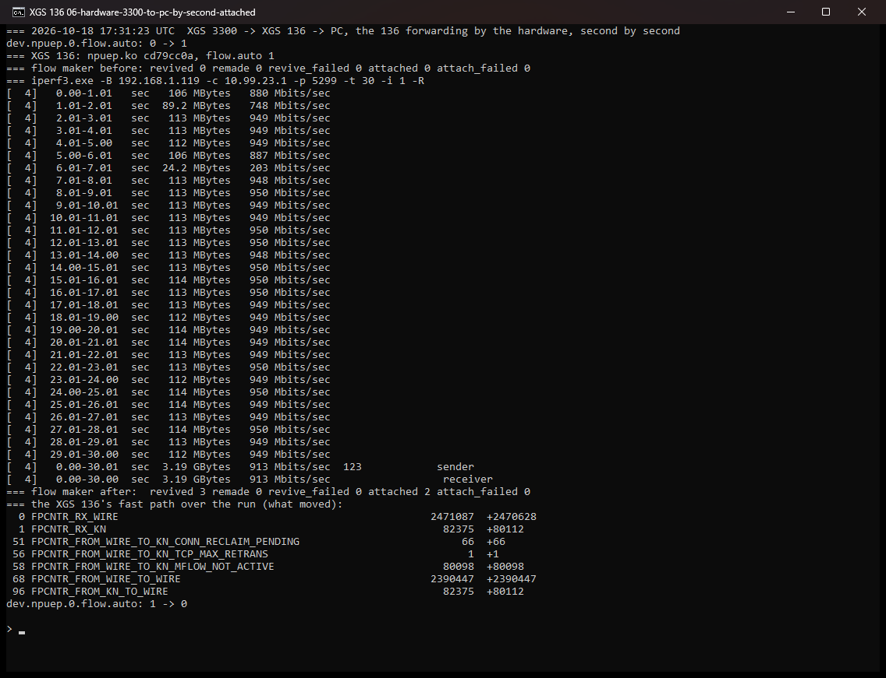

## Translated, LAN to WAN

The same PC on the XGS 136's LAN, now to the second XGS 3300's WAN address on the network both WAN
ports share - out by the 136's WAN (Port1) and its automatic outbound NAT, so every frame of the
connection is rewritten both ways. Module `31ee65e3`; the frames counted are the host's on the
136's WAN. For the runs the far end's WAN had a pass rule for the load's one source and port, and its
"Block private networks" off - the 136's WAN address is a private one - both put back afterwards.

| the XGS 136 forwarding by | direction | iperf3 | its CPUs busy | frames its host took on its WAN, in / out (15 s) |
|---|---|---|---|---|
| the host | PC to the WAN address | 940 Mbit/s | 19.6 % | 1,255,213 / 1,255,194 |
| the host | the WAN address to PC | 906 Mbit/s | 19.3 % | 1,237,367 / 615,885 |
| **the coprocessor** | PC to the WAN address | **941 Mbit/s** | **0.4 %** | **2 / 5** |
| **the coprocessor** | the WAN address to PC | **919 Mbit/s** | **0.4 %** | **0 / 13** |

- **The translation is the coprocessor's**: the connection block carries both of pf's keys, and the
  host saw none of the connection's frames - the handful counted are the WAN's own traffic.
- **The far end is not a clean bench.** Two tries before the photographed runs, through the same
  path, gave 596 Mbit/s in hardware and 235 Mbit/s through the host with the 136's CPUs at 0.2 % and
  5.8 % - the limit was not the 136 - and the next try 942; those are said here and not tabled, as
  they were not photographed. The WAN network is shared with other machines.

## IPv6

The bench PC with an address of its own on the XGS 136's LAN, `fd99:136::2/64`, and a route through
the 136 to the second XGS 3300's network behind it, set by the owner on 2026-10-18; to the second XGS
3300's address `fd99:2::1`, through the 136's LAN and Port8 - no translation, as every IPv6 connection
of a routed network. Module `31ee65e3`.

| the XGS 136 forwarding by | direction | iperf3 | its CPUs busy | frames its host took on Port8, in / out (15 s) |
|---|---|---|---|---|
| the host | PC to XGS 3300 | ~~250 Mbit/s~~ 925 Mbit/s | ~~5.6 %~~ 27.9 % | ~~335,217 / 335,211~~ 1,258,166 / 1,258,181 |
| the host | XGS 3300 to PC | 909 Mbit/s | 14.1 % | 1,225,460 / 608,626 |
| **the coprocessor** | PC to XGS 3300 | **929 Mbit/s** | **3.8 %** | **1 / 1** |
| **the coprocessor** | XGS 3300 to PC | **919 Mbit/s** | **0.3 %** | **1 / 1** |

The first row was taken twice, both photographed: the first IPv6 run after the PC's address was set
gave 250 Mbit/s with the 136's CPUs at 5.6 % - not the 136's limit - and the same run minutes later
925. The struck figures are the first; both photographs are below.

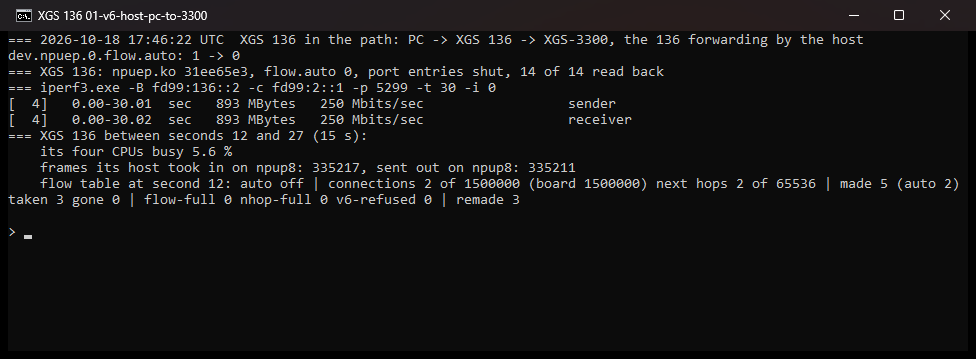
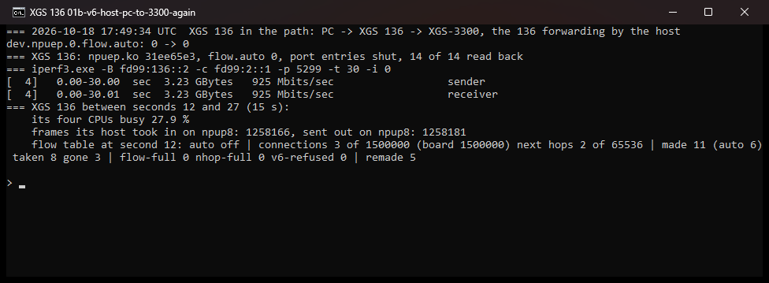
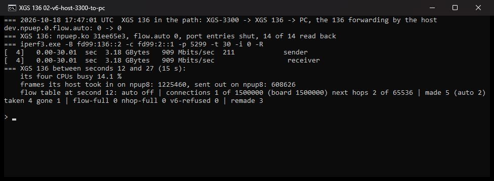
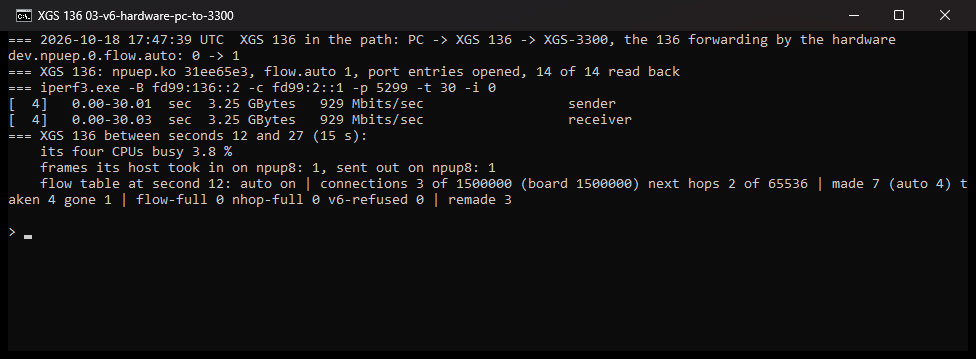
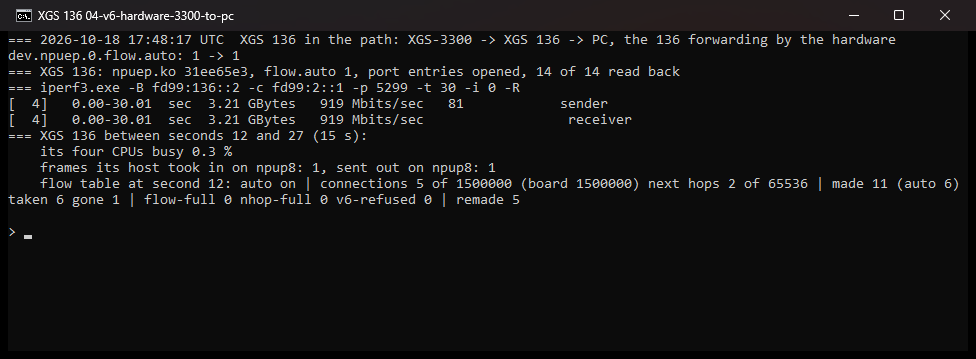

- **IPv6 connections are made in hardware on this family**, both ways, with none of their frames
  through the host - the first IPv6 traffic measured through the XGS 136's coprocessor.
- An IPv6 connection that pf translates stays with the host, as on the XGS 3300; none was on this
  path.

## A thousand connections at once

Eight iperf3 clients on the PC, 128 streams each - 1,024 connections - to eight iperf3 servers on the
second XGS 3300, through the XGS 136's LAN and Port8, forty seconds. The load fills the 136's LAN
link, which is also the PC's only way to its shell, so the 136's readings - its flow table at second
20, its CPU time and Port8's host counters from second 20 to 30 - are taken by a job started on it
beforehand; the traffic is read where it ends, the bytes the second XGS 3300's host received on its
Port8 over the same ten seconds. The 136's firewall states are flushed between runs, so each starts
with an empty flow table.

| the XGS 136 forwarding by | module | in hardware at second 20 | its CPUs busy | frames its host took on Port8, in / out (10 s) | delivered |
|---|---|---|---|---|---|
| the host | `31ee65e3` | - | 18.8 % | 807,628 / 807,431 | 996 Mbit/s |
| the coprocessor, 1,024 candidate slots | `31ee65e3` | 609 of 1,024 | 5.6 % | 193,625 / 192,003 | 994 Mbit/s |
| **the coprocessor, 16,384 candidate slots** | **`d4cf7022`** | **953 of 1,024** | **6.0 %** | **1,129 / 174** | **996 Mbit/s** |

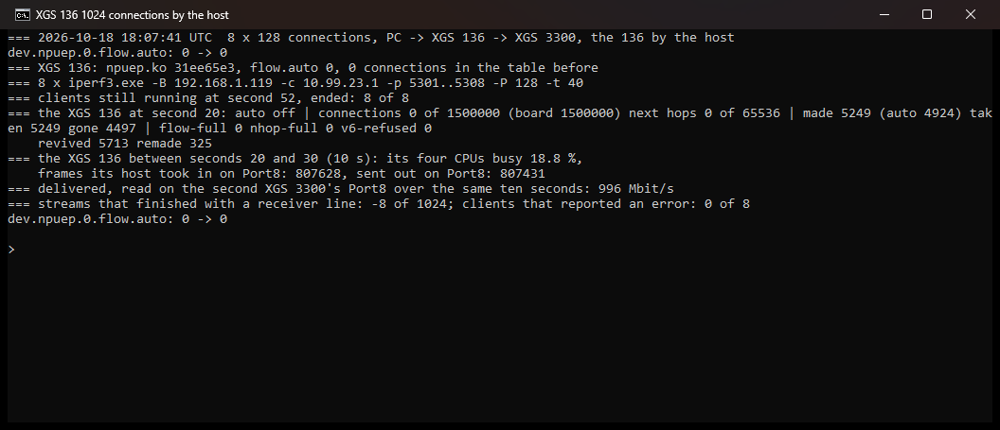
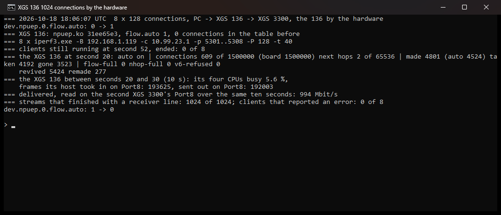
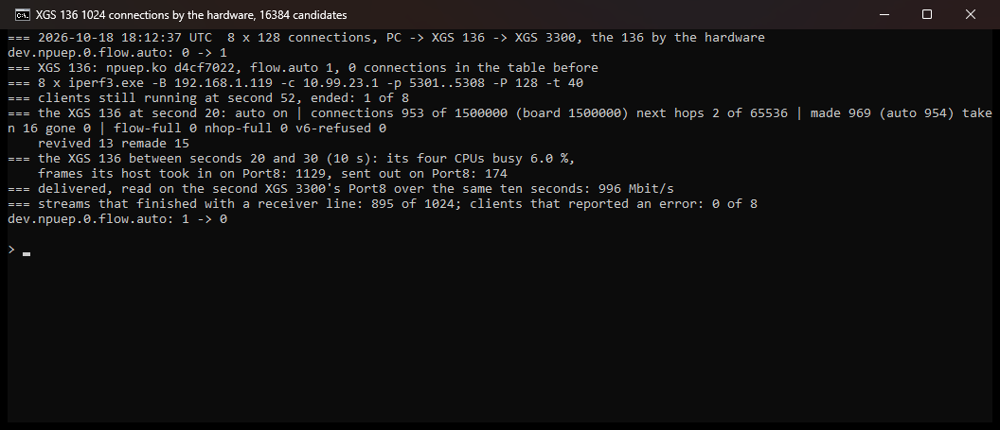

- **The candidate table was the limit.** A connection is made from both of its directions'
  candidates - the punted frames' identities - and the table held 1,024, one slot per hash: a
  thousand connections are two thousand directions, and 176,283 of 184,866 candidates pushed another
  out, so a connection's two directions were seldom there together and four in ten were still crossing
  the host twenty seconds in. At 16,384 slots, the XGS 3300 driver's count, 1,938 of 6,456 did, and
  953 of the 1,024 were in hardware; the host carried 1,129 frames in ten seconds where it had carried
  193,625.
- **The 6 % is the flow table's own upkeep**, not the traffic: the sweep reads every candidate and
  touches every connection's pf state each second, a thousand of each.
- **The clients are the PC's, and not all finish.** Under this load Windows' iperf3 loses some control
  connections: 895 of the 1,024 streams reported a result in the last run, one client of eight had to
  be ended, and in the host run all eight ran past their forty seconds. The table and the frames
  above are read on the appliances and do not depend on them; the delivered figure is the far end's.
- An earlier try of the same load, before the tool was rewritten and not photographed, lost the PC's
  shell to the 136 for the run - the reason the readings are now taken on the appliance itself.

## Taking a connection out

One iperf3 stream from the bench PC to the second XGS 3300 through the XGS 136's LAN and Port8, made
in hardware; at second 10 its pf states are killed by id (`pfctl -k <host> -k <host>` kills nothing
on this firewall), which the flow table's keepalive answers with a takeout at its next sweep. What
still arrives is read where the traffic ends, on the second XGS 3300's Port8, from second 13 to 23.
Run by `images/deploy/lab-136-takeout.sh`;
[the finding](../findings/a-takeout-took-nothing-out-on-the-armada.md) has the cause.

| module | the takeout sends | the stream after the kill | delivered, seconds 13 to 23 | frames the host took on Port8, 3 s / 10 s after |
|---|---|---|---|---|
| `52fc321c` | two `MFLOW_INVALIDATE`, type 0 - refused | went on at 942 Mbit/s to the end | **998 Mbit/s**, with no state in the firewall | 1 / 0 |
| `eddcb16c` | `CONN_RECLAIM_FP` | 584 Mbit/s in the two seconds of the kill, then nothing | 0 | 4 / 0 |
| `c0aca1d9` | `CONN_RECLAIM_FP`, pf states sloppy | 205 Mbit/s in the two seconds of the kill, then nothing | 0 | 5 / 0 |

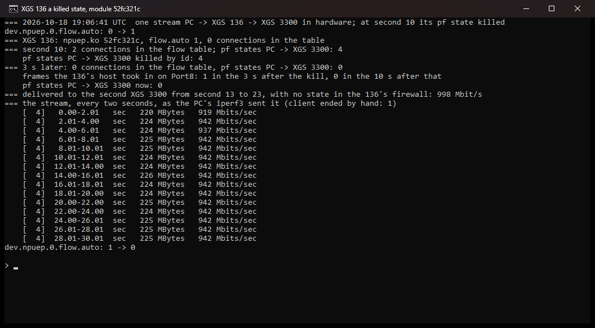
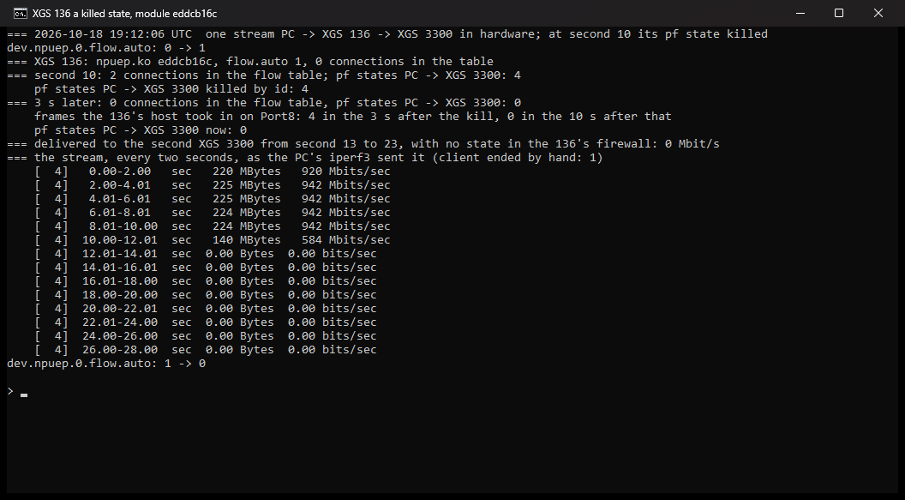
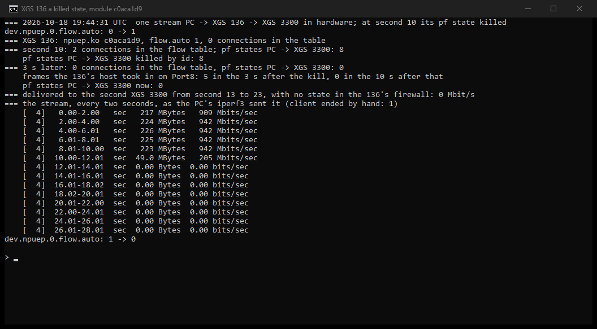

The first two tries of the first row did not kill anything (`pfctl -k` by host) and lost the client's
per-second lines when it was ended; their photographs were not kept, and the script was changed to
kill by id and read the far end.

## Handed back to the host

The same stream, handed back at second 10 with `flow.release` - Return to host - for every connection
in the table. pf still holds their states, so the stream should go on through the host. Run by
`images/deploy/lab-136-release.sh`.

| module | `flow.pf_sloppy` | the stream after the release | delivered, seconds 13 to 23 | frames the host took on Port8, 3 s / 10 s after | pf's `state-mismatch` drops, before / after |
|---|---|---|---|---|---|
| `932e486d` | - (not built yet) | 111 Mbit/s in the two seconds of the release, then nothing | 0 | 64 / 213 | not read |
| `c0aca1d9` | 1 | **went on at 941 to 943 Mbit/s** | **978 Mbit/s** | 242,630 / 853,891 | not read in the run |
| `c9e4efb4` | 0 | 127 Mbit/s, then nothing | 0 | 5 / 2 | 0 / **1,290** |
| `c9e4efb4` | 1 | **went on at 941 and 942 Mbit/s** | **999 Mbit/s** | 242,493 / 884,148 | 1,293 / 1,295 |

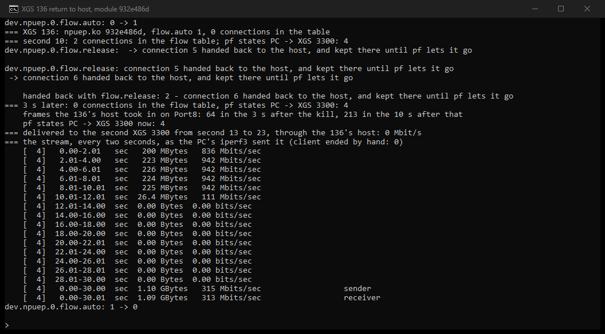
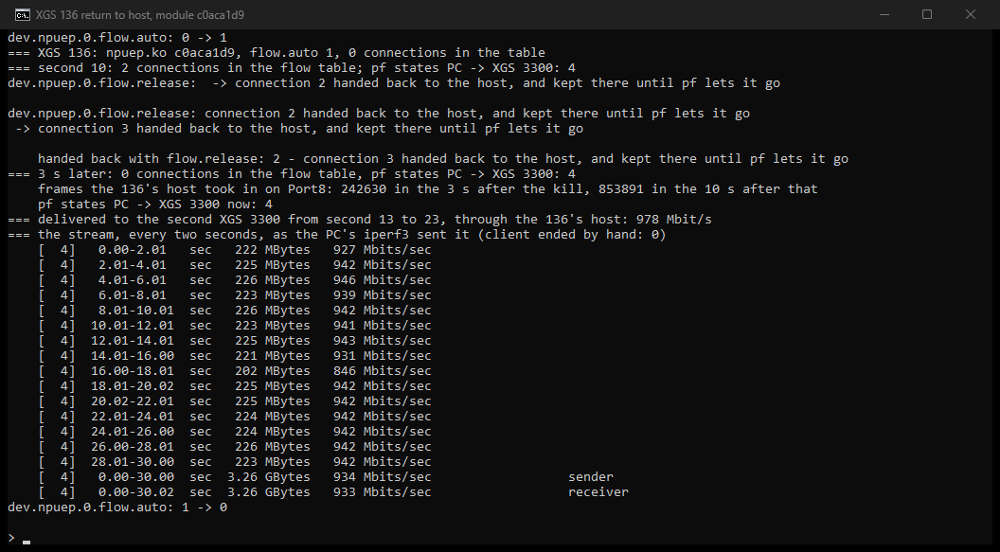
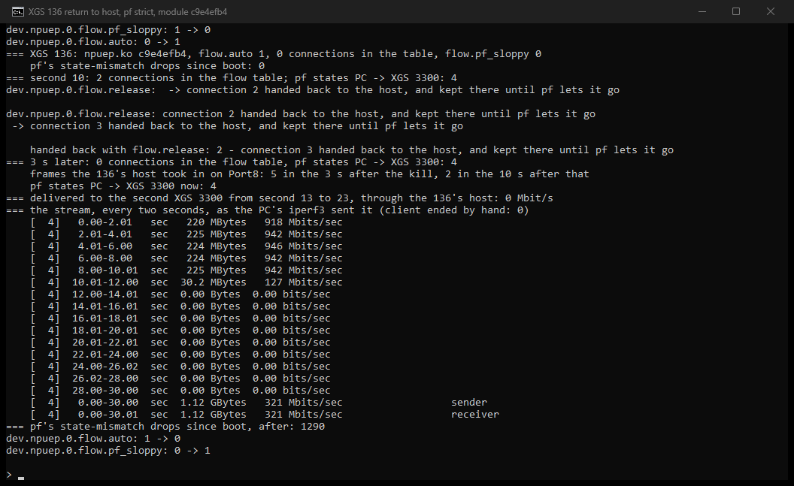
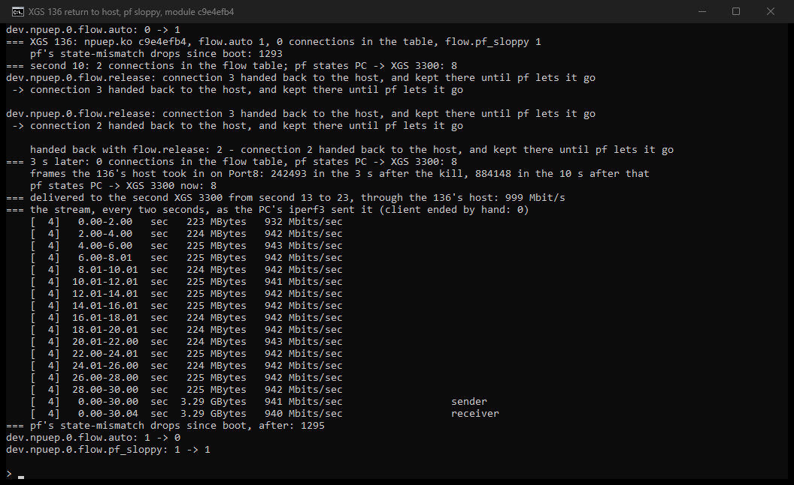

- **pf dropped what came back.** With the states left strict the frames reached the host and pf
  counted them as `state-mismatch`, 1,290 in the run: its window was where the connection had left it
  ten seconds and a gigabyte earlier. Marked sloppy, the stream moved to the host and went on at the
  link's rate, the host now carrying about 88,000 frames a second on Port8 alone.
- Between the first and second rows a run of the first row's build, not photographed, read pf's
  counter rise by 1,440; it is why the switch was added and the last two rows taken on one build.

## A thousand connections taken out at once

Eight iperf3 clients of 128 streams each through the XGS 136 for twenty seconds, every connection
made in hardware; then, the clients done and their connections still in the flow table, pf's states
flushed at once by a job on the 136 - so the keepalive's next sweep takes them all back. What is
read is that: how long until the table is empty, and the longest time a sweep held the flow table -
the lock every other flow command waits behind (`flow.held_us_max`, added for this). Run by
`images/deploy/lab-136-teardown.sh`.

| module | the takeout | flow writes | in the table at the flush | the table empty | taken back | the longest hold |
|---|---|---|---|---|---|---|
| `52fc321c` | `MFLOW_INVALIDATE` type 0 | posted | 1,025 | not after 15 s (63 left) | 961 | **6,995,589 µs** |
| `52fc321c` | `MFLOW_INVALIDATE` type 0 | waited for | 1,032 | not after 15 s (380 left) | 650 | **12,383,652 µs** |
| `eddcb16c` | `CONN_RECLAIM_FP` | posted | 1,029 | 10.5 s | 1,029 | 4,262 µs |
| `eddcb16c` | `CONN_RECLAIM_FP` | waited for | 1,024 | 8.1 s | 958 | 15,344 µs |
| `eddcb16c` | `CONN_RECLAIM_FP` | posted | 1,027 | 10.4 s | 1,027 | 4,270 µs |
| `eddcb16c` | `CONN_RECLAIM_FP` | waited for | 1,030 | 10.3 s | 1,030 | 14,062 µs |
| `932e486d` | the walk fixed | posted | 1,031 | **0.1 s** | 1,031 | **8,340 µs** |
| `932e486d` | the walk fixed | posted | 1,032 | 0.4 s | 1,032 | 8,351 µs |
| `932e486d` | the walk fixed | waited for | 1,031 | 0.2 s | 1,022 | 27,788 µs |

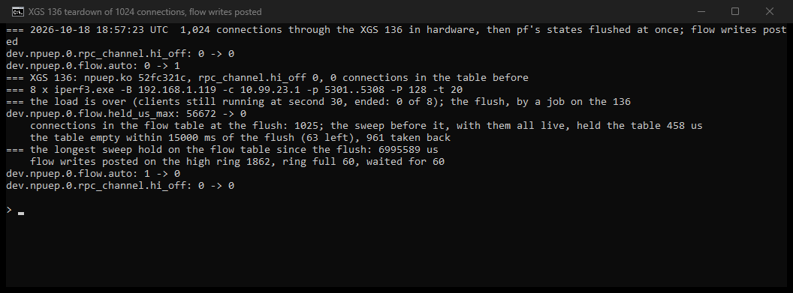
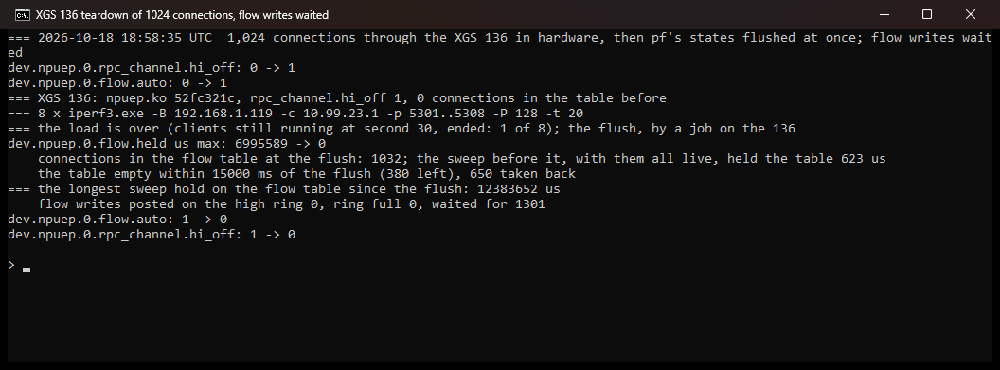
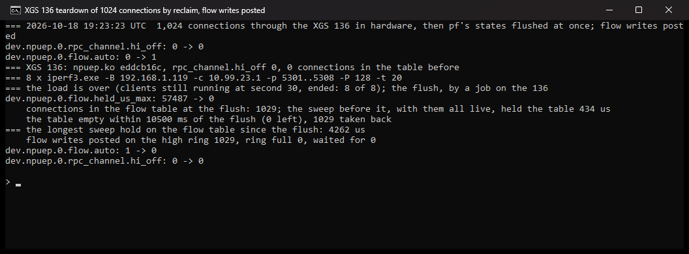
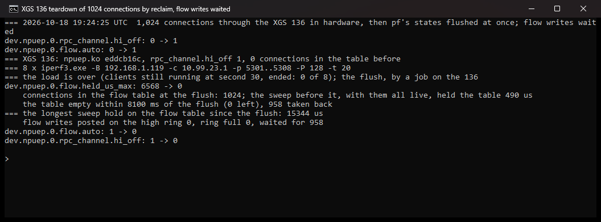

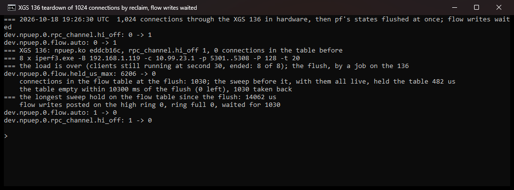
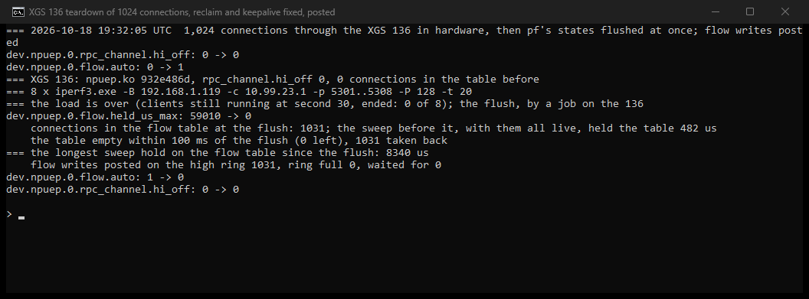

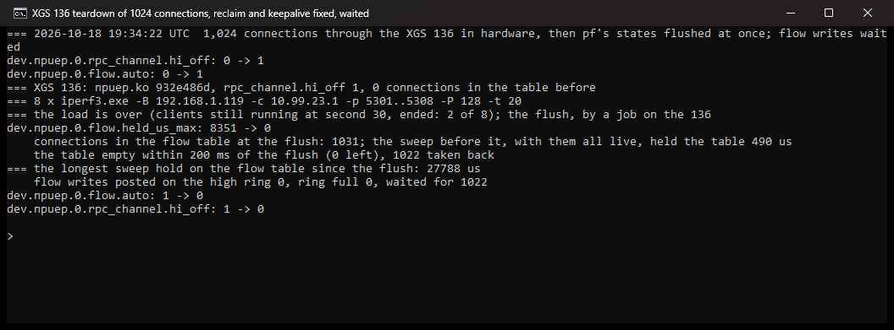

- **The first two rows are the console, not the work.** Every command was refused with a line on the
  coprocessor's console, and the lines are what took 3.6 to 9.5 ms a command; with each posted, the
  32-slot ring filled every 31 commands and the next one waited behind all of them.
- **The middle rows are the walk.** Each sweep took out half of what was left, so a thousand took ten
  sweeps; a sweep's hold was for half the table, about 500 reclaims.
- **The last rows are the fix.** One sweep takes the whole table back: about 8 µs a connection with
  the writes posted, 27 with each waited for - the high-priority ring's whole worth, measured, and the
  reason for posting.
- In two of the waited runs some connections (66 and 9) left the table by another way than the
  keepalive's takeout; which way, these runs do not say.

## Flow writes posted on the high ring

The same thousand connections at once as above, on module `e130e58b` - the first build that posts
the fast path's revivals and takeouts on the high-priority ring the board declares, without waiting -
alternating the ring on and off (`rpc_channel.hi_off`), the 136's firewall states flushed and its flow
table let empty between runs. The probe first: one `LO_LIF_READ` posted on the ring was taken within
10 ms (`rpc_channel.hi_probe`), the first command that ring has carried on this family.

| flow writes | in hardware at second 20 | revived in the first 20 s | its CPUs busy | frames the host took on Port8, in / out (10 s) | delivered |
|---|---|---|---|---|---|
| posted | 1,023 of 1,024 | 124 | 6.0 % | 1,526 / 1,023 | 996 Mbit/s |
| posted | 1,001 | 29 | 6.2 % | 39 / 33 | 997 Mbit/s |
| waited for | 1,032 | 14 | 0.2 % | 2 / 0 | 998 Mbit/s |
| posted | 1,032 | 40 | 0.3 % | 167 / 0 | 998 Mbit/s |
| waited for | 1,028 | 25 | 5.3 % | 4 / 0 | 997 Mbit/s |

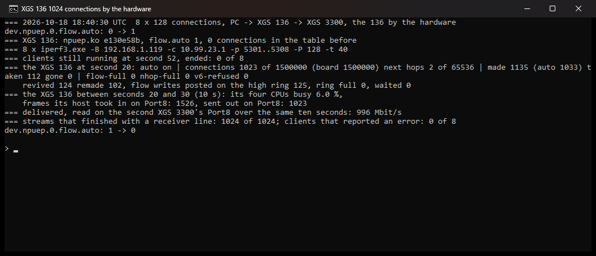
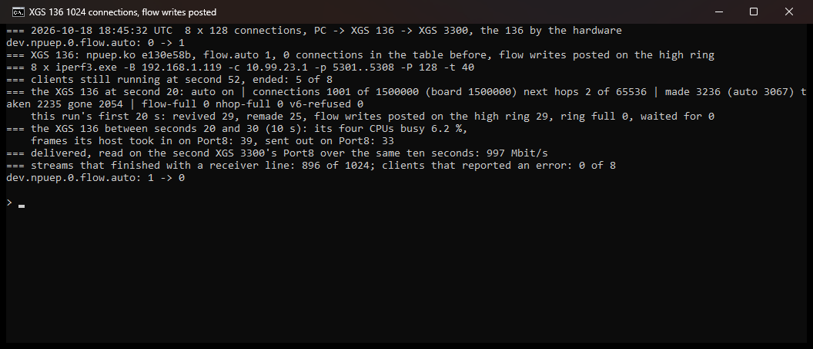
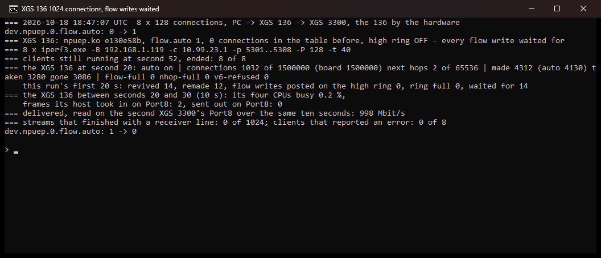
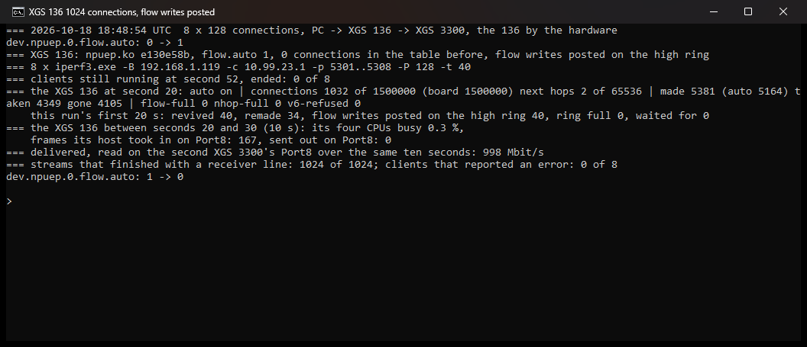
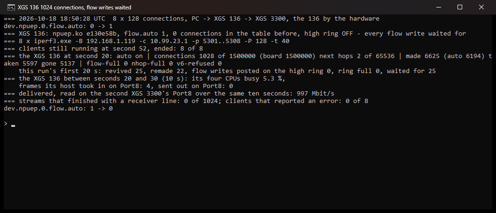

- **No difference on this load.** Every run had the table in hardware and the link full; the CPU
  figure moves between runs by more than between settings. The writes the ring carries are few here -
  14 to 124 revivals in twenty seconds - so it is the teardown above that shows its worth.
- A first run with the ring off, between the first and second rows, read its counters from boot,
  mixed with the run before it; its photograph was not kept, and the script now reads every counter at
  its own start.
- The clients that hang at the end (`ended` in the photographs) hang with the host forwarding too
  ([the host's run](#a-thousand-connections-at-once)) and with pf's states sloppy (the last run
  below), so they are not pf's window; they are taken to be Windows iperf3's under 128 streams, not
  measured further.

The same load on module `c0aca1d9`, with the takeout, the walk and the sloppy states all fixed: 1,009
in hardware at second 20, the CPUs 0.6 % busy, the host taking 1,703 frames in and 237 out on Port8 in
ten seconds, and 999 Mbit/s delivered.

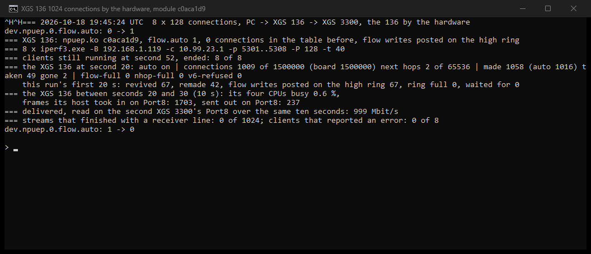
