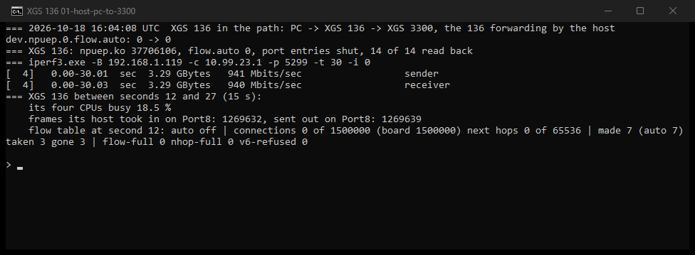
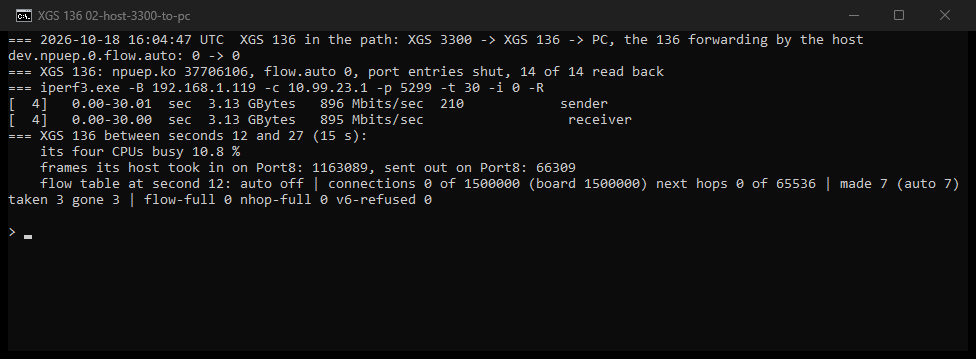
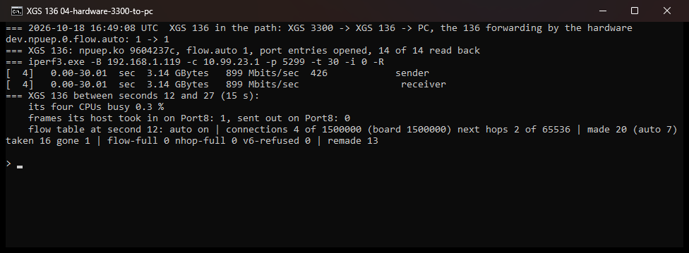
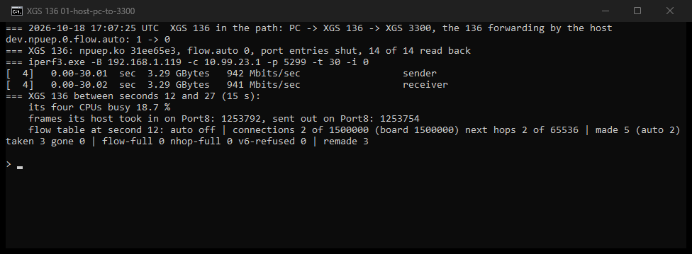
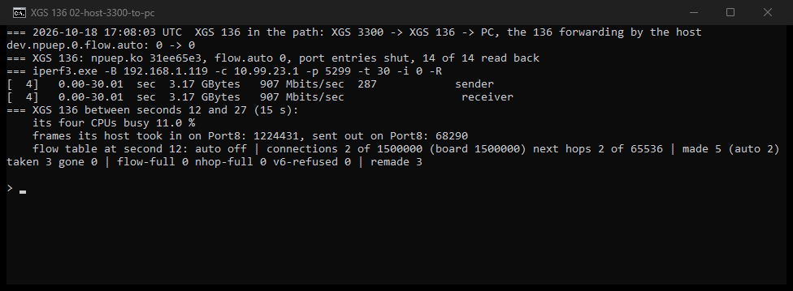
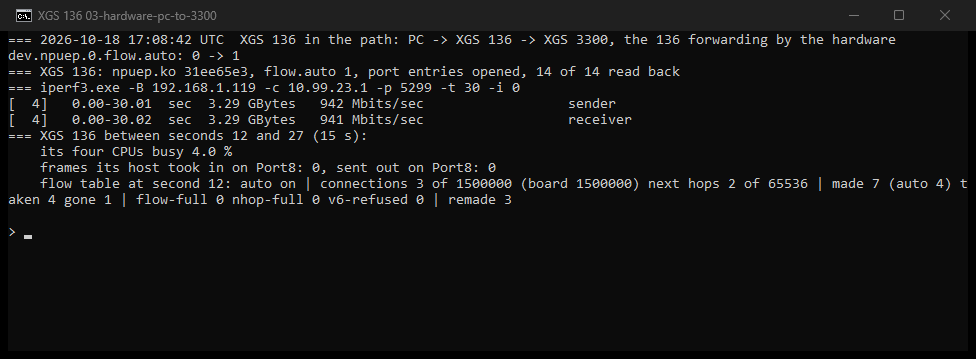
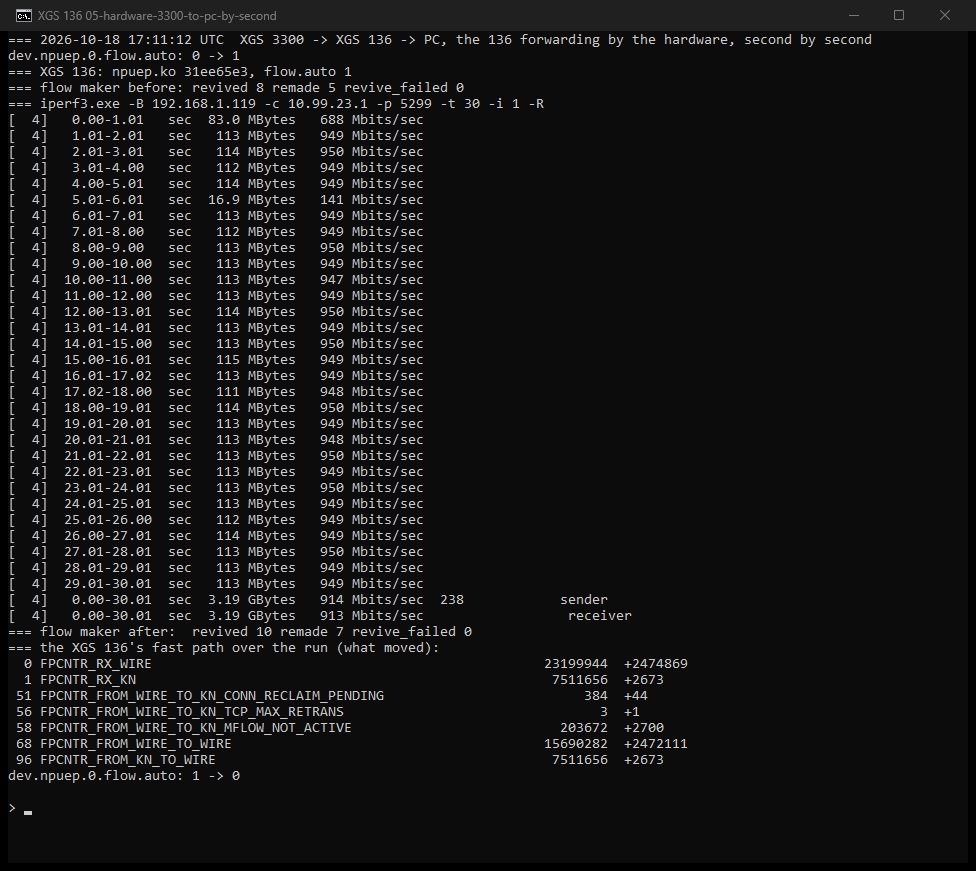
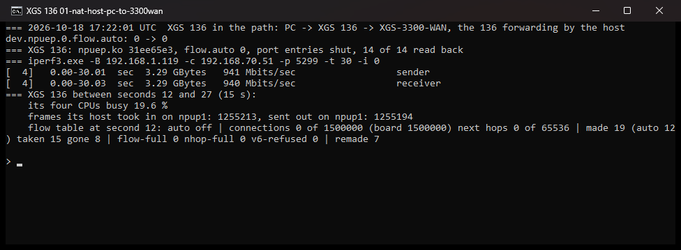
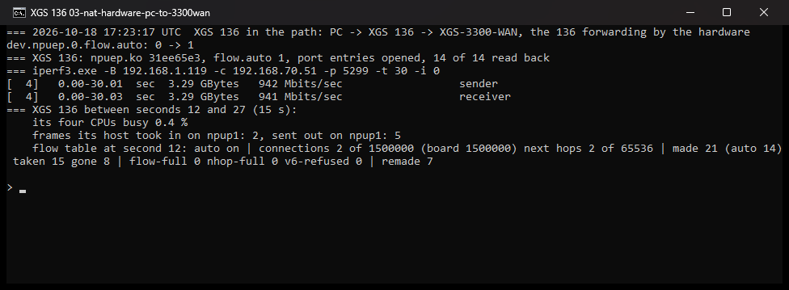
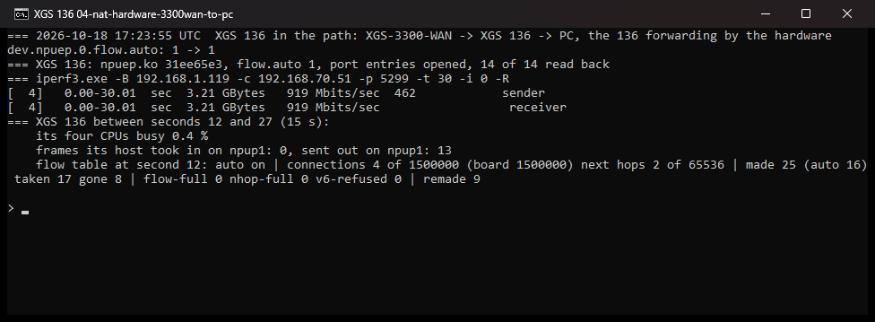

<!-- reviewed: 2026-10-18 -->
# The XGS 136 forwarding by its coprocessor, measured, 2026-10-18

The first measurement of a connection crossing the XGS 136 in its coprocessor's fast path rather than
through the host: the same traffic, the same ports, once with the host forwarding it and once with the
flow maker on, both ways. Each run was taken in a window of its own and photographed when it finished.

Before this day no connection made in hardware on this appliance had delivered a frame: every next
hop had named an empty cage ([the finding](../findings/every-next-hop-named-an-empty-cage-on-the-armada.md)),
the flow maker needed the ports' interface entries opened by hand, and a connection the fast path let
go was never made again. All three were fixed the same day; this is what they give.

## The bench

| link | from | to | medium |
|---|---|---|---|
| the PC | the PC's gigabit port | the XGS 136's Port3, a member of its LAN bridge | copper, 1 Gbit/s |
| the gigabit link | the XGS 136's Port8, a routed /30 | the second XGS 3300's Port8 | copper, 1 Gbit/s |

- **Load:** iperf3 for Windows on the PC, bound to its address on the XGS 136's LAN - Windows sends by
  the interface that owns the source address, so the path is the 136's - to iperf3 on the second XGS
  3300. One TCP stream, thirty seconds; `-R` for the other direction. The figure is iperf3's.
- **Driver:** `npuep.ko` with md5 `9604237c`, built on the appliance from the branch that went out with
  this page; the 136's settings left as they are, the flow maker set at run time - `flow.auto` 0 for
  the host, 1 for the hardware, which opens the fourteen interface entries.
- **What the host carried** is read between seconds 12 and 27 of each run, after the flow maker has had
  time to make the connection: the XGS 136's own CPU time across its four cores, and the frames its
  host counted on Port8. A connection in hardware sends the host nothing.

## Results

| the XGS 136 forwarding by | direction | iperf3 | its CPUs busy | frames its host took on Port8, in / out (15 s) |
|---|---|---|---|---|
| the host | PC to XGS 3300 | 940 Mbit/s | 18.7 % | 1,256,988 / 1,256,985 |
| the host | XGS 3300 to PC | 919 Mbit/s | 14.1 % | 1,250,359 / 622,822 |
| **the coprocessor** | PC to XGS 3300 | **940 Mbit/s** | **4.0 %** | **0 / 0** |
| **the coprocessor** | XGS 3300 to PC | **899 Mbit/s** | **0.3 %** | **1 / 0** |

## What it means, and what it does not

- **The link is the ceiling both ways.** A gigabit port on each side, and the host already reached it:
  the fast path does not make this path faster, it takes the work off the host - from a fifth of four
  cores to nothing measurable. The figure that would show the coprocessor's own ceiling needs a faster
  pair of ports on this appliance and a load that can fill them.
- **The fourth run is 20 Mbit/s under the second.** The fast path let that download go eleven times in
  thirty seconds (`remade` went from 2 to 13) - its rule for a connection that retransmits - and each
  time the frames crossed the host until the next sweep made the connection again, about a second
  later. ~~Followed second by second in a run of twenty seconds, 1,306,539 of 1,373,887 frames went wire
  to wire in the fast path and 67,366 to the host; the one give-back in it cost two seconds at 373 and
  265 Mbit/s, the other eighteen ran at 949.~~ Struck: that run was not photographed, and a figure from
  a run that was not is not published here; the photographed one is in the next section. The XGS 3300
  revives such a connection in place within frames; ~~that is the next step here~~ done the same
  evening, below.
- **The 4.0 % of the third run** is not the connection's carrying: Port8's counters did not move, so
  none of its frames crossed the host, and the figure is the host's other work in those fifteen seconds.
- **No translation on this path**: Port3 to Port8 is routed without NAT. A connection the firewall
  translates, LAN to WAN, is ~~yet to be measured on this appliance after the fixes~~ measured below,
  [translated](#translated-lan-to-wan).

## Revived in place, the same evening

The XGS 3300's answer to a connection given back, on this family: the same `FLOW_CREATE_FP` the
connection was made with, sent again for its index and revision with no microflow in it, puts it back
to VALID, and its microflows forward the next frame. The receive path kicks it at the first frame of a
connection in hardware that reaches the host, instead of the next sweep; a connection whose last frame
was a FIN or a RST is left to pf; one whose frames come back under new identities - its microflows'
own timer, a few seconds after a give-back - is made again as before.

Module `31ee65e3`, the same bench and the same four runs, then the download again second by second
with the fast path's counters read over it:

| the XGS 136 forwarding by | direction | iperf3 | its CPUs busy | frames its host took on Port8, in / out (15 s) |
|---|---|---|---|---|
| the host | PC to XGS 3300 | 941 Mbit/s | 18.7 % | 1,253,792 / 1,253,754 |
| the host | XGS 3300 to PC | 907 Mbit/s | 11.0 % | 1,224,431 / 68,290 |
| **the coprocessor** | PC to XGS 3300 | **941 Mbit/s** | **4.0 %** | **0 / 0** |
| **the coprocessor** | XGS 3300 to PC | **914 Mbit/s** | **0.3 %** | **0 / 0** |

The download in hardware is now above the same download through the host, where it was 20 Mbit/s
under it.

Second by second (the fifth photograph): 949 Mbit/s in every second but the first and the fifth -
141 Mbit/s that second, a give-back and the microflows' new identities in it - 913 Mbit/s over the
thirty. The fast path over the run: **2,472,111 of 2,474,869 frames wire to wire**, 2,673 to the host
(2,700 `MFLOW_NOT_ACTIVE`, 44 `CONN_RECLAIM_PENDING`, one `TCP_MAX_RETRANS` give-back); the flow maker
revived the connection twice and made it again twice, none refused.

- **The 4.0 % of the third run, again**: read over a run of the same direction with the fast path's
  counters, ten frames of a million reached the host and the CPUs were 99 % idle; it is not the
  connection's (that reading was not photographed, so it is said, not tabled).
- **What is left of a give-back**: one second in thirty. It is the microflows' new identities - the
  connection is made again from both, and the second appears a moment after the first; attaching each
  direction to the live connection as it comes, as the XGS 3300 does, is the next step.

## Translated, LAN to WAN

The same PC on the XGS 136's LAN, now to the second XGS 3300's WAN address on the network both WAN
ports share - out by the 136's WAN (Port1) and its automatic outbound NAT, so every frame of the
connection is rewritten both ways. Module `31ee65e3`; the frames counted are the host's on the
136's WAN. For the runs the far end's WAN had a pass rule for the load's one source and port, and its
"Block private networks" off - the 136's WAN address is a private one - both put back afterwards.

| the XGS 136 forwarding by | direction | iperf3 | its CPUs busy | frames its host took on its WAN, in / out (15 s) |
|---|---|---|---|---|
| the host | PC to the WAN address | 940 Mbit/s | 19.6 % | 1,255,213 / 1,255,194 |
| the host | the WAN address to PC | 906 Mbit/s | 19.3 % | 1,237,367 / 615,885 |
| **the coprocessor** | PC to the WAN address | **941 Mbit/s** | **0.4 %** | **2 / 5** |
| **the coprocessor** | the WAN address to PC | **919 Mbit/s** | **0.4 %** | **0 / 13** |

- **The translation is the coprocessor's**: the connection block carries both of pf's keys, and the
  host saw none of the connection's frames - the handful counted are the WAN's own traffic.
- **The far end is not a clean bench.** Two tries before the photographed runs, through the same
  path, gave 596 Mbit/s in hardware and 235 Mbit/s through the host with the 136's CPUs at 0.2 % and
  5.8 % - the limit was not the 136 - and the next try 942; those are said here and not tabled, as
  they were not photographed. The WAN network is shared with other machines.

