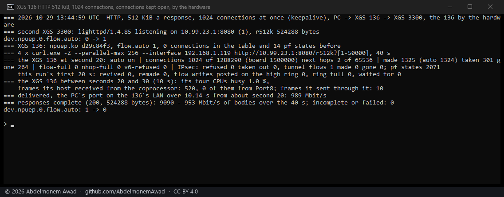
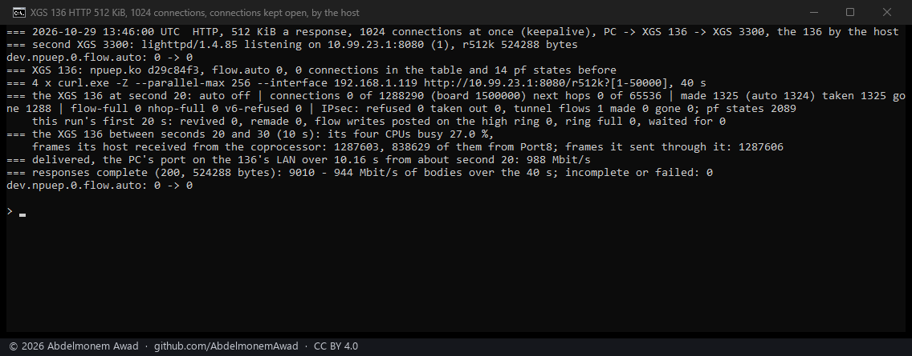
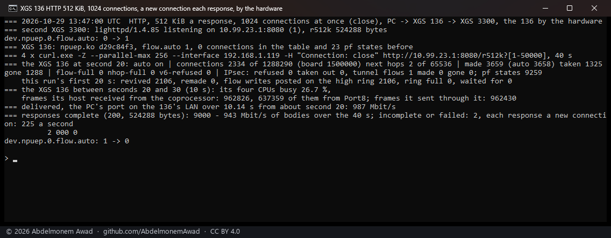
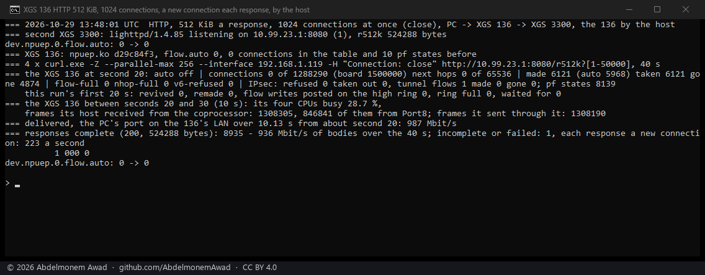

<!-- reviewed: 2026-10-29 -->
# HTTP through the XGS 136 the datasheet's way - 512 KiB a response, a thousand connections, 2026-10-29

The vendor gives its firewall throughput for HTTP with 512 KB responses, measured with a traffic
generator that plays the clients and the servers on either side of the box. Until this page the XGS
136 had been loaded with iperf3 streams only
([a thousand connections at once](xgs136-hardware-2026-10-18.md#a-thousand-connections-at-once)).
Here is the vendor's kind of load, as far as this bench can make it: one gigabit path through the
box, a thousand connections at once, each asking for 512 KiB again and again - with its connections
kept open, and with a new connection for each response.

## The bench

- **Clients:** curl for Windows 8.21 on the PC, four processes of 256 transfers at once - 1,024
  connections - bound to the PC's port on the XGS 136's LAN, asking for one file again and again for
  forty seconds.
- **Server:** lighttpd 1.4.85, OPNsense's own package, on the second XGS 3300's host, serving one file
  of 524,288 random bytes on its Port8 address. The second XGS 3300 is only the far end.
- **Path:** the PC's port into the 136's LAN, through the 136, routed to and from its Port8, and the
  cable to the second XGS 3300's Port8. Every response crosses the 136 from Port8 to its LAN. The PC's
  port is at MTU 1,500, so no frame is larger.
- **Two ways of using a connection:** kept open, each connection carrying response after response;
  and closed after each response (`Connection: close`), so the 136 makes and ends over two hundred
  connections a second.
- **The 136 forwarding by its coprocessor and by its host:** the driver's flow maker on, and off.
- **XGS 136:** vendor version 21's coprocessor software, `npuep.ko` `d29c84f3`, v0.1.0-alpha.9
  (`images/deploy/lab-136-http.sh`, `lab-136-http-series.ps1`).

The load fills the 136's LAN link, which is also the PC's way to its shell, so the 136's readings are
taken by a job started on it beforehand: its flow table and pf's states at second 20, its CPU time,
and the frames its host received from the coprocessor and sent through it from second 20 to 30.
Those frames are the driver's own counts. An interface's counters would not do: since 2026-10-19 the
coprocessor's counts of what it forwarded are added to them
([port counts](xgs136-counts-2026-10-19.md)), so they no longer say what reached the host. The
traffic is read where it arrives - the bytes the PC's port received over ten seconds from about second
20, and the complete responses curl counted over the forty seconds. Between runs the 136's firewall
states are flushed and its flow table is let empty, so each run starts from nothing.

## What it carried

| connections | the XGS 136 forwarding by | in its flow table at second 20 | its CPUs busy | frames its host received / sent, 10 s | at the PC's port | complete responses, 40 s |
|---|---|---|---|---|---|---|
| kept open | **coprocessor** | **1,024 of 1,024** | **1.0 %** | **520 / 10** | **989 Mbit/s** | 9,090 - 953 Mbit/s of bodies, none failed |
| kept open | host | - | 27.0 % | 1,287,603 / 1,287,606 | 988 Mbit/s | 9,010 - 944 Mbit/s, none failed |
| a new one each response | coprocessor | 2,334, ending ones among them | 26.7 % | 962,826 / 962,430 | 987 Mbit/s | 9,000 - 943 Mbit/s, 2 failed; 225 connections a second |
| a new one each response | host | - | 28.7 % | 1,308,305 / 1,308,190 | 987 Mbit/s | 8,935 - 936 Mbit/s, 1 failed; 223 connections a second |

- **The link was full in every run.** 987 to 989 Mbit/s reached the PC's port, a gigabit link's worth
  with its headers; 936 to 953 Mbit/s of that were the responses' own bytes.
- **With its connections kept open, the coprocessor carries all of it.** All 1,024 connections were
  in hardware twenty seconds in; the host received 520 frames in ten seconds where, forwarding the
  load itself, it received 1,287,603, and its CPUs were 1.0 % busy against 27.0 %.
- **With a new connection for each response, three quarters still cross the host.** The flow maker
  did make the connections - 2,334 were in its table at second 20, and it revived 2,106 in the first
  twenty seconds - but the host still received 962,826 frames in ten seconds, 74 % of the 1,308,305 it
  took forwarding everything itself, and its CPUs were nearly as busy, 26.7 % against 28.7 %. Each
  such connection carries one response, about 360 of the server's frames, over about four and a half
  seconds; where in its life its frames cross the host is not looked into yet
  ([885](https://github.com/AbdelmonemAwad/os-xgs-npu/issues/885)).
- **Three responses of 36,038 failed,** all with a new connection each time: curl got no answer at
  all (its code 000). Not looked into.

## The vendor's figures

The vendor's datasheet gives the XGS 136 a firewall throughput of 11.5 Gbit/s, for HTTP with 512 KB
responses on a traffic generator; it does not say on how many ports, in which directions, at what MTU
or on which version. This bench has one gigabit path through the box, and the box filled it in every
run - with its connections kept open, at 1 % of its CPUs, so the link was the limit and not the box.
Beyond a gigabit nothing was measured here.

## Before the series

A trial of the tool with 256 connections kept open, not photographed (13:41 UTC): 252 in hardware at
second 20, 988 Mbit/s at the PC's port, 9,481 responses, none failed. It read Port8's own interface
counters - 831,886 frames in and 260,034 out in ten seconds, which hold the coprocessor's counts as
well - and the second XGS 3300's Port8 at 1,024 Mbit/s sent, more than a gigabit link carries; so
neither says what crossed the host or the wire alone, and the series reads the driver's counts and
the PC's port instead.

## Not measured

- The XGS 136 above a gigabit: its 2.5G labels 11 and 12 at 2.5G, and more than one path through it
  at once.
- Where a connection made and ended for each response leaves its frames to the host
  ([885](https://github.com/AbdelmonemAwad/os-xgs-npu/issues/885)), and the XGS 3300 under the same
  load.
