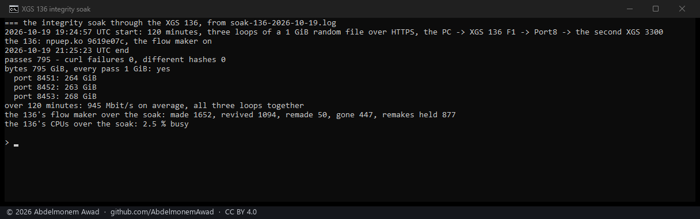

<!-- reviewed: 2026-10-19 -->
# Two hours of TLS through the XGS 136, every byte checked, 2026-10-19

The XGS 3300's integrity soak ([two hours of TLS](xgs3300.md#two-hours-of-tls-on-the-failures-own-path-translated-through-the-host)),
made on the XGS 136 for the first time:

- a 1 GiB file of random bytes, served over HTTPS by three TLS servers on the second XGS 3300;
- downloaded by the bench PC in three loops at once for 120 minutes, in through the XGS 136's F1 and
  out of its Port8 to the XGS 3300;
- each pass checked twice: curl's own TLS, which refuses a record that does not authenticate, and the
  file's SHA-256 against the server's;
- the XGS 136 - npuep 9619e07c, v0.1.0-alpha.2, its flow maker on - read over its LAN before and
  after, and nothing on it changed for the run.

Script: `images/deploy/lab-136-soak.sh`.

## Measured

| | |
|---|---|
| passes, in 120 minutes | 795 - 264, 263 and 268 GiB on the three loops |
| passes curl failed | 0 |
| passes whose file differed | 0 |
| bytes | 795 GiB, every pass the whole 1 GiB |
| rate, the three loops together, over the whole run | 945 Mbit/s on average - the gigabit link nearly full for two hours |
| the XGS 136's CPUs, over the whole run | 2.5 % busy |

## The flow maker over the run

Its counters, read before and after:

| | over the run |
|---|---|
| connections it put in hardware (`flow.auto_made`) | 1,652 |
| given back by the fast path and put back in place (`flow.revived`) | 1,094 |
| let go while pf still held them, and made again (`flow.remade`) | 50 |
| given back soon after they were made, and left with the host a while (`flow.remake_held`) | 877 |
| taken back because pf no longer held them (`flow.auto_gone`) | 447 |

795 passes are 795 TLS connections, so a connection was put in hardware about twice on average, and
many were given back along the way - revived in place, or held with the host by the give-back fix of
[#532](https://github.com/AbdelmonemAwad/os-xgs-npu/pull/532). Whichever path carried a stretch of a
connection, the bytes that arrived were the bytes sent: that is what this run measures, and all it
claims. How much of the 795 GiB the coprocessor forwarded is not read here.

## What it does not show

- One appliance, one firmware, one build: the XGS 136 above, on the bench of 2026-10-19.
- TLS over TCP and IPv4 only, at about a gigabit; no IPsec and no IPv6.
- A soak finds corruption that happens; two hours without any is not a proof that none can.
