<!-- reviewed: 2026-10-20 -->
<!-- board: 1,024 connections at once | XGS 3300 | 9,837 Mbit/s, CPU 7.8 % -->
# A thousand connections at once through the XGS 3300, measured, 2026-10-19

The same run as on the XGS 136 ([a thousand connections at once](xgs136-hardware-2026-10-18.md#a-thousand-connections-at-once)):

- eight iperf3 clients on the bench PC, 128 streams each - 1,024 connections, and the clients' eight
  control connections beside them;
- from the PC's 10G port into the second XGS 3300's F1, out of its A4, across the 10G link to the first
  XGS 3300, where eight iperf3 servers end them;
- the second XGS 3300 - octep 3315c08f, v0.1.0-alpha.2, its flow maker on - read over its management
  port, which the load does not cross;
- the traffic read where it ends, on the first XGS 3300's F1.

Script: `images/deploy/lab-3300-many.sh`.

## Measured

| | |
|---|---|
| streams that finished, of 1,024 | 1,024, no client with an error |
| connections in the flow table at second 20 | 1,326, of them 294 left from the run before and closing - so the run's own 1,032 |
| delivered, over ten seconds from second 20 | 9,837 Mbit/s - the 10 Gbit/s link full |
| the second XGS 3300's CPUs, over eight seconds from second 20 | 7.8 % busy |
| table full | never |

## Two readings that were wrong first

The run was made three times, because two of the script's readings were wrong:

- **The rate, read across two ssh calls.** The first run reported 10,386 Mbit/s on a 10 Gbit/s
  link. The counter was read twice from the PC, and the time between the two reads was more than the
  ten seconds it was divided by. The same fault was made on 2026-10-19 with the DoS probe's rates
  and noted then. Now each side reads its own counter twice, ten seconds apart by its own clock, in
  one session.

  

- **The connections, counted as lines.** The second run counted 3,099. A connection in
  `dp.flow_table` is four lines, three of which carry the word the script counted: 3,099 is 1,033
  connections. Now the script counts each connection's first line.

  

## Seen, and not explained yet

Over the run's first 30 seconds the flow maker made **5,936** connections and revived **19,732**, for
about a thousand connections. Each connection was made five or six times, and given back and revived
nearly twenty times. The coprocessor gave connections back, and the driver revived each one at once.

The traffic did not suffer: the link stayed full and the CPUs stayed below 12 %. Still, a connection
given back that often is work on both sides. The XGS 136 showed the same pattern on 2026-10-19
([a connection given back and made again at once](xgs136-giveback-2026-10-19.md)): the vendor's fast
path gives a connection back after ten identical packets in a row, and duplicate acknowledgements
under load are exactly that. Whether that rule is what gives these back is the question, in
[#544](https://github.com/AbdelmonemAwad/os-xgs-npu/issues/544).

## How it grows with the number of connections, 2026-10-20

The same run with 16, 32, 64 and 128 streams per client - 128 to 1,024 connections - on the same
build (`octep.ko` md5 `3315c08f`), `images/deploy/lab-3300-revive-series.sh`, photographed. Plain,
as on 2026-10-19: the lab tunnel between the two XGS 3300s, which covers exactly this pair, was taken
down for each run and brought up after it (`lab-3300-revive-plain.sh`).

| connections | made, over the first 30 s | revived | the second XGS 3300's CPUs | delivered |
|---|---|---|---|---|
| 128 | 136 - 1.1 each | 0 | 0.5 % | 9,957 Mbit/s |
| 256 | 266 - 1.0 each | 2 | 0.2 % | 9,955 Mbit/s |
| 512 | 584 - 1.1 each | 58 - 0.1 each | 0.6 % | 9,958 Mbit/s |
| 1,024 | **3,351 - 3.3 each** | **14,000 - 13.7 each** | **12.0 %** | 9,800 Mbit/s |

**It is not in proportion to the connections.** Up to 512 the coprocessor gives almost nothing back;
at 1,024 every connection is given back and revived about fourteen times in 30 seconds, and the
CPUs go from under 1 % to 12 %. 2026-10-19's 19,732 is the same thing, read once. Every revival
here is of a connection the fast path gave back for its retransmission rule - the driver revives no
other kind ([octep_conn_probe](../../contrib/octep/octep_dp.c)) - so the rule is what gives these
back. Why the rule starts to fire between 512 and 1,024 connections - losses at a full link's queues
would make exactly such runs of duplicate acknowledgements - was not measured.

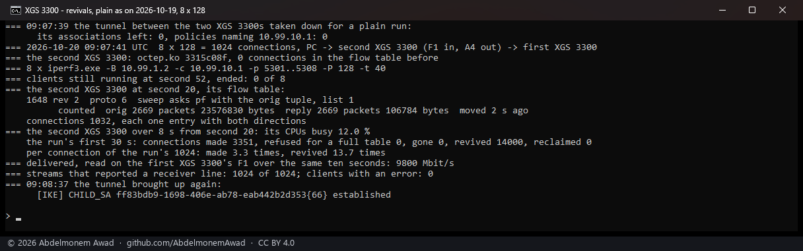

128, 256 and 512 connections

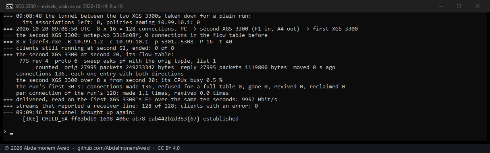

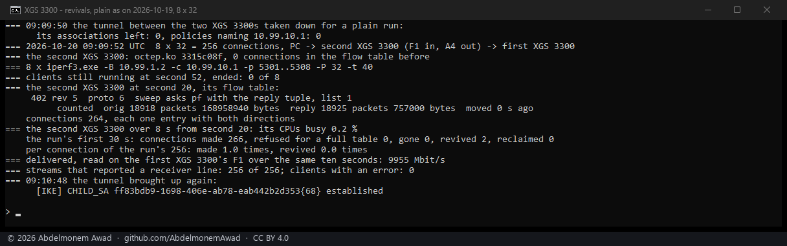

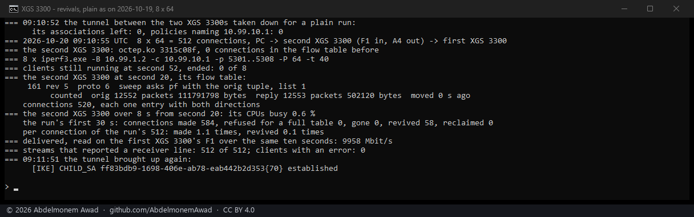

**Through the tunnel, none.** The first series this morning ran with the tunnel up, before it was
noticed: every connection was a tunnel connection, its encrypting direction in hardware and its
acknowledgements arriving decrypted, with the host, as tunnel flows are built
([the flow carries the association](../findings/the-flow-carries-the-association.md)). At 1,024
connections each was made once and none was revived: the fast path never sees the acknowledgements,
so their duplicates cannot fire its rule. The host carries them instead - the CPUs 20.1 % busy - and
the far XGS 3300's address line counted 8,691 Mbit/s, not compared here with the plain runs. On that run the far
end's link-line byte count stood still (28,222 bytes against 21 million packets), so the script reads
the address line since.

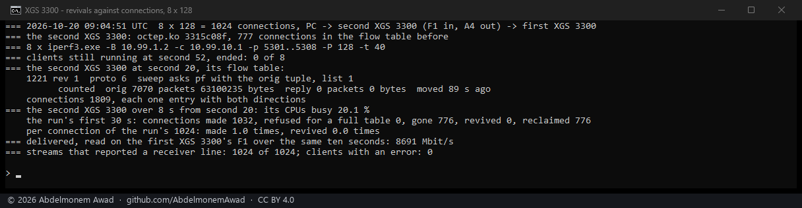

## The XGS 136's hold, tried on the XGS 3300, 2026-10-20

Step 3 of #544, at the owner's word: the rule the XGS 136 has had since #532 - a connection given
back again and again is left with the host for a while, a second at first and doubling to a minute -
built into the XGS 3300's driver behind a setting, `dp.revive_hold`, so one build measures both
(`octep.ko` md5 `872fd0bc`). With it on, a connection revived four times in four seconds and given
back again is taken out, and both its directions wait before the maker may make it again; a wait
that follows the last one within ten seconds is twice as long. The same plain run of 1,024
connections, ten times, the setting off and on in turn (`images/deploy/lab-3300-revive-plain.sh 128
<0|1>`, photographed):

| UTC | dp.revive_hold | made, first 30 s | revived | the CPUs | delivered | taken out at a streak's end | makes skipped while waiting |
|---|---|---|---|---|---|---|---|
| 09:50 | off | 4,793 | 16,067 | 7.4 % | 9,899 Mbit/s | - | - |
| 09:51 | on | 1,216 | 734 | 0.7 % | 9,955 Mbit/s | 1,621 | 553 |
| 09:52 | off | 1,311 | 1,332 | 1.1 % | 9,952 Mbit/s | - | - |
| 09:53 | on | 1,140 | 2,316 | 1.9 % | 9,941 Mbit/s | 2,486 | 1,201 |
| 09:54 | off | 1,275 | 288 | 1.2 % | 9,955 Mbit/s | - | - |
| 09:55 | on | 2,126 | 4,939 | 7.1 % | 9,852 Mbit/s | 2,352 | 1,390 |
| 09:56 | off | 1,393 | 528 | 1.3 % | 9,956 Mbit/s | - | - |
| 09:57 | on | 1,298 | 1,281 | 1.0 % | 9,953 Mbit/s | 2,045 | 784 |
| 09:59 | off | 2,939 | 10,807 | 8.7 % | 9,864 Mbit/s | - | - |
| 10:00 | on | 3,884 | 8,346 | 16.0 % | 9,738 Mbit/s | 2,383 | 1,113 |

**It does not help.** The give-backs come in episodes that neither setting decides: with the hold
off, two runs of five revived 16,067 and 10,807 and three revived 288 to 1,332; with it on, the
quietest run revived 734 and the busiest 8,346 - with the CPUs at 16.0 %, the most of all ten, and
9,738 Mbit/s, the least. Mean of the five each way: 5,804 revived and 3.9 % of the CPUs off, 3,523
and 5.3 % on. When an episode comes, a connection the hold takes out is carried by the host while it
waits, and that costs more than reviving it. So `dp.revive_hold` stays **0**, as it ships: the
XGS 3300 revives every time, which is what it did before. The setting stays in the driver, off, for
whoever wants to measure it on other traffic.

What decides whether an episode comes was not found: the ten runs were back to back on the same
bench, the same build and the same 1,024 streams.

The ten runs

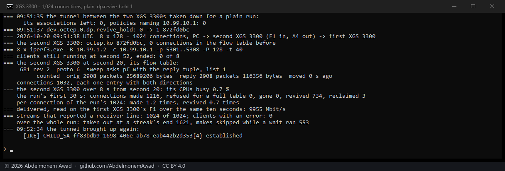

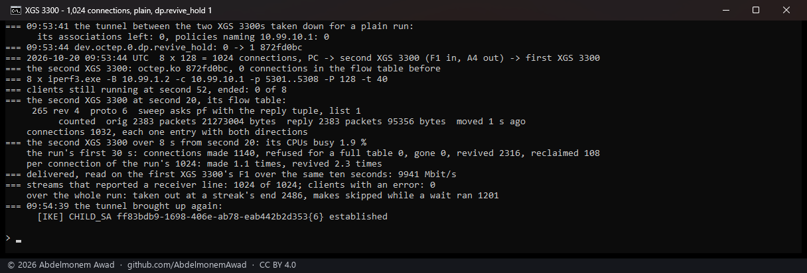

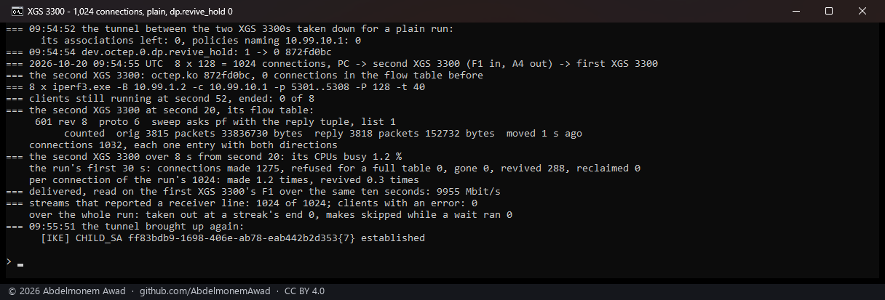

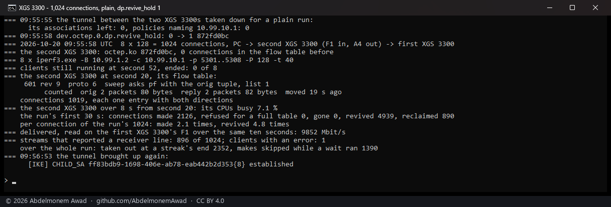

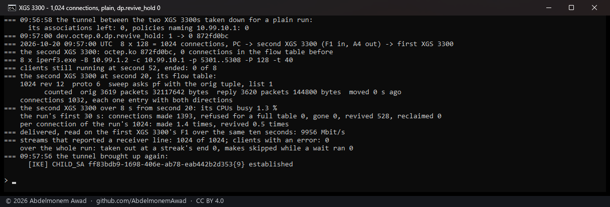

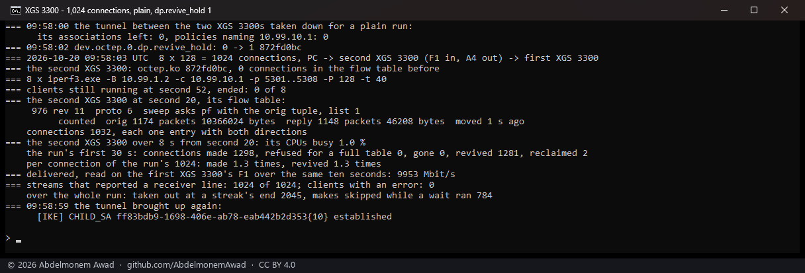

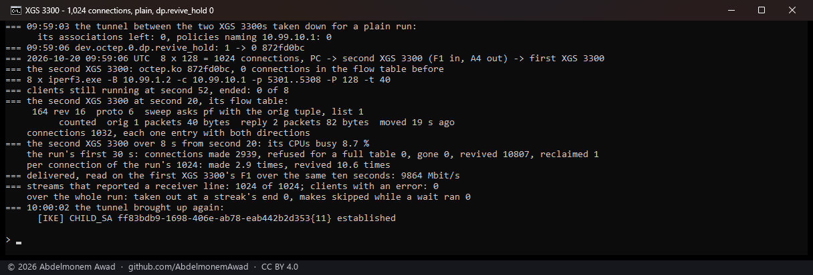

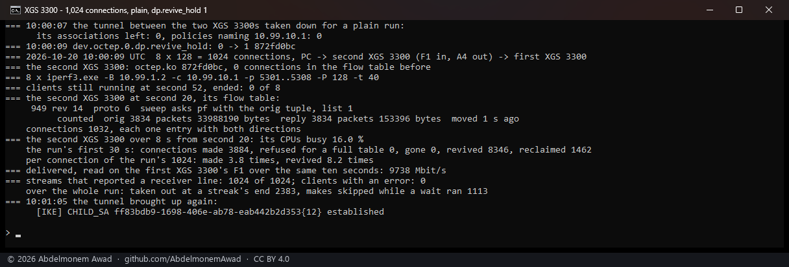

