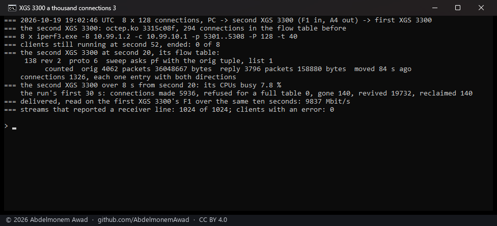
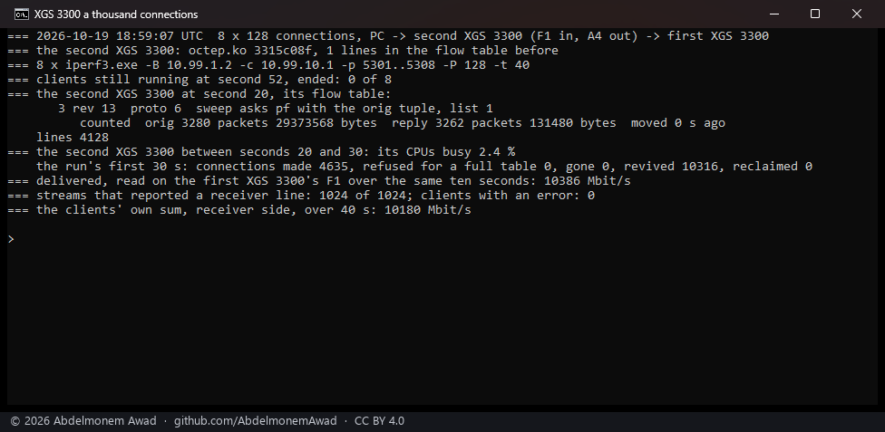
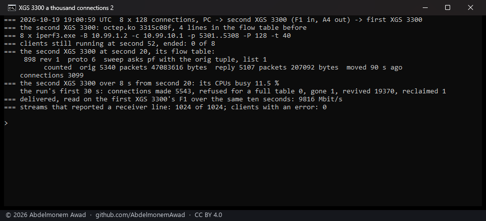

<!-- reviewed: 2026-10-19 -->
# A thousand connections at once through the XGS 3300, measured, 2026-10-19

The same run as on the XGS 136 ([a thousand connections at once](xgs136-hardware-2026-10-18.md#a-thousand-connections-at-once)):

- eight iperf3 clients on the bench PC, 128 streams each - 1,024 connections, and the clients' eight
  control connections beside them;
- from the PC's 10G port into the second XGS 3300's F1, out of its A4, across the 10G link to the first
  XGS 3300, where eight iperf3 servers end them;
- the second XGS 3300 - octep 3315c08f, v0.1.0-alpha.2, its flow maker on - read over its management
  port, which the load does not cross;
- the traffic read where it ends, on the first XGS 3300's F1.

Script: `images/deploy/lab-3300-many.sh`.

## Measured

| | |
|---|---|
| streams that finished, of 1,024 | 1,024, no client with an error |
| connections in the flow table at second 20 | 1,326, of them 294 left from the run before and closing - so the run's own 1,032 |
| delivered, over ten seconds from second 20 | 9,837 Mbit/s - the 10 Gbit/s link full |
| the second XGS 3300's CPUs, over eight seconds from second 20 | 7.8 % busy |
| table full | never |

## Two readings that were wrong first

The run was made three times, because two of the script's readings were wrong:

- **The rate, read across two ssh calls.** The first run reported 10,386 Mbit/s on a 10 Gbit/s
  link. The counter was read twice from the PC, and the time between the two reads was more than the
  ten seconds it was divided by. The same fault was made on 2026-10-19 with the DoS probe's rates
  and noted then. Now each side reads its own counter twice, ten seconds apart by its own clock, in
  one session.

  

- **The connections, counted as lines.** The second run counted 3,099. A connection in
  `dp.flow_table` is four lines, three of which carry the word the script counted: 3,099 is 1,033
  connections. Now the script counts each connection's first line.

  

## Seen, and not explained yet

Over the run's first 30 seconds the flow maker made **5,936** connections and revived **19,732**, for
about a thousand connections. Each connection was made five or six times, and given back and revived
nearly twenty times. The coprocessor gave connections back, and the driver revived each one at once.

The traffic did not suffer: the link stayed full and the CPUs stayed below 12 %. Still, a connection
given back that often is work on both sides. The XGS 136 showed the same pattern on 2026-10-19
([a connection given back and made again at once](xgs136-giveback-2026-10-19.md)): the vendor's fast
path gives a connection back after ten identical packets in a row, and duplicate acknowledgements
under load are exactly that. Whether that rule is what gives these back is the question, in
[#544](https://github.com/AbdelmonemAwad/os-xgs-npu/issues/544).
